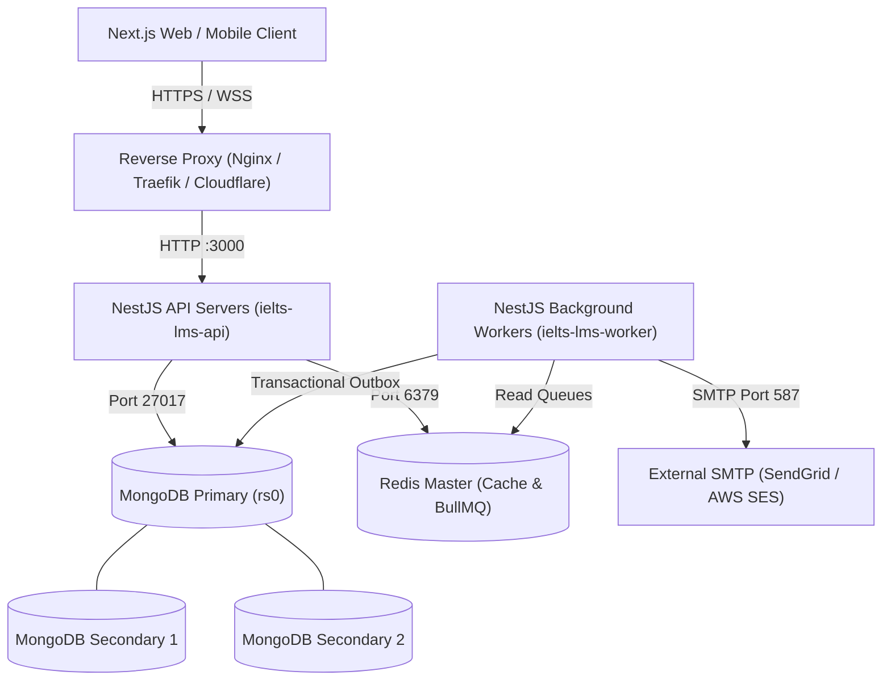

# IELTS LMS Backend — Production Deployment & Operations Guide

**Version:** 1.0.0  
**Target Platform:** Linux / Docker / Kubernetes  
**Runtime:** Node.js 22 LTS (Alpine Linux)  
**Database:** MongoDB 7.0+ (Replica Set `rs0` required for ACID multi-document transactions)  
**Cache & Queue:** Redis 7.4+ (In-memory + BullMQ)

---

## 1. System Architecture



---

## 2. Infrastructure Prerequisites

| Component | Minimum Spec (Dev/Staging) | Recommended Spec (Production) |
| :--- | :--- | :--- |
| **CPU / RAM** | 2 vCPU, 4GB RAM | 4+ vCPU, 8GB+ RAM |
| **Operating System** | Ubuntu 22.04 LTS / Debian 12 | Ubuntu 24.04 LTS / Alpine |
| **Docker Engine** | 24.0+ | 26.0+ with Docker Compose v2 |
| **MongoDB** | 7.0 Single-node Replica Set (`rs0`) | 7.0+ 3-Node Managed Replica Set (e.g. MongoDB Atlas) |
| **Redis** | 7.0+ Alpine | 7.4+ with Persistence (`appendonly yes`) & Password |
| **SMTP Provider** | Ethereal / Local MailHog | AWS SES / SendGrid / Postmark |

---

## 3. Environment Preparation

1. Copy the production environment template:
   ```bash
   cp .env.production.example .env.production
   ```
2. Generate cryptographically strong secrets:
   ```bash
   # Generate 64-character secrets for JWT
   openssl rand -base64 48
   ```
3. Update `.env.production` with secure values:
   - `JWT_ACCESS_SECRET`
   - `JWT_REFRESH_SECRET`
   - `MONGODB_URI` (ensure `replicaSet=rs0` parameter is present)
   - `REDIS_PASSWORD`
   - `SMTP_USER` & `SMTP_PASS`
   - `CORS_ALLOWED_ORIGINS` (restrict to production Next.js frontend domains)
4. Protect file permissions:
   ```bash
   chmod 600 .env.production
   ```

---

## 4. Controlled Index Initialization & Seeding

In production, automatic index rebuilding on container startup is disabled (`DatabaseModule` skips auto-indexing when `NODE_ENV=production`) to prevent startup latency and collection lockups.

Before launching production traffic, execute the controlled index migration:

```bash
# 1. Synchronize all 16 MongoDB collection indexes
npm run init:indexes

# 2. Seed initial administrator account (if not already seeded)
npm run seed
```

---

## 5. Container Deployment via Docker Compose

### 5.1 Build Multi-Stage Docker Image
```bash
docker compose build --no-cache api
```

### 5.2 Start Production Services
```bash
# Start MongoDB replica set, Redis, and API container in detached mode
docker compose up -d
```

### 5.3 Verify Container Health
```bash
docker compose ps
```
Both `ielts-lms-mongo`, `ielts-lms-redis`, and `ielts-lms-api` should report `(healthy)`.

---

## 6. Database Backup & Disaster Recovery

### 6.1 Point-in-Time MongoDB Backup (`mongodump`)
```bash
# Create point-in-time archive with oplog
TIMESTAMP=$(date +"%Y%m%d_%H%M%S")
docker exec -i ielts-lms-mongo mongodump \
  --uri="mongodb://localhost:27017/ielts_lms?replicaSet=rs0" \
  --oplog \
  --archive="/data/db/backup_${TIMESTAMP}.archive.gz" \
  --gzip
```

### 6.2 MongoDB Restore (`mongorestore`)
```bash
# Restore from archive using oplog replay
docker exec -i ielts-lms-mongo mongorestore \
  --uri="mongodb://localhost:27017/ielts_lms?replicaSet=rs0" \
  --oplogReplay \
  --archive="/data/db/backup_TARGET.archive.gz" \
  --gzip \
  --drop
```

### 6.3 Redis Snapshot & AOF
Redis is configured with an automated Append-Only File (`AOF`) and RDB snapshot volume mounted at `redis_data:/data`. Back up the volume snapshot periodically:
```bash
docker exec -i ielts-lms-redis redis-cli BGSAVE
```

---

## 7. Observability & Health Monitoring

### 7.1 Kubernetes / Load Balancer Probes
- **Liveness Probe:** `GET /api/v1/health/live`  
  - Interval: 15s  
  - Timeout: 5s  
  - Failure threshold: 3  
  - Purpose: Verifies Node.js process event-loop responsiveness (independent of transient heap spikes to avoid cascading pod kills).
- **Readiness Probe:** `GET /api/v1/health/ready`  
  - Interval: 10s  
  - Timeout: 5s  
  - Failure threshold: 2  
  - Purpose: Validates external dependencies (MongoDB replica set ping and Redis ping). Removes pod from ingress during outages.
- **Memory Monitoring:** `GET /api/v1/health/memory`  
  - Interval: 30s  
  - Purpose: Dedicated monitoring endpoint for APM/Prometheus scraping memory heap status against configured `HEALTH_HEAP_THRESHOLD_MB`.

### 7.2 Queue & Worker Health (Admin Only)
- **Endpoint:** `GET /api/v1/jobs/health`  
- **Authorization:** `Bearer <admin_jwt_token>`  
- **Returns:**
  ```json
  {
    "emailQueue": { "waiting": 0, "active": 0, "completed": 128, "failed": 0, "delayed": 0 },
    "deadlineQueue": { "waiting": 0, "active": 0, "completed": 84, "failed": 0, "delayed": 0 }
  }
  ```

---

## 8. Security Hardening Checklist Before Going Live

- [x] **Argon2id Password Hashing:** Enabled (memory cost 64MB, 3 iterations).
- [x] **Token Revocation in Redis:** Configured with atomic get-and-delete replay rejection.
- [x] **Account Suspension Enforcement:** `JwtStrategy` validates active status on every request.
- [x] **Answer Key Protection:** Answer specifications omitted from student projections until PASS (>= 70%).
- [x] **Strict CORS Allowed Origins:** Configured to whitelist only authentic frontend domains.
- [x] **Helmet Security Headers:** Content-Security-Policy, HSTS, X-Content-Type-Options active.
- [x] **Request Size Limit:** Hard cap of 10MB on incoming payload to prevent memory exhaustion attacks.
- [x] **Correlation Tracking:** `X-Correlation-Id` stamped on all requests, logs, and error responses.
- [x] **Non-Root Runtime User:** Container executes as unprivileged user `appuser:appgroup` (UID/GID 1000).

