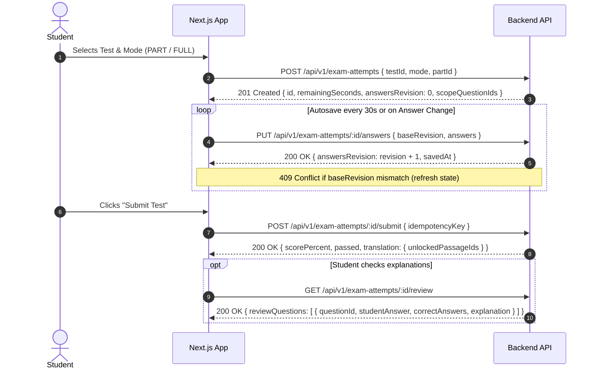
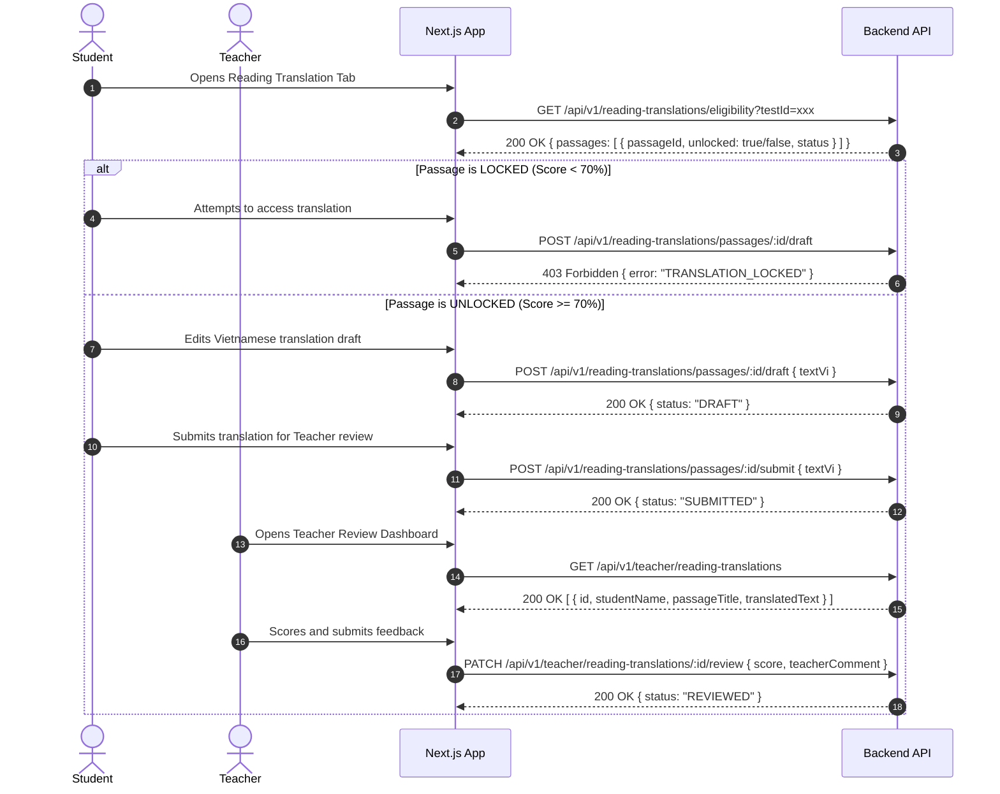

# IELTS LMS Backend — Frontend Integration API Contract

**Version:** 1.0.0  
**Target Consumer:** Next.js 14/15 App Router Frontend  
**Base URL:** `http://localhost:3000/api/v1` (Production: `https://api.ielts-lms.edu.vn/api/v1`)  
**OpenAPI Specification:** [docs/openapi.json](file:///d:/WEB-IELTS/docs/openapi.json)

---

## 1. Architectural & Protocol Conventions

### 1.1 HTTP Headers
Every client request must provide:
- `Content-Type: application/json`
- `Authorization: Bearer <accessToken>` (for protected endpoints)
- Optional: `X-Correlation-Id: <uuid>` (for distributed request tracking; auto-generated if omitted)

### 1.2 Standard Success Envelope
All successful 2xx responses are wrapped by `TransformInterceptor`:
```json
{
  "statusCode": 200,
  "data": { ... },
  "timestamp": "2026-11-12T01:50:00.000Z"
}
```

### 1.3 Standard Error Envelope
All error responses (4xx, 5xx) follow the standardized structure from `GlobalExceptionFilter`:
```json
{
  "statusCode": 400,
  "error": "BadRequest",
  "message": [
    "title must be longer than or equal to 3 characters"
  ],
  "path": "/api/v1/courses",
  "timestamp": "2026-11-12T01:50:00.000Z",
  "correlationId": "d3b07384-d113-441d-a34f-03ec7b6b1580"
}
```

### 1.4 Pagination Envelope
Paginated endpoints return the envelope:
```json
{
  "items": [ ... ],
  "total": 42,
  "page": 1,
  "limit": 20
}
```

---

## 2. Authentication & Token Refresh Flow

The backend employs **short-lived Access Tokens (15m)** and **rotating, Redis-backed Refresh Tokens (7d)**.

```mermaid
sequenceDiagram
    autonumber
    actor User as Next.js Client
    participant Auth as /api/v1/auth
    participant Redis as Redis Token Store
    participant API as Protected APIs

    User->>Auth: POST /auth/login { email, password }
    Auth->>Redis: SET auth:refresh:{tokenId} { userId, tokenHash, family } EX 604800
    Auth-->>User: 200 OK { accessToken, refreshToken, expiresIn: '15m' }

    User->>API: GET /assignments/mine (Bearer accessToken)
    API-->>User: 200 OK { data: [...] }

    Note over User,API: 15 minutes elapse; accessToken expires
    User->>API: GET /assignments/mine (Expired Token)
    API-->>User: 401 Unauthorized

    User->>Auth: POST /auth/refresh { refreshToken }
    Auth->>Redis: Atomic getdel auth:refresh:{oldTokenId}
    Auth->>Redis: SET auth:refresh:{newTokenId} EX 604800
    Auth-->>User: 200 OK { accessToken: newAccess, refreshToken: newRefresh }

    User->>API: GET /assignments/mine (Bearer newAccess)
    API-->>User: 200 OK { data: [...] }
```

### Next.js Client Refresh Handler Pattern
When your Next.js client encounters a `401 Unauthorized`:
1. Intercept the error via Axios or standard Fetch wrapper.
2. Call `POST /api/v1/auth/refresh` with the stored `refreshToken`.
3. If refresh succeeds: Store the new `accessToken` and `refreshToken`, then retry the original request.
4. If refresh returns `401 Unauthorized`: Clear tokens and redirect the user to `/login`.

---

## 3. Complete REST API Catalog

### 3.1 Authentication (`/auth`)
| Method | Endpoint | Role | Description |
| :--- | :--- | :--- | :--- |
| `POST` | `/auth/login` | Public | Email and password login. Returns `{ accessToken, refreshToken, expiresIn }`. |
| `POST` | `/auth/refresh` | Public | Refresh token rotation. Invalidates old refresh token. |
| `POST` | `/auth/logout` | Public | Revokes refresh token in Redis immediately. |
| `GET` | `/auth/me` | Authenticated | Returns currently authenticated user profile. |

### 3.2 Users (`/users`)
| Method | Endpoint | Role | Description |
| :--- | :--- | :--- | :--- |
| `POST` | `/users` | `ADMIN` | Create user (Student, Teacher, Admin). |
| `GET` | `/users` | `ADMIN` | Paginated user list with `role` and `status` filters. |
| `GET` | `/users/me` | Authenticated | Own profile details. |
| `PATCH` | `/users/me` | Authenticated | Update own profile (`fullName`, `phone`). |
| `GET` | `/users/:id` | `ADMIN`, `TEACHER` | Get user details by ID. |
| `PATCH` | `/users/:id` | `ADMIN` | Update user metadata. |
| `PATCH` | `/users/:id/status`| `ADMIN` | Change status (`active`, `inactive`, `suspended`). |

### 3.3 Courses & Enrollments (`/courses`)
| Method | Endpoint | Role | Description |
| :--- | :--- | :--- | :--- |
| `POST` | `/courses` | `ADMIN` | Create course (`code`, `title`, `startBand`, `targetBand`, `type`, `teacherId`). |
| `GET` | `/courses` | `ADMIN`, `TEACHER` | List all courses (Teacher sees only assigned courses). |
| `GET` | `/courses/mine` | Authenticated | Student's enrolled courses or Teacher's assigned courses. |
| `GET` | `/courses/:id` | Authenticated | Course detail. |
| `PATCH` | `/courses/:id` | `ADMIN`, `TEACHER` | Update course details. |
| `DELETE` | `/courses/:id` | `ADMIN` | Soft-archive (or delete unused) course. |
| `POST` | `/courses/:id/students` | `ADMIN`, `TEACHER` | Enroll student into course. |
| `DELETE` | `/courses/:id/students/:studentId` | `ADMIN`, `TEACHER` | Drop student from course. |
| `GET` | `/courses/:id/students` | `ADMIN`, `TEACHER` | List enrolled students in course. |

### 3.4 Lessons (`/lessons`)
| Method | Endpoint | Role | Description |
| :--- | :--- | :--- | :--- |
| `POST` | `/lessons` | `ADMIN`, `TEACHER` | Create lesson schedule with title, description, time range, Google Meet URL. |
| `GET` | `/lessons` | Authenticated | Query lessons filtered by `courseId`, `status`, date range. |
| `GET` | `/lessons/:id` | Authenticated | Lesson details. |
| `PATCH` | `/lessons/:id` | `ADMIN`, `TEACHER` | Reschedule lesson or update Google Meet link. |
| `DELETE` | `/lessons/:id` | `ADMIN`, `TEACHER` | Cancel lesson (`status: cancelled`). |

### 3.5 Exercise Bank (`/exercises`)
| Method | Endpoint | Role | Description |
| :--- | :--- | :--- | :--- |
| `POST` | `/exercises` | `ADMIN`, `TEACHER` | Create Reading/Listening exercise with questions. |
| `GET` | `/exercises` | `ADMIN`, `TEACHER` | List exercises with pagination and filters. |
| `GET` | `/exercises/:id` | Authenticated | View exercise (Students receive sanitized version without answers). |
| `PATCH` | `/exercises/:id` | `ADMIN`, `TEACHER` | Update draft exercise. |
| `POST` | `/exercises/:id/publish` | `ADMIN`, `TEACHER` | Publish exercise to make it assignable. |

### 3.6 Assignments (`/assignments`)
| Method | Endpoint | Role | Description |
| :--- | :--- | :--- | :--- |
| `POST` | `/assignments` | `ADMIN`, `TEACHER` | Assign exercise to course with `openAt`, `deadlineAt`, `allowRetake`. |
| `GET` | `/assignments` | `ADMIN`, `TEACHER` | List course assignments. |
| `GET` | `/assignments/mine` | `STUDENT` | Authenticated student's assignments, deadlines, best scores. |
| `GET` | `/assignments/:id` | Authenticated | Assignment details. |
| `PATCH` | `/assignments/:id` | `ADMIN`, `TEACHER` | Update deadline or metadata. |
| `GET` | `/assignments/:id/students` | `ADMIN`, `TEACHER` | Student roster for assignment. |
| `POST` | `/assignments/:id/backfill-students` | `ADMIN`, `TEACHER` | Backfill assignments for newly enrolled students. |

### 3.7 Submissions & Grading (`/assignments/:id/submissions`)
| Method | Endpoint | Role | Description |
| :--- | :--- | :--- | :--- |
| `POST` | `/assignments/:id/submissions` | `STUDENT` | Submit answers. Server auto-grades deterministically against immutable snapshot. |
| `GET` | `/assignments/:id/submissions/mine` | `STUDENT` | Student's own submission history and attempts. |
| `GET` | `/assignments/:id/answers` | Authenticated | Unlocks answer keys and explanations (Student must have PASS score >= 70%). |
| `GET` | `/submissions/:id` | Authenticated | Specific submission details and question feedback. |

### 3.8 Reading Translation (`/assignments/:id/translation-submission`)
| Method | Endpoint | Role | Description |
| :--- | :--- | :--- | :--- |
| `POST` | `/assignments/:id/translation-submission` | `STUDENT` | Submit sentence-by-sentence Vietnamese translation. |
| `GET` | `/assignments/:id/translation-submission/mine` | `STUDENT` | View own translation submission. |
| `GET` | `/assignments/:id/translation-submissions` | `ADMIN`, `TEACHER` | List student translations for teacher review. |
| `PATCH` | `/translation-submissions/:id/feedback` | `ADMIN`, `TEACHER` | Teacher score and qualitative feedback on translation. |

### 3.9 Extension Requests (`/extension-requests`)
| Method | Endpoint | Role | Description |
| :--- | :--- | :--- | :--- |
| `POST` | `/extension-requests` | `STUDENT` | Request deadline extension (Enforces max 3 requests per month in Vietnam timezone). |
| `GET` | `/extension-requests/quota` | `STUDENT` | Check current month's remaining extension quota. |
| `GET` | `/extension-requests/mine` | `STUDENT` | Student's extension request history. |
| `GET` | `/extension-requests` | `ADMIN`, `TEACHER` | List extension requests for assigned courses. |
| `PATCH` | `/extension-requests/:id/review` | `ADMIN`, `TEACHER` | Approve or reject extension. Auto-reverses late penalty if approved. |

### 3.10 Penalty Points (`/penalties`)
| Method | Endpoint | Role | Description |
| :--- | :--- | :--- | :--- |
| `GET` | `/penalties/mine` | `STUDENT` | Current student penalty points balance and transaction history. |
| `GET` | `/penalties/student/:studentId` | `ADMIN`, `TEACHER` | View specific student's penalty ledger. |
| `GET` | `/penalties/leaderboard` | Authenticated | Course-level penalty points leaderboard. |

### 3.11 Notifications (`/notifications`)
| Method | Endpoint | Role | Description |
| :--- | :--- | :--- | :--- |
| `GET` | `/notifications` | Authenticated | Paginated notifications (supports `?isRead=false`, `page`, `limit`). |
| `GET` | `/notifications/mine` | Authenticated | Alias for `GET /notifications`. |
| `GET` | `/notifications/unread-count` | Authenticated | Returns `{ unreadCount: number }`. |
| `PATCH` | `/notifications/:id/read` | Authenticated | Mark a single notification as read. |
| `PATCH` | `/notifications/read-all` | Authenticated | Mark all unread notifications as read. |

### 3.12 Observability & Health (`/health`, `/jobs`)
| Method | Endpoint | Role | Description |
| :--- | :--- | :--- | :--- |
| `GET` | `/health/live` | Public | Liveness probe (verifies process event-loop responsiveness; independent of heap). |
| `GET` | `/health/ready` | Public | Readiness probe (verifies critical external dependencies: MongoDB & Redis readiness). |
| `GET` | `/health/memory`| Public | Memory monitoring (isolated heap check against configured threshold). |
| `GET` | `/jobs/health` | `ADMIN` | BullMQ queue metrics (email queue, deadline queue). |
| `POST` | `/jobs/deadlines/trigger` | `ADMIN`, `TEACHER` | Trigger immediate background overdue check. |

---

## 4. Key DTO Examples for Next.js

### 4.1 Login Request & Response
```ts
// POST /api/v1/auth/login
const requestBody = {
  email: "student@ielts-lms.edu.vn",
  password: "Password@123"
};

// Response 200 OK
const responseBody = {
  statusCode: 200,
  data: {
    accessToken: "eyJhbGciOi...",
    refreshToken: "59f6323c-91d4-42b9-b8ae-24caea37e191.bf7a...",
    expiresIn: "15m"
  },
  timestamp: "2026-11-12T01:50:00.000Z"
};
```

### 4.2 Submitting Exercise Answers
```ts
// POST /api/v1/assignments/:id/submissions
const requestBody = {
  answers: [
    { questionId: "q-1", value: "A" },
    { questionId: "q-2", value: "TRUE" },
    { questionId: "q-3", value: "industrial revolution" }
  ]
};

// Response 201 Created (Auto-graded)
const responseBody = {
  statusCode: 201,
  data: {
    id: "6732389abcde...",
    scorePercent: 70,
    correctCount: 7,
    totalQuestions: 10,
    isPassed: true,
    submittedAt: "2026-11-12T01:55:00.000Z",
    feedback: [
      {
        questionId: "q-1",
        studentAnswer: "A",
        awardedPoints: 1,
        isCorrect: true,
        prompt: "What was the initial material used?"
      }
    ]
  },
  timestamp: "2026-11-12T01:55:00.000Z"
};
```

### 4.3 Submitting Extension Request
```ts
// POST /api/v1/extension-requests
const requestBody = {
  studentAssignmentId: "673238901234...",
  requestedDeadlineAt: "2026-11-20T23:59:59.000Z",
  reason: "Bị sốt xuất huyết phải nhập viện điều trị 3 ngày, xin phép gia hạn nộp bài."
};
```

---

## 5. Phase 9: IELTS Exam Modes, Question Bank & Reading Translation Unlock

### 5.1 Enums & Types
```ts
export enum ExamSkill {
  READING = 'READING',
  LISTENING = 'LISTENING',
}

export enum ExamMode {
  PART = 'PART',
  FULL = 'FULL',
}

export enum PartType {
  PASSAGE = 'PASSAGE',
  SECTION = 'SECTION',
}

export enum ExamTestStatus {
  DRAFT = 'DRAFT',
  PUBLISHED = 'PUBLISHED',
  ARCHIVED = 'ARCHIVED',
}

export enum AttemptStatus {
  IN_PROGRESS = 'IN_PROGRESS',
  SUBMITTED = 'SUBMITTED',
  EXPIRED = 'EXPIRED',
  ABANDONED = 'ABANDONED',
}

export enum TranslationStatus {
  LOCKED = 'LOCKED',
  DRAFT = 'DRAFT',
  SUBMITTED = 'SUBMITTED',
  REVIEWED = 'REVIEWED',
}
```

### 5.2 Flow: Taking an Exam (PART or FULL)



### 5.3 Flow: Reading Translation Unlock Workflow



### 5.4 Sample Payloads

#### Start Exam Attempt
```ts
// POST /api/v1/exam-attempts
// For PART mode:
{
  "testId": "673238901111...",
  "mode": "PART",
  "partId": "673238902222...",
  "idempotencyKey": "part-attempt-uuid-001"
}
// For FULL mode:
{
  "testId": "673238901111...",
  "mode": "FULL",
  "idempotencyKey": "full-attempt-uuid-002"
}
```

#### Autosave Answers
```ts
// PUT /api/v1/exam-attempts/:id/answers
{
  "baseRevision": 2,
  "answers": [
    { "questionId": "1", "value": "TRUE" },
    { "questionId": "2", "value": "FALSE" },
    { "questionId": "3", "value": "NOT GIVEN" }
  ]
}
```

#### Submit Exam Attempt
```ts
// POST /api/v1/exam-attempts/:id/submit
{
  "idempotencyKey": "submit-attempt-uuid-001"
}

// Response 200 OK
{
  "statusCode": 200,
  "data": {
    "attemptId": "673238903333...",
    "mode": "PART",
    "correctCount": 8,
    "totalPoints": 10,
    "scorePercent": 80,
    "passed": true,
    "translation": {
      "unlockedPassageIds": ["673238902222..."]
    }
  },
  "timestamp": "2026-11-12T05:30:00.000Z"
}
```

---

## 6. Phase 10: Daily Assignment Scheduling & Teacher-Configurable Assignments

### 6.1 Fixed Daily Window Model (06:00 VN)
- **Timezone:** `Asia/Ho_Chi_Minh` (+07:00).
- **Daily Window:** Available from `06:00:00` local on `assignedDate` until `06:00:00` on the following day (exactly 24h).
- **Access Interval:** `[availableAt, dueAt)`. At exactly `dueAt`, assignment is expired unless a valid extension applies.
- **Timestamps:** Returned in ISO 8601 UTC with companion `+07:00` Vietnam display fields (`availableAtVn`, `dueAtVn`, `openAtVn`, `deadlineAtVn`).

### 6.2 Status Lifecycle
- `DRAFT`: Teacher draft, invisible to students.
- `SCHEDULED`: Scheduled for future date (`now < availableAt`). Visible on student calendar/dashboard with countdown timer, but content (passages, questions, audio) is strictly locked.
- `AVAILABLE`: Currently open for attempts (`availableAt <= now < dueAt`).
- `EXPIRED`: Deadline has passed (`now >= dueAt`). No new attempts allowed.
- `COMPLETED`: Student has submitted and completed the assignment.

### 6.3 Endpoints Reference

#### Validate Assignment Configuration
```http
POST /api/v1/assignments/validate
Authorization: Bearer <teacher_jwt>
Content-Type: application/json
```
Request Body:
```json
{
  "courseId": "673238901111222233334444",
  "exerciseId": "673238905555666677778888",
  "assignedDate": "2026-11-28",
  "requiredScope": "PART",
  "requiredPartId": "673238902222333344445555",
  "selectedQuestionGroupIds": ["673238909999000011112222"],
  "targetScorePercent": 75,
  "durationSecondsOverride": 1800
}
```
Response 200 OK:
```json
{
  "statusCode": 200,
  "data": {
    "valid": true,
    "errors": []
  },
  "timestamp": "2026-11-14T05:30:00.000Z"
}
```

#### Preview Assignment (Dry Run)
```http
POST /api/v1/assignments/preview
Authorization: Bearer <teacher_jwt>
Content-Type: application/json
```
Response 200 OK:
```json
{
  "statusCode": 200,
  "data": {
    "course": { "id": "...", "code": "IELTS-01", "title": "IELTS Master" },
    "title": "Climate Change Reading Test",
    "skill": "READING",
    "scope": "PART",
    "assignedDate": "2026-11-28",
    "availableAt": "2026-11-27T23:00:00.000Z",
    "availableAtVn": "2026-11-28T06:00:00+07:00",
    "dueAt": "2026-11-28T23:00:00.000Z",
    "dueAtVn": "2026-11-29T06:00:00+07:00",
    "durationSeconds": 1800,
    "targetScorePercent": 75,
    "questionCount": 5,
    "totalPoints": 5,
    "enrolledStudentsCount": 24,
    "passage": "<p>Reading passage content...</p>",
    "questions": [...]
  }
}
```

#### Get Full Preview by Assignment ID (Teacher/Admin)
```http
GET /api/v1/assignments/:id/preview
Authorization: Bearer <teacher_jwt>
```

#### Student Dashboard & Zero-Leakage View
When `scheduleStatus === 'SCHEDULED'`:
- `GET /api/v1/assignments/mine` returns `scheduleStatus: "SCHEDULED"`, `isAvailable: false`, and `remainingSeconds`.
- `GET /api/v1/assignments/:id` returns metadata only. `exercise` field omits `passage` and `questions`.
- Starting an attempt via `POST /api/v1/exam-attempts` before `availableAt` returns `403 Forbidden`:
```json
{
  "statusCode": 403,
  "error": "Forbidden",
  "code": "ASSIGNMENT_NOT_YET_AVAILABLE",
  "message": "Assignment is scheduled and not yet available until 2026-11-28T06:00:00+07:00"
}
```

#### Attempt Timer Capped by Deadline
When student starts an attempt during `AVAILABLE` window, expiration is strictly capped:
`expiresAt = min(startedAt + duration, effectiveDeadlineAt)`
```json
{
  "attemptId": "...",
  "startedAt": "2026-11-28T22:50:00.000Z",
  "expiresAt": "2026-11-28T23:00:00.000Z"
}
```


