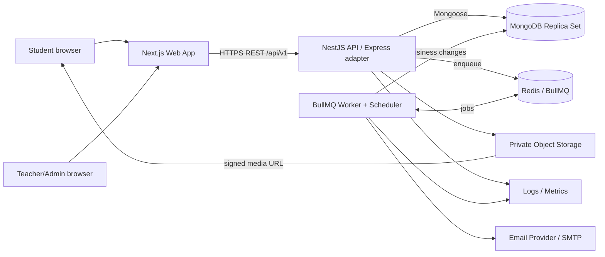
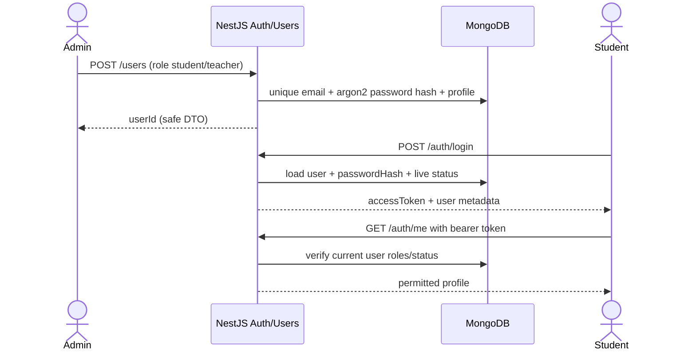
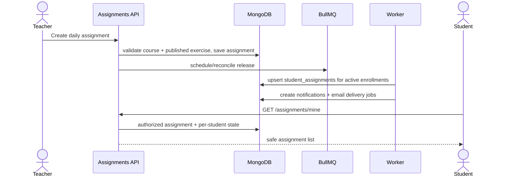
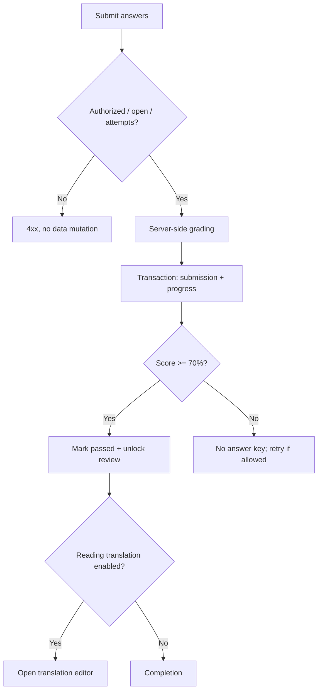
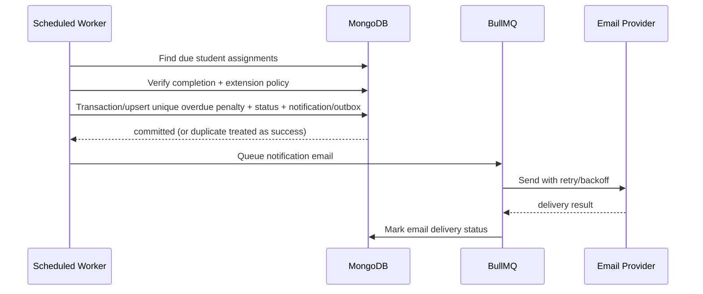

# FRONTEND SYSTEM DESIGN — IELTS LEARNING MANAGEMENT SYSTEM

> **Version:** 1.0 | **Date:** 2026-11-11 | **Language:** Vietnamese | **Status:** Target architecture + implementation handoff  
> **Primary audience:** Developer / Antigravity AI coding agent / QA / technical reviewer  
> **Purpose:** Implementation blueprint for the **Next.js/React frontend**, with shared API and business contracts.  
> **Existing source baseline:** `IELTS_LMS_NestJS_Backend_Modules.zip` (NestJS starter with 16 Mongoose schemas and 4 feature modules).  
> **Important:** This document is the **target design**. Feature status is explicitly marked; do not assume planned components are already implemented.

---

> **Scope:** Frontend ownership. The API and workflow chapters are shared contracts, not frontend authorization logic.

---

## 0. Document rules & traceability

### 0.1 Source of requirements

**[R] Requirements explicitly stated in the original demo:** student and teacher interfaces; calendar with Google Meet; Reading IELTS-style test then Vietnamese translation of the same passage; Reading/Listening PASS threshold >=70%, answers visible only after PASS; new daily exercises with deadline 00:00–23:59 Vietnam time; student may request late submission up to 3 times per month from homeroom teacher; overdue incurs +1 positive penalty point; Gmail/email notices for new assignment, overdue and newly added course; teacher dashboard, learners/courses/exercises/calendar; course by band and one-to-one or group.

**[D] Agreed technical decisions:** Next.js (React + TypeScript), NestJS (Node.js + Express adapter), MongoDB + Mongoose; Redis + BullMQ for background processing; modular monolith; REST; object storage for listening audio.

**[P] Proposed product/engineering decisions requiring sign-off:** whether "completed" means submitted or passed before deadline; maximum attempts; translation grading; how 3 monthly extension requests are counted; whether pending extension pauses penalty; teacher/homeroom permission boundaries; refund/penalty reversal policy; what happens when newly enrolled/withdrawn learners cross an assignment date; whether a late PASS can remain penalized. The implementation defaults in this document are proposals, not original requirements.

### 0.2 Status legend

- `EXISTING (unverified runtime)`: source code exists in the previous zip, but npm install/build/integration tests were not confirmed.
- `TO BUILD`: not implemented in the previous backend milestone.
- `TARGET`: final intended behavior, subject to acceptance tests.
- `DECISION REQUIRED`: stakeholder must approve before production semantics are frozen.

### 0.3 Priorities

`P0`: essential end-to-end study experience + safe access; `P1`: operational completeness; `P2`: optional enhancements.

---

## 1. Executive summary & scope

A specialized web LMS for IELTS Reading and Listening. Teachers create/manage learners, courses, schedules, exercises, daily assignments and extension requests. Learners join Google Meet lessons, complete Reading/Listening tests, receive automatic scores, unlock answer review only after >=70%, translate Reading passages into Vietnamese, and track deadlines, extensions and positive penalty points. The system sends email and in-app notifications and provides dashboards.

### 1.1 In scope (MVP)

1. Role-based identity, admin-managed account provisioning and user profiles.
2. Courses by IELTS band, 1:1/group mode, course enrollment and teacher ownership.
3. Lesson calendar and saved Google Meet URLs (Google Calendar API integration is **not mandatory**).
4. Exercise bank containing passages/audio/questions/answer keys; authoring, draft/publish/version management.
5. Per-course assignments and per-student progress/deadline records; scheduled daily release.
6. Reading/Listening submissions, server-side scoring, repeat attempts per approved policy; grade threshold >=70%.
7. Conditional answer reveal; Reading translation writing/submission and teacher feedback.
8. Three monthly extension requests; approval/rejection; effective individual due dates.
9. One-time overdue penalty per eligible student-assignment, full ledger and reversal trail.
10. In-app + email notification; operational dashboard, filtering and basic reports.
11. Audit, logging, security, automated tests, deployment and backup procedures.

### 1.2 Out of scope for MVP

AI translation grading, Speaking/Writing, payment/billing, real-time video hosting, native mobile app, Google Meet meeting *creation* API, elaborate recommendation engine, microservices, event streaming, elaborate gamification. These can be added later.

### 1.3 Personas and authorization

- **Student:** own profile, enrolled courses, own schedule, own assignments/submissions/translation/extension/notifications/penalty history.
- **Teacher:** courses assigned to them, associated students, owned exercise content/assignments/lesson schedule, per-student results, extension decisions for permitted students.
- **Admin:** account management, system-wide courses/teacher assignments, configuration, reports, privileged audit; cannot casually modify graded historical evidence.
- **Worker/system principal:** background jobs only; credentials separate from user roles; all changes traceable.

A user can have multiple roles (existing schema `roles: UserRole[]`). Authorization must check both **role** and **resource ownership/enrollment** on every endpoint.

---

## 2. System context and overall architecture

### 2.1 Architecture style

**Modular monolith**: Next.js application + one NestJS API process + one BullMQ worker process sharing tested domain modules. MongoDB is source of truth; Redis is ephemeral queue infrastructure; object storage serves audio via authorized signed URLs; email provider delivers transactional messages. Services communicate over HTTPS; internal workers use Redis + MongoDB. Keep front-end free of database credentials and answer keys.



### 2.2 Responsibilities and trust boundaries

| Component | Responsibilities | Not responsible for |
|---|---|---|
| Next.js | Student/teacher pages, form state, API calls, browser UX, accessible responsive layout | Business-grade scoring, auth enforcement, storing secret answer keys |
| NestJS API | Access control, domain validation, CRUD, grading, orchestration, MongoDB queries, signed audio access | Sending thousands of emails synchronously in request threads |
| MongoDB | Authoritative users/courses/exercises/assignments/submissions/penalties/audit | Redis queues, large audio binaries |
| Redis + BullMQ | Delayed/retry jobs, distribution, rate-limiting support | Definitive penalty balance or permanent history |
| Worker | Release assignments, reconcile deadlines, publish notifications, send email | Defining policy separately from shared domain services |
| Object storage | Private media assets (audio, optionally thumbnails) | Correct answers or authorization policy |
| Email delivery | Transactional messages and provider status | Source of truth about task completion |

### 2.4 Deployment topology

- One Next.js service (Node runtime), one NestJS API service, one BullMQ worker service.
- Managed MongoDB with replica set (transactions require deployment support), managed Redis, private S3-compatible storage, transactional email provider, reverse proxy/TLS.
- Docker Compose for local integration; production containers can run on a single VPS initially if properly backed up and sized, or managed PaaS later.
- Separate dev/staging/prod configurations and credentials. No public MongoDB/Redis ports in production.

---

## 3. Frontend design (Next.js)

### 3.1 Stack and conventions

- Next.js App Router, React, TypeScript; UI with reusable form and data components; React Hook Form + Zod for validation (proposal), TanStack Query for server-state cache (proposal).
- Backend NestJS is **the only authoritative API**; Next.js route handlers are optional BFF/proxy, not an independent persistence layer.
- Auth session: prefer short-lived access token in memory plus rotating httpOnly Secure SameSite refresh cookie **after refresh implementation**. Current starter only supports 15-minute Bearer JWT; a temporary MVP can use Bearer access tokens with careful storage/renewal behavior and explicit logout on expiry.
- All timestamps rendered in `Asia/Ho_Chi_Minh` (or course timezone, default VN); mobile responsive; consistent empty/loading/error states.

### 3.2 Target routing

```text
/login
/unauthorized
/student/dashboard
/student/calendar
/student/courses
/student/assignments
/student/assignments/[studentAssignmentId]
/student/assignments/[studentAssignmentId]/review
/student/assignments/[studentAssignmentId]/translation
/student/extensions
/student/penalties
/student/notifications
/student/profile
/teacher/dashboard
/teacher/calendar
/teacher/students
/teacher/students/[id]
/teacher/courses
/teacher/courses/new
/teacher/courses/[id]
/teacher/courses/[id]/students
/teacher/exercises
/teacher/exercises/new
/teacher/exercises/[id]/edit
/teacher/assignments
/teacher/assignments/new
/teacher/assignments/[id]/results
/teacher/extensions
/teacher/translations
/admin/users
/admin/courses
/admin/audit
/admin/settings
```

### 3.3 Screens and UX requirements

| Screen | Main UI elements | Backend dependence |
|---|---|---|
| Login | email/password, errors, session state | auth login/me |
| Student dashboard | today tasks, next lesson, overdue, score, penalties, extension quota | assignments/lessons/analytics |
| Calendar | month/week agenda, teacher, Meet button | lessons |
| Reading test | source passage left, questions right, autosave draft if supported, submit confirmation | safe exercise DTO, submission |
| Translation | same passage left, Vietnamese editor right, save draft/submit, teacher comments | translations |
| Listening test | authorized audio player, questions, submit | media signed URL, submission |
| Answer review | answers/explanations **only after authorization** | answer review endpoint |
| Teacher exercise builder | passage/audio editor, question types, answer key, publish version | exercises |
| Course management | band, group/1:1, teacher, roster | courses/enrollments |
| Deadline dashboard | per-learner state, due time, extension, penalties | assignments/extensions/penalties |
| Notifications | read/unread, deep-link | notifications |

**Rendering/security:** answer keys must never be serialized into a student page, client cache, page HTML, React props or hidden fields before PASS. Check answer unlock through API each time. Audio should use short-lived signed URLs without exposing storage credentials. Sanitize rich text against XSS.

---

## 5. Domain workflow specifications

### 5.1 Authentication and provisioning



- Existing baseline: admin-created users, Argon2 hashes, JWT access token expires in 15 minutes; roles/status checked against DB on protected routes.
- Target hardening: login throttling, password reset/invitation, token revocation/refresh with hashed rotating refresh tokens or server-side sessions, secure cookie strategy, auth audit and protected account changes.
- Admin bootstrap account seeded via environment variables **only once**, never hard-code credentials.

### 5.2 Teacher creates course and enrolls students

1. Teacher/admin creates course: name/code/type/band/timezone/teacher and dates; enforce `startBand <= targetBand` if pedagogically required.
2. For 1:1, enforce **max one active enrollment** transactionally; group supports multiple active users.
3. Enroll a valid active student; create/update `enrollments`; notify student through in-app/email.
4. Decide what to do with already-open assignments when adding a learner: proposed default is assign only **future** assignments unless teacher explicitly backfills historical items.
5. On withdrawal, set status `withdrawn`, preserve submission history; stop newly scheduled deliveries.

### 5.3 Teacher authors and publishes exercise

1. Save draft passage(s) or audio storage reference, question types, options, grading rubrics.
2. Publish validates media presence, question completeness, answer key consistency, nonzero total points.
3. Published content is immutable in scoring-relevant fields. Edits create next version; assignment pins `exerciseId` + `exerciseVersion`.
4. Student-safe GET never includes grading.
5. For Listening, issue time-limited storage access only after course/assignment authorization.

### 5.4 Daily assignment scheduling

- Instructor chooses published exercise, course, start and due dates; defaults to VN local `00:00` through `23:59`, but **implement exclusive due boundary at next local 00:00** to avoid off-by-millisecond behavior. Store as UTC dates.
- `assignments` records course-level schedule. `student_assignments` records allocation, current progress and `effectiveDueAt` for each learner.
- At creation or release, allocate to active enrollments with unique upsert `(assignmentId,studentId)`. Release worker performs retry-safe reconciliation; do **not** depend on a single midnight cron run being perfect.
- Notify affected students when assignment becomes available, not on draft creation.
- If `openAt > now`, student can see only allowed preview metadata; no questions/audio before opening.



### 5.5 Submit and grade Reading/Listening

1. Student requests safe exercise for active personal assignment; verify time window, role, enrollment and status.
2. Student sends `answers[]` with question IDs and values; only backend reads answer key.
3. Validate expected questions, payload shape and allowed attempts; lock/check repeat requests (client request idempotency token is recommended).
4. Load immutable exercise version, calculate earned points, exact PASS decision >=70%, save new immutable `submissions` record with `attemptNo` and `gradingVersion`.
5. Update `student_assignments.attemptCount`, `bestScore`, `lastSubmittedAt` and `passedAt` only when first PASS; do so transactionally with submission insert.
6. Return score, pass/fail, attempt number and next available action. Never return answer key in failed response.
7. Once passed, GET `/student-assignments/:id/review` authorizes and sends correct answers and optional explanations.
8. If Reading `translationEnabled`, show translation editor following test stage; precise unlock rule is proposed to be after PASS.



### 5.6 Reading translation

- `translation_submissions` stores **one current draft/submitted/reviewed document per student assignment**, as enforced by existing unique index; it is **not** a full revision history.
- `draft` editable; on `submitted` freeze the submitted snapshot; teacher can `reviewed` + feedback and metadata; any edits after review need explicit reopen workflow or a separate revision collection.
- Show same source passage used in Reading test with side-by-side Vietnamese textbox.
- No auto-score or AI feedback in MVP. Teacher manual review supported as operational enhancement.
- **Decision required:** Is translation submission mandatory for Reading assignment completion and overdue penalties? Default suggested: treat Reading test PASS as completion of scored task, track translation status separately; teacher can choose `translationRequired` in a future assignment-policy field.

### 5.7 Extensions (3 per month)

- Student selects own `student_assignment`, gives reason and proposed due time. Only eligible not-yet-final assignments can request extension.
- Proposed default: **maximum 3 submitted extension requests per student per calendar month in Asia/Ho_Chi_Minh**, including rejected; count with `createdAt` bounds converted to UTC. This is a *proposal*, original demo says 3 times/month without defining counted events.
- One pending request per assignment (partial unique index).
- Homeroom teacher or course owner/admin (define exact authorization policy) can approve/reject; write decision actor/time, new `effectiveDueAt` on approval, audit, notification **in a transaction**.
- Concurrent requests must be protected with a transaction/serialized counter where needed; a simple `countDocuments <3` before insert is race-prone. Consider a `monthly_extension_quotas` record as additional collection if strict atomic quota enforcement is required.
- **Decision required:** Does request submitted before due pause penalty while pending? Default recommended: pause enforcement until teacher decides, then reconcile based on accepted/declined effective deadline. This requires explicit policy/state logic and worker handling.

### 5.8 Overdue penalty

- Demo: each late task adds **+1**, positive penalty score; do not penalize repeatedly.
- **Decision required:** What qualifies as on-time completion? Proposed target: must PASS by `effectiveDueAt` for scored activity; translation separately tracked. Alternate: any submission before due qualifies. This must be approved before implementing worker.
- Worker scans `student_assignments` due and not complete; verify approved extensions/pending policies and current state.
- Insert ledger row with `eventType='overdue'`, `pointsDelta=+1`, `idempotencyKey='overdue:'+studentAssignmentId`. Unique index protects against retries.
- Mark assignment overdue / `penaltyApplied=true` as a derived cache, insert in-app notification and email delivery record. Perform consistent multi-write transaction or outbox.
- Penalty balance = sum `pointsDelta` in `penalty_transactions`, **not** mutable standalone `student_profiles.penaltyPoints`.
- Correction: insert reversal transaction with negative `pointsDelta`, link `reversesTransactionId`, never delete original penalty. Display positive total while allowing audited reversals; prevent arbitrary negative overall balance unless explicitly supported.



### 5.9 Calendar / Google Meet

- Teacher creates/modifies lessons with course, teacher, start/end, title, `https://meet.google.com/...` link and status.
- Validate start < end, teacher-course ownership, student active enrollment, date conflicts per policy.
- Student views only lessons in active (or approved historical) enrollments; teacher sees their lessons; admin all.
- MVP only stores and opens instructor-provided Meet URL. Creating meetings automatically via Google APIs would be a **separate** integration requiring user consent, OAuth scopes and token lifecycle.

### 5.10 Notifications and email

- Trigger types from original demo: `assignment_new`, `overdue`, `course_added`. Existing enum also has `extension_decided` as additional useful event.
- Persist notification in MongoDB; create email delivery with unique idempotency key; enqueue to BullMQ.
- Email template contains concise event summary, local due date and deep link; never include password, refresh token, full answer keys, or sensitive feedback.
- Retry transient email failures with exponential backoff and bounded attempts; expose status to admin via logs/metrics.
- Use a transactional outbox or equivalent recovery mechanism so DB transaction and Redis enqueue cannot silently diverge.

---

## 6. API design (REST /api/v1)

### 6.1 API standards

- Base path: `/api/v1`; JSON UTF-8; timestamps ISO 8601 UTC; pagination `{page, limit, total, items}` or agreed cursor format.
- Auth: `Authorization: Bearer <accessToken>` for protected APIs; add secure refresh-cookie flow when implemented.
- Input validation: NestJS ValidationPipe `whitelist`, `forbidNonWhitelisted`, `transform`; consistent DTOs.
- Error response proposed:

```json
{
  "statusCode": 403,
  "code": "ANSWER_LOCKED",
  "message": "Correct answers are available only after PASS",
  "requestId": "req_xxx",
  "timestamp": "2026-11-11T07:00:00.000Z"
}
```

- Common statuses: 400 invalid input, 401 unauthenticated, 403 unauthorized, 404 hidden/not found, 409 conflicting version/state, 422 unprocessable content, 429 throttled, 500 internal failure.
- Route order: static endpoints before `/:id`; verify object IDs; never expose privileged full MongoDB documents.

### 6.2 Existing API baseline (source code exists; runtime not yet confirmed)

| Method | Route | Roles/resource scope | Status |
|---|---|---|---|
| POST | `/auth/login` | Public | EXISTING |
| GET | `/auth/me` | Authenticated | EXISTING |
| POST | `/users` | Admin | EXISTING |
| GET | `/users` | Admin | EXISTING |
| GET | `/users/:id` | Admin | EXISTING |
| PATCH | `/users/:id` | Admin | EXISTING |
| POST | `/courses` | Teacher/Admin | EXISTING |
| GET | `/courses` | Own/enrolled/admin | EXISTING |
| GET | `/courses/:id` | Authorized | EXISTING |
| PATCH | `/courses/:id` | Owner/Admin | EXISTING |
| POST | `/courses/:id/students` | Owner/Admin | EXISTING |
| GET | `/courses/:id/students` | Owner/Admin | EXISTING |
| DELETE | `/courses/:id/students/:studentId` | Owner/Admin | EXISTING |
| POST | `/assignments` | Owner/Admin | EXISTING |
| GET | `/assignments/mine` | Student | EXISTING |
| GET | `/assignments/course/:courseId` | Course-authorized | EXISTING |
| GET | `/assignments/:id` | Authorized | EXISTING |
| PATCH | `/assignments/:id` | Owner/Admin | EXISTING |
| GET | `/assignments/:id/students` | Owner/Admin | EXISTING |

**IMPORTANT:** Earlier implementation has *no* exercise authoring, submission auto-grading, extension workflow, overdue worker, email jobs, refresh tokens or frontend, as explicitly noted in the source README.

### 6.3 Target new APIs (TO BUILD — proposed contract)

| Method | Route | Purpose | Access |
|---|---|---|---|
| POST | `/auth/refresh` | Rotate session token | Auth cookie/session |
| POST | `/auth/logout` | Revoke refresh session | Authenticated |
| POST | `/auth/forgot-password` | Begin reset flow | Public throttled |
| POST | `/auth/reset-password` | Complete reset | Reset token |
| GET | `/students/me/profile` | Student profile | Self |
| GET | `/teachers/me/profile` | Teacher profile | Self |
| POST | `/lessons` | Create lesson | Teacher/Admin owner |
| GET | `/lessons` | Calendar query `from,to,courseId` | Scope-aware |
| PATCH | `/lessons/:id` | Reschedule/meet URL | Owner/Admin |
| POST | `/exercises` | Create exercise draft | Teacher/Admin |
| GET | `/exercises` | Exercise bank list | Teacher/Admin |
| GET | `/exercises/:id` | Authoring detail incl. grading | Owner/Admin only |
| PATCH | `/exercises/:id` | Edit draft | Owner/Admin |
| POST | `/exercises/:id/publish` | Validate and publish | Owner/Admin |
| POST | `/exercises/:id/versions` | New editable version | Owner/Admin |
| GET | `/student-assignments/:id` | Student-safe assigned exercise | Owner student |
| POST | `/student-assignments/:id/submissions` | Submit answers, calculate grade | Owner student |
| GET | `/student-assignments/:id/submissions` | Attempt history | Owner/Teacher |
| GET | `/student-assignments/:id/review` | Correct answers after PASS | Passed student/Teacher |
| GET | `/student-assignments/:id/translation` | Translation draft/status | Owner/Teacher |
| PUT | `/student-assignments/:id/translation/draft` | Save translation | Owner student |
| POST | `/student-assignments/:id/translation/submit` | Submit translation | Owner student |
| POST | `/translations/:id/review` | Teacher feedback | Course owner/Admin |
| POST | `/student-assignments/:id/extensions` | Request extension | Owner student |
| GET | `/extensions/mine` | Requests + monthly usage | Owner student |
| GET | `/extensions/pending` | Teacher review queue | Teacher/Admin |
| POST | `/extensions/:id/decision` | Approve/reject | Authorized teacher/Admin |
| GET | `/penalties/mine` | Sum + ledger | Owner student |
| GET | `/students/:id/penalties` | Student ledger | Authorized teacher/Admin |
| POST | `/penalties/:id/reverse` | Audit correction | Admin/authorized |
| GET | `/notifications` | Own messages | Authenticated |
| PATCH | `/notifications/:id/read` | Mark as read | Owner |
| GET | `/dashboard/student` | Student aggregate | Student |
| GET | `/dashboard/teacher` | Course analytics | Teacher |
| POST | `/media/audio/upload-init` | Validate private media upload | Teacher/Admin |
| POST | `/media/audio/upload-complete` | Confirm object + metadata | Teacher/Admin |
| GET | `/media/audio/:assetId/playback` | Signed access to assigned listening | Authorized student/teacher |
| GET | `/health/live` | Process liveness | Infrastructure |
| GET | `/health/ready` | Dependency readiness | Restricted infrastructure |

**Potential later API:** admin user invitations, teacher roster access beyond admin-only user routes, bulk student import, assignment cancellation/reassignment, reporting export, admin settings and audit search.

### 6.4 Example contracts

**Submit answers**

```http
POST /api/v1/student-assignments/672.../submissions
Authorization: Bearer <token>
Idempotency-Key: attempt-client-uuid
Content-Type: application/json
```

```json
{
  "answers": [
    {"questionId":"<ObjectId>","value":"B"},
    {"questionId":"<ObjectId>","value":"TRUE"}
  ]
}
```

```json
{
  "submissionId": "<ObjectId>",
  "attemptNo": 2,
  "score": 75,
  "passed": true,
  "bestScore": 75,
  "answerReviewUnlocked": true,
  "translationAvailable": true
}
```

**Request extension**

```json
{
  "reason": "Bận lịch thi ở trường",
  "requestedDueAt": "2026-11-14T16:59:59.999Z"
}
```

**Teacher decision**

```json
{
  "decision": "approved",
  "decisionNote": "Đồng ý gia hạn 1 ngày"
}
```

Do not allow clients to set status, approvedAt, teacher actor ID, score or penalty ledger delta arbitrarily.

---

## 7. Security & privacy architecture

### 7.1 Authentication/access control

- Argon2 password hash; password reset tokens time-limited, single-use and hashed in persistence.
- JWT validation: signature, audience/issuer as configured, expiry; live user active status and roles; explicit course ownership and enrollment checks.
- Secure cookies on refresh flow; CSRF protection if cookie-authenticated mutation endpoints are introduced; strict CORS allowlist and TLS only.
- Rate-limit login, reset, uploads and submission endpoints; lockout/captcha only after measured abuse.
- No public administrative registration, no hardcoded secrets, no raw response leaking `passwordHash`.

### 7.2 Content and answers

- Dedicated student-safe DTO excludes `grading.acceptedAnswers`, aliases, solution explanations and answer keys before PASS.
- Prevent IDOR: check `(studentAssignmentId, authenticatedUserId)` and active policy, not only that ID exists.
- Published exercise versions immutable; use versioned grading; do not accept client-supplied scoring.
- HTML source sanitation + CSP; limit media MIME, size, malware scanning when feasible; private buckets, short-lived signed URLs.

### 7.3 Database and operations

- MongoDB auth, private network, encryption in transit/at rest; scoped DB credentials.
- Secrets via environment secret manager; local `.env` ignored from Git.
- Structured logs strip tokens, passwords, full answer rubrics and raw email credentials; correlation/request ID.
- Sensitive audit records append-only; record actors for extension and penalty manual changes.
- Periodic MongoDB backup and restore drills; object storage retention/backups; Redis not authoritative.

### 7.4 Authorization matrix

| Resource | Student | Teacher | Admin |
|---|---|---|---|
| Own user/profile | Read limited, edit safe fields | Read/edit own | Manage all |
| Course | Read enrolled | CRUD owned | All |
| Enrollment | Read own | Manage owned course | All |
| Calendar | Read enrolled lessons | Manage owned lessons | All |
| Exercise answer key | Only after PASS for assigned instance | Manage owned exercises | Authorized all |
| Student submission | Own history | Course students' results | Authorized all |
| Extension | Request own | Decide eligible learners | All |
| Penalty | Read own | Read permitted students | Correct/reverse with audit |
| System logs/secret settings | None | None | Restricted admin only |

---

## 9. Non-functional requirements and SLO targets (proposals)

These are engineering acceptance targets, **not figures from the original demo**.

| Category | Proposed target |
|---|---|
| Availability | >=99.5% monthly after stabilization |
| API performance | p95 GET under 500ms; p95 typical write under 1s excluding external email/media |
| Scaling | Initial 100 concurrent active users; load-test and size hosting before launch |
| Grade integrity | No ungraded accepted attempt; no duplicate attempt number; stable scores across retries |
| Penalty integrity | At most one overdue penalty per student-assignment; audited reversals |
| Daily release | Available from configured opening time; job/reconcile lag monitored |
| Time | Store UTC; calculate deadlines by Asia/Ho_Chi_Minh |
| Recovery | Define RPO/RTO per actual deployment budget, run restore test |
| Accessibility | Semantic forms, keyboard navigation, contrast, readable error feedback |
| Compatibility | Current Chrome/Edge/Firefox/Safari and mobile viewport |
| Monitoring | Health checks, job queue lag, errors, response latency, failed email counts |

---

## 11. Test strategy and acceptance criteria

### 11.1 Unit tests

- Grading: normalized answers, question types, multi-part questions, decimal thresholds, exactly 70.00%, empty/invalid responses.
- RBAC: student cannot access other student data; teacher cannot edit unrelated course; inactive users blocked.
- Deadline: date boundary in Asia/Ho_Chi_Minh, open/closed status, inclusive/exclusive check.
- Extensions: 0/1/2/3/4 monthly requests, two concurrent requests, pending behavior, rejected requests.
- Penalties: +1 only once, duplicate job, reversal only once, balance calculation.

### 11.2 Integration tests

- NestJS modules with test MongoDB replica set and Redis; use real indexes.
- Create student + profile, course + enrollment, exercise + assignment allocation, submit and grade, extension update, scheduled penalty ledger.
- Idempotency and transaction rollback tests; authorized answer review requires PASS.
- Email adapter mocked or Mailpit sandbox; ensure retry state persisted.

### 11.3 E2E scenarios (P0)

| ID | Scenario | Expected |
|---|---|---|
| AC-01 | Admin adds student and teacher | Users exist, password hashed, roles validated |
| AC-02 | Teacher creates 1:1 course and adds second active student | Second enrollment blocked |
| AC-03 | Teacher creates/publishes Reading exercise | Correct published version, nonempty questions |
| AC-04 | Teacher assigns exercise to group | Per-student assignments created exactly once |
| AC-05 | Student before opening time | Cannot access questions/submission |
| AC-06 | Student fails with 69% | `passed=false`; answers remain unavailable |
| AC-07 | Student achieves exactly 70% | PASS; review endpoint works |
| AC-08 | Different student requests another learner's review | 403/404, no answer leakage |
| AC-09 | Student submits same attempt request twice | Exactly one credited attempt (idempotent) |
| AC-10 | Translation of same Reading passage submitted | Draft/submitted state stored; teacher feedback supported |
| AC-11 | Student requests 3 extensions in one month | 3 accepted as requests; fourth denied under agreed policy |
| AC-12 | Teacher approves extension | Effective due updated and notification emitted |
| AC-13 | Learner overdue after effective due | Exactly +1 ledger and overdue email queued |
| AC-14 | Worker retries same overdue job | No second +1 |
| AC-15 | Teacher schedules lesson with Meet link | Student and teacher calendar show correct local time |
| AC-16 | Teacher from course A tries update course B | Rejected |
| AC-17 | Learner receives new assignment/course email | One logically unique delivery record |
| AC-18 | MongoDB unavailable | Readiness fails and API returns controlled errors |

### 11.4 Final definition of done

- All P0 features usable end-to-end through browser without direct database manipulation.
- OpenAPI / Swagger reflects actual deployed route behavior and roles.
- All indexes created and critical tests pass.
- No answer-key leakage in failed test API responses or browser payloads.
- Deadline/extension/penalty decisions signed off and tested.
- Auth, monitoring, storage security, email provider, backups and deployment configuration documented.
- Demo: teacher creates course/Reading/Listening and assigns; student logs in, completes and passes, translates, requests extension; teacher approves; worker handles overdue exactly once.

---

## 13. Critical architectural decisions (ADRs)

### ADR-01: MongoDB instead of relational DB — ACCEPTED

**Reason:** heterogenous exercise structures, embedded question documents, flexibility for Reading/Listening variants. **Tradeoff:** enforce relationships, aggregation/indexes and transactions in application; no SQL foreign keys. Reassess only if data relationships/reporting become dominant; do not swap without explicit approval.

### ADR-02: NestJS over bare Express — ACCEPTED

NestJS runs on Node.js and uses Express adapter by default; modular DI, guards, DTO validation and testability. Do not build a duplicate Express app.

### ADR-03: Next.js over standalone React SPA — ACCEPTED

React-based frontend with App Router, routing/layout and flexible rendering. Keep a clean API boundary to NestJS.

### ADR-04: Modular monolith — ACCEPTED

Single deployable API domain with dedicated worker, clear internal modules; avoid premature microservices.

### ADR-05: Redis/BullMQ for async — ACCEPTED

Workers for deadline/email/reconciliation, MongoDB is source of truth; use idempotency + outbox.

### ADR-06: Per-student assignment state — ACCEPTED

Course `assignments` shared; per-learner `student_assignments` for deadline/progress. Supports 1:1 extensions correctly.

### ADR-07: Published exercise immutability — RECOMMENDED

Version exercise keys/contents once assigned so historical submissions remain reproducible.

### ADR-08: Completion semantics — DECISION REQUIRED

**Choice A:** submit on time ⇒ no penalty regardless of score. **Choice B:** PASS >=70% on time ⇒ no penalty. Recommendation for strict learning outcome: B, but must get teacher approval.

### ADR-09: Translation requirement — DECISION REQUIRED

Recommendation: after Reading PASS unlock translation; translation is tracked separately and reviewed manually; whether required for daily completion is configurable in later policy.

### ADR-10: Extension counting — DECISION REQUIRED

Recommendation: count all submitted requests per calendar month in VN time; preserve audit; pending decision suspends penalty until resolved.

### ADR-11: Attempt limits — DECISION REQUIRED

Recommendation: multiple attempts allowed within active assignment period, capped configurable by course/assignment for abuse prevention; record every attempt separately. Do not invent an unlimited-retry contract as if it were in the demo.

### ADR-12: Account provisioning — RECOMMENDED

Admin-created credentials + reset/invitation; no public self-registration required by demo.

---

## Frontend implementation handoff — Antigravity

**Task:** Build the complete Next.js App Router frontend described in this file, integrating with the NestJS API. The Backend document is the authoritative implementation owner for persistence, scoring, deadlines, and authorization. Do not connect to MongoDB from the browser.

**Suggested order**
1. Bootstrap Next.js + TypeScript, shared design system, env config (`NEXT_PUBLIC_API_BASE_URL`).
2. Auth/login/logout, role-based routing and route guards. Treat UI authorization as convenience only; backend is authoritative.
3. Student dashboard, calendar, courses, assignment listing and detail.
4. Reading/Listening exam interface, attempt submission, pass/fail and gated answer review.
5. Translation editor and teacher review, extension requests, penalty history, notifications.
6. Teacher/Admin dashboard, learners, course roster, exercise builder, assignments and results.
7. Test loading/error/empty states, mobile responsiveness, accessibility, security and E2E flows.

**Contract obligations:** Use only `/api/v1` endpoints specified in the API section. Endpoints marked `TO BUILD` require backend implementation; do not fabricate mock-backed production flows. Never receive answer keys before an authorized review. Keep all dates timezone-aware and display in `Asia/Ho_Chi_Minh`. Implement retries only for safe requests; never silently duplicate submissions.

**Deliverable:** working Next.js app with typed API client, React components/pages, route protection, tests, env example and README. Mark mocks explicitly; verify integration against running backend.

## Appendix: exact baseline status & validation checklist

### 16.1 Previously delivered artifacts

- `demo.docx`: original requirements.
- `Thiet_ke_Database_chi_tiet_IELTS_MongoDB.docx`: MongoDB design.
- `IELTS_NestJS_Mongoose_Schemas.zip`: 16 Nest/Mongoose model schemas.
- `IELTS_LMS_NestJS_Backend_Modules.zip`: 16 schemas + Authentication, User Management, Course Management, Assignment Management baseline.

**Important limitation:** previous ZIP was generated and statically reviewed, but npm dependency installation timed out, so **actual TypeScript compile and end-to-end runtime success remain unconfirmed**. Do not treat the ZIP as production-ready.

### 16.2 Immediate bring-up checklist

```bash
npm install
npm run check
npm run build
# Set env: MongoDB replica set, JWT_SECRET, ADMIN_EMAIL/PASSWORD
npm run seed:admin
npm run start:dev
```

Confirm `POST /api/v1/auth/login`, `GET /api/v1/auth/me`, then test Users/Courses/Assignments. Login success alone does not prove exercises/submissions exist.

### 16.3 Policy sign-off checklist

- [ ] Late means **not submitted** or **not PASS**?
- [ ] Max attempts per assignment and whether retries after deadline are allowed?
- [ ] Translation mandatory or optional and whether linked to overdue?
- [ ] Monthly 3 extension limit counts submitted requests or approved extensions?
- [ ] Pending extension blocks penalty or not?
- [ ] Authorized decision maker is homeroom teacher, course teacher, or both?
- [ ] How to handle assignment for a learner enrolled mid-course?
- [ ] How/when to reverse penalty after late approval or admin correction?
- [ ] Should answer review unlock permanently after first PASS even if course expires?
- [ ] Which email sender/provider, allowed audio size, and desired production hosting?

---

**End of document.** This file is meant to guide full-system implementation, not to represent already completed functionality.
