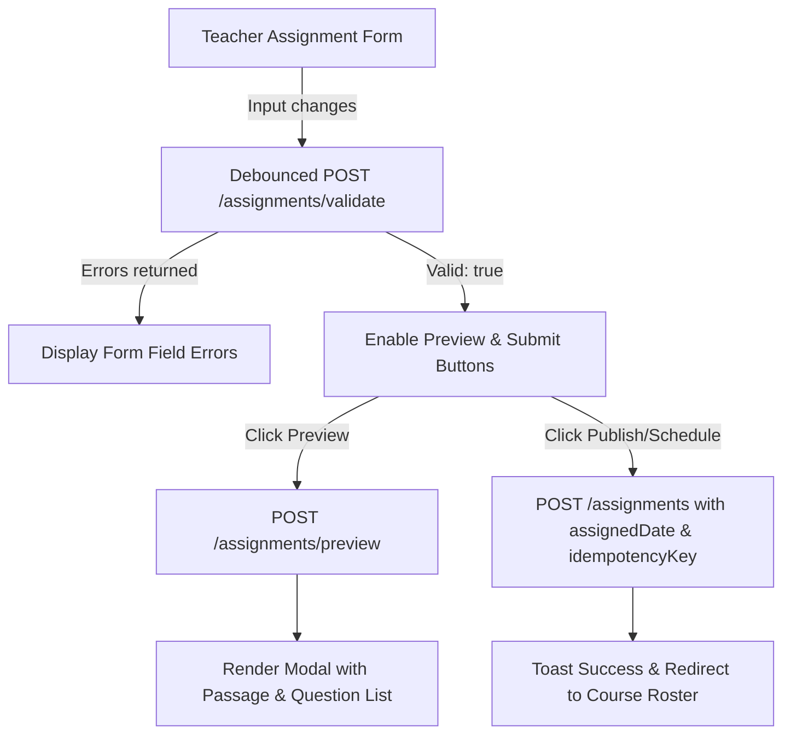
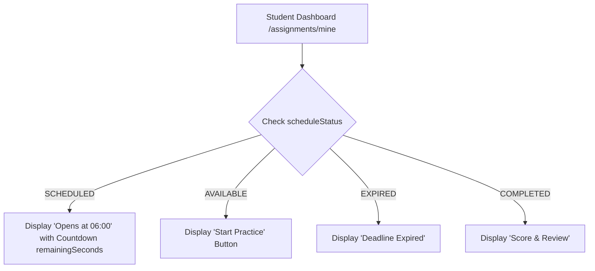

# PHASE 10 — FRONTEND INTEGRATION & HANDOFF GUIDE

**Target Consumer:** Frontend Engineering Team (Next.js 14/15 App Router, React 19 / TanStack Query, TailwindCSS, Shadcn UI)  
**Backend Base URL:** `http://localhost:3000/api/v1` (Production: `https://api.ielts-lms.edu.vn/api/v1`)  
**OpenAPI Specification:** [docs/openapi.json](file:///d:/WEB-IELTS/docs/openapi.json)  
**API Contract:** [docs/FRONTEND_API_CONTRACT.md](file:///d:/WEB-IELTS/docs/FRONTEND_API_CONTRACT.md)  
**Date:** November 14, 2026

---

## 1. Overview & High-Level Architecture

Phase 10 standardizes Daily IELTS Assignment Scheduling and Teacher-Configurable IELTS Assignments:
1. **Fixed Daily Assignment Window:**
   - Daily assignments are bound to local Vietnam time (`Asia/Ho_Chi_Minh`, +07:00).
   - Time interval: `[06:00:00, 06:00:00 following day)` — exactly 24 hours.
   - Timestamps stored in UTC, companion `+07:00` display strings (`availableAtVn`, `dueAtVn`, `openAtVn`, `deadlineAtVn`) provided for UI formatting.
2. **Standardized Status Lifecycle:**
   - `DRAFT`: Teacher draft, invisible to students.
   - `SCHEDULED`: Assignment date is in the future (`now < availableAt`). Visible on student calendar/dashboard with countdown timer, but content (passages, questions, audio) is strictly locked.
   - `AVAILABLE`: Currently open for student attempts (`availableAt <= now < dueAt`).
   - `EXPIRED`: Deadline has passed (`now >= dueAt`). No new attempts permitted.
   - `COMPLETED`: Student has completed the assignment.
3. **Zero-Leakage Security for Scheduled Homework:**
   - `GET /assignments/mine` returns `scheduleStatus: "SCHEDULED"`, `isAvailable: false`, and `remainingSeconds`.
   - `GET /assignments/:id` returns metadata only; `exercise` snapshot excludes `passage` and `questions`.
   - Starting an attempt before `availableAt` is rejected with HTTP 403 `ASSIGNMENT_NOT_YET_AVAILABLE`.
4. **Deadline-Capped Attempt Timer:**
   - Attempt expiration is strictly capped: `expiresAt = min(startedAt + duration, effectiveDeadlineAt)`.
5. **Decoupled Course Target vs. 70% Translation Unlock:**
   - Teachers configure passing criteria `targetScorePercent` (default 70).
   - Reading translation unlock strictly remains tied to the unrounded 70% IELTS threshold.
6. **Form Validation & Preview Endpoints:**
   - `POST /api/v1/assignments/validate`: Validates form configurations without writing to DB.
   - `POST /api/v1/assignments/preview`: Generates full preview data (passage, questions, total points, enrolled students).
   - `GET /api/v1/assignments/:id/preview`: Full preview of an existing assignment for teacher/admin.

---

## 2. Step-by-Step UI Integration Flows

### Flow 1: Teacher Form Validation & Live Preview



#### Step 1: Validate Form Data
```ts
// POST /api/v1/assignments/validate
const payload = {
  courseId: "673238901111222233334444",
  exerciseId: "673238905555666677778888",
  assignedDate: "2026-11-28", // YYYY-MM-DD
  requiredScope: "PART",
  requiredPartId: "673238902222333344445555",
  selectedQuestionGroupIds: ["673238909999000011112222"],
  targetScorePercent: 75,
  durationSecondsOverride: 1800,
};

const res = await api.post("/assignments/validate", payload);
// res.data -> { valid: true, errors: [] }
```

#### Step 2: Live Preview
```ts
// POST /api/v1/assignments/preview
const res = await api.post("/assignments/preview", payload);
// res.data -> {
//   title: "Climate Change Reading Test",
//   availableAtVn: "2026-11-28T06:00:00+07:00",
//   dueAtVn: "2026-11-29T06:00:00+07:00",
//   questionCount: 5,
//   totalPoints: 5,
//   enrolledStudentsCount: 24,
//   passage: "<p>Passage HTML...</p>",
//   questions: [...]
// }
```

#### Step 3: Create Assignment (Idempotent)
```ts
// POST /api/v1/assignments
const res = await api.post("/assignments", {
  ...payload,
  idempotencyKey: crypto.randomUUID(),
});
```

---

### Flow 2: Student Dashboard & Countdown



1. **Dashboard Query:**
   ```ts
   // GET /api/v1/assignments/mine
   const res = await api.get("/assignments/mine");
   // Each item contains:
   // {
   //   id: "...",
   //   title: "Daily Reading Passage 1",
   //   assignedDate: "2026-11-28",
   //   availableAtVn: "2026-11-28T06:00:00+07:00",
   //   dueAtVn: "2026-11-29T06:00:00+07:00",
   //   scheduleStatus: "SCHEDULED" | "AVAILABLE" | "EXPIRED" | "COMPLETED",
   //   isAvailable: boolean,
   //   remainingSeconds: number,
   //   isTargetAchieved: boolean
   // }
   ```

2. **Starting an Attempt:**
   ```ts
   // POST /api/v1/exam-attempts
   const res = await api.post("/exam-attempts", {
     assignmentId: item.id,
     mode: "FULL" // or "PART"
   });
   // Attempt expiration is automatically capped:
   // res.data.expiresAt <= assignment.dueAt
   ```

---

## 3. Error Codes & Handling Guide

| HTTP Status | Error Code | Meaning | Recommended UI Action |
|-------------|------------|---------|-----------------------|
| 400 | `ASSIGNMENT_VALIDATION_FAILED` | Invalid configuration parameters | Highlight specific invalid fields using `errors` array |
| 403 | `ASSIGNMENT_NOT_YET_AVAILABLE` | Attempt started before 06:00 VN opening | Show lock icon with `availableAtVn` open countdown |
| 400 | `ASSIGNMENT_EXPIRED` | Assignment due date passed | Disable start button, prompt for extension request |
| 409 | `ATTEMPT_ALREADY_IN_PROGRESS` | Active unfinished attempt exists | Prompt student to "Resume current attempt" |
| 403 | `TRANSLATION_LOCKED` | Translation accessed without achieving 70% | Display notification: "Achieve ≥ 70% on Reading test to unlock Vietnamese translation" |

---

## 4. Verification & Testing Checklist

- [x] Fixed 06:00 VN daily window tested via AC-01.
- [x] Countdown timer and scheduled status on `/assignments/mine` verified via AC-02.
- [x] Zero-leakage verification: questions/passages strictly omitted for scheduled assignments via AC-03.
- [x] Attempt start rejection (403 `ASSIGNMENT_NOT_YET_AVAILABLE`) verified via AC-04.
- [x] Form validation endpoint `POST /assignments/validate` verified via AC-05a & AC-05b.
- [x] Dry-run preview endpoint `POST /assignments/preview` verified via AC-06a.
- [x] Question group subset filtering verified via AC-07.
- [x] Client idempotency deduplication verified via AC-08.
- [x] Active assignment execution during available window verified via AC-09.
- [x] Deadline-capped attempt timer verified via AC-10.
- [x] Decoupled course target score vs. 70% translation unlock verified via AC-11 & AC-11b.

