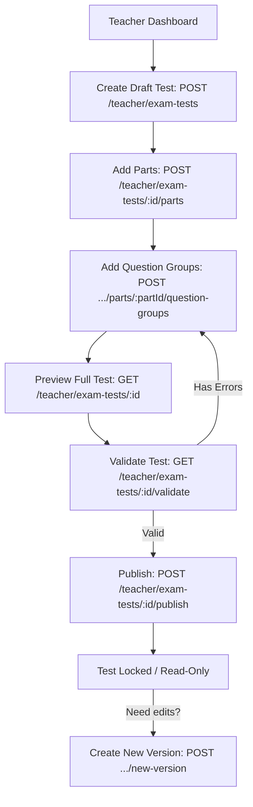
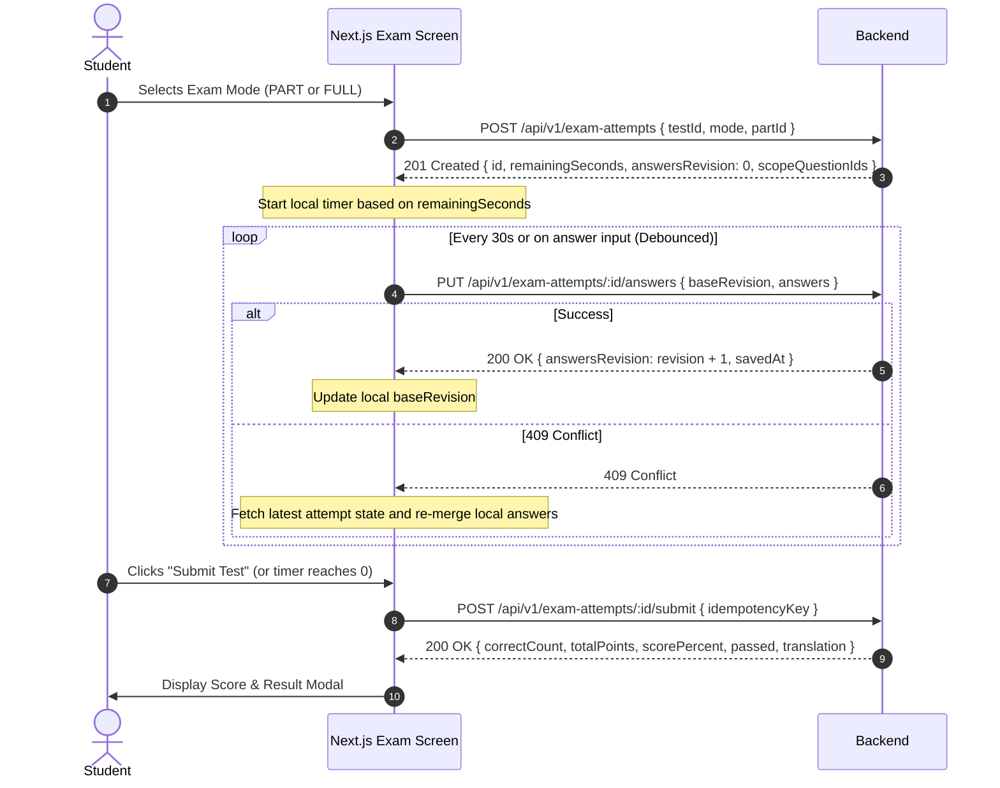

# PHASE 9 — FRONTEND INTEGRATION & HANDOFF GUIDE

**Target Consumer:** Frontend Engineering Team (Next.js 14/15 App Router, React 19 / TanStack Query, TailwindCSS, Shadcn UI)  
**Backend Base URL:** `http://localhost:3000/api/v1` (Production: `https://api.ielts-lms.edu.vn/api/v1`)  
**OpenAPI Specification:** [docs/openapi.json](file:///d:/WEB-IELTS/docs/openapi.json)  
**API Contract:** [docs/FRONTEND_API_CONTRACT.md](file:///d:/WEB-IELTS/docs/FRONTEND_API_CONTRACT.md)  
**Date:** November 12, 2026

---

## 1. Overview & High-Level Architecture

Phase 9 introduces IELTS Exam Practice Modes, Teacher Question Bank Authoring, Server-Side Auto-Grading (14 question types), and Reading Translation Unlocking.

### Core Architecture Concepts
1. **Hierarchical Test Structure:** `ExamTest` -> `ExamPart` (Passages 1–3 or Sections 1–4) -> `QuestionGroup` -> `ExamQuestion`.
2. **Two Exam Modes:**
   - **`PART` mode:** Single passage/section practice. Scored against that part's total points only.
   - **`FULL` mode:** Full IELTS exam simulation. Continuous global question numbering (e.g., 1–40). Scored against all questions.
3. **Session Lifecycle & Autosave:**
   - `ExamAttempt` tracks student session state (`startedAt`, `expiresAt`, `answersRevision`, `savedAnswers`).
   - Autosave endpoint `PUT /exam-attempts/:id/answers` uses optimistic locking (`baseRevision`).
4. **Zero-Leakage Security Guarantee:**
   - Student test & part endpoints NEVER send `grading` (acceptedKeys, explanation, scoringStrategy).
   - Explanations and correct answers are only revealed via `/exam-attempts/:id/review` AFTER submission.
5. **Dynamic Reading Translation Unlock:**
   - PASS threshold is unrounded `≥ 70%` (e.g. 7/10 or 14/20 is PASS; 6.99/10 is FAIL).
   - In `PART` mode: PASS unlocks **only** that specific Passage.
   - In `FULL` mode: PASS unlocks **all** Passages in the exam.
   - Any attempt to access locked translations returns HTTP 403 with `{ error: "TRANSLATION_LOCKED" }`.

---

## 2. Step-by-Step UI Integration Guides

### Flow 1: Teacher Question Bank Authoring



1. **Create Draft Test:**
   `POST /api/v1/teacher/exam-tests`
   ```json
   {
     "title": "Cambridge IELTS 18 - Reading Test 1",
     "skill": "READING",
     "allowedModes": ["PART", "FULL"],
     "passScore": 70,
     "fullDurationSeconds": 3600,
     "translationEnabled": true,
     "examPreset": "IELTS_ACADEMIC"
   }
   ```
2. **Add Part (Passage or Section):**
   `POST /api/v1/teacher/exam-tests/:id/parts`
   ```json
   {
     "type": "PASSAGE",
     "ordinal": 1,
     "title": "Passage 1: Urban Farming in Megacities",
     "contentHtml": "<p>Urban farming is revolutionizing urban food supply...</p>",
     "durationSeconds": 1200
   }
   ```
3. **Add Question Group & Questions:**
   `POST /api/v1/teacher/exam-tests/:id/parts/:partId/question-groups`
   Supported 14 question types:
   - `MULTIPLE_CHOICE_SINGLE`, `MULTIPLE_CHOICE_MULTIPLE`
   - `TRUE_FALSE_NOT_GIVEN`, `YES_NO_NOT_GIVEN`
   - `MATCHING_HEADINGS`, `MATCHING_INFORMATION`, `MATCHING_FEATURES`, `MATCHING_SENTENCE_ENDINGS`
   - `SENTENCE_COMPLETION`, `SUMMARY_COMPLETION`, `NOTE_COMPLETION`, `TABLE_COMPLETION`, `FLOW_CHART_COMPLETION`, `SHORT_ANSWER`
4. **Validate & Publish:**
   - Call `GET /api/v1/teacher/exam-tests/:id/validate`. If `valid: false`, display the list of `errors`.
   - Once validated, call `POST /api/v1/teacher/exam-tests/:id/publish`. The test is now immutable (`PUBLISHED`) and accessible in the student catalog.
5. **Editing Published Tests:**
   Published tests cannot be mutated directly. Call `POST /api/v1/teacher/exam-tests/:id/new-version` to create a `DRAFT` copy with `version = version + 1`.

---

### Flow 2: Student Exam Experience (Taking PART or FULL Test)



#### Frontend Implementation Checklist for Exam Screen:
1. **Timer Management:**
   - When receiving `remainingSeconds` from `POST /exam-attempts` or `GET /exam-attempts/:id`, initialize a countdown.
   - When the countdown reaches `0`, automatically trigger `POST /exam-attempts/:id/submit`.
2. **Autosave Handling:**
   - Keep a local `answersRevision` state (starts at `0`).
   - Every 30 seconds or on student input (debounced by 2 seconds), send:
     ```json
     {
       "baseRevision": currentRevision,
       "answers": [ { "questionId": "1", "value": "TRUE" } ]
     }
     ```
   - On HTTP 200: Update `currentRevision = res.data.answersRevision`.
   - On HTTP 409 Conflict: A concurrent session or retry updated the revision. Fetch `GET /exam-attempts/:id`, merge any non-conflicting answers, update `currentRevision`, and resume autosaving.
3. **Review & Explanations Screen:**
   - Call `GET /api/v1/exam-attempts/:id/review` to fetch complete review data.
   - Highlight student answers vs accepted answers, and display teacher explanations.

---

### Flow 3: Reading Translation Unlock & Submission Flow

```mermaid
flowchart TD
    A[Student opens Reading Translation tab] --> B[GET /reading-translations/eligibility?testId=xxx]
    B --> C{Passage Unlocked?}
    C -->|No: score < 70%| D[Display Lock Badge: 'Hoàn thành bài thi đạt >= 70% để mở khóa']
    D --> E[Disable Editing / Textarea]
    C -->|Yes: score >= 70%| F[Enable Translation Workspace]
    F --> G[Edit draft: POST .../draft { textVi }]
    G --> H[Submit: POST .../submit { textVi }]
    H --> I[Status: SUBMITTED - Awaiting Teacher Review]
    I --> J[Teacher Reviews: PATCH /teacher/reading-translations/:id/review]
    J --> K[Status: REVIEWED - Score & Teacher Feedback displayed]
```

#### Eligibility Response Shape:
`GET /api/v1/reading-translations/eligibility?testId=<testId>`
```json
{
  "statusCode": 200,
  "data": {
    "testId": "673238901111...",
    "translationEnabled": true,
    "passages": [
      {
        "passageId": "673238902222...",
        "title": "Passage 1: Urban Farming in Megacities",
        "ordinal": 1,
        "unlocked": true,
        "submissionStatus": "DRAFT",
        "bestScorePercent": 80
      },
      {
        "passageId": "673238903333...",
        "title": "Passage 2: The History of Glassmaking",
        "ordinal": 2,
        "unlocked": false,
        "submissionStatus": "LOCKED",
        "bestScorePercent": 50
      }
    ]
  }
}
```

#### Handling HTTP 403 `TRANSLATION_LOCKED`:
If a student attempts to POST a draft or submission to a locked passage:
```json
{
  "statusCode": 403,
  "error": "Forbidden",
  "message": "TRANSLATION_LOCKED: Passage translation is locked. Student must score at least 70% on this passage or the full test to unlock."
}
```
**Frontend Action:** Display an informative toast / modal explaining that they must score at least 70% on that passage (or full test) to unlock Vietnamese translation.

---

### Flow 4: Media Audio Playback for Listening Exams

1. **Teacher Audio Upload Intent:**
   - Teacher selects an MP3/WAV file.
   - Frontend calls `POST /api/v1/media/audio/upload-intent`:
     ```json
     { "filename": "ielts-test1-section1.mp3", "contentType": "audio/mpeg", "sizeBytes": 10485760 }
     ```
   - Backend returns `{ uploadUrl, assetId, storagePath }`.
   - Frontend directly uploads the audio file to `uploadUrl` via PUT request.
   - When creating or editing a Section in the question bank, pass the `assetId` or `audioUrl` into `audioMetadata`.
2. **Student Secure Audio Playback:**
   - Call `GET /api/v1/media/audio/:assetId/playback`.
   - Backend returns `{ playbackUrl, expiresAt }`.
   - Bind `playbackUrl` to HTML5 `<audio>` tag or custom audio player component.

---

## 3. Standard Status Mappings for Frontend Display

| Entity | Backend Field | Values (API Envelope) | Badge Color / UI Treatment |
|---|---|---|---|
| Exam Test | `status` | `DRAFT`, `PUBLISHED`, `ARCHIVED` | Yellow (`DRAFT`), Green (`PUBLISHED`), Gray (`ARCHIVED`) |
| Exam Attempt | `status` | `IN_PROGRESS`, `SUBMITTED`, `EXPIRED`, `ABANDONED` | Blue (`IN_PROGRESS`), Green (`SUBMITTED`), Red (`EXPIRED`) |
| Translation | `status` | `LOCKED`, `DRAFT`, `SUBMITTED`, `REVIEWED` | Gray (`LOCKED`), Amber (`DRAFT`), Blue (`SUBMITTED`), Emerald (`REVIEWED`) |
| Exam Skill | `skill` | `READING`, `LISTENING` | Emerald (`READING`), Violet (`LISTENING`) |
| Exam Mode | `mode` | `PART`, `FULL` | Teal (`PART`), Indigo (`FULL`) |

---

## 4. Error Code Reference

| Status Code | Error Message / Pattern | Suggested Frontend Handling |
|---|---|---|
| `400 Bad Request` | Validation failure (array of field errors) | Show inline form field errors |
| `401 Unauthorized` | Invalid/expired JWT | Trigger refresh token flow or redirect to `/login` |
| `403 Forbidden` | `TRANSLATION_LOCKED` | Show modal prompting student to practice and achieve ≥ 70% |
| `403 Forbidden` | Course enrollment or role forbidden | Show permission denied banner |
| `409 Conflict` | `baseRevision mismatch` | Refresh attempt data and re-merge local input |
| `409 Conflict` | Test already published or idempotent submit duplicate | Notify user that state has already advanced |

---
*End of Frontend Handoff Guide.*

