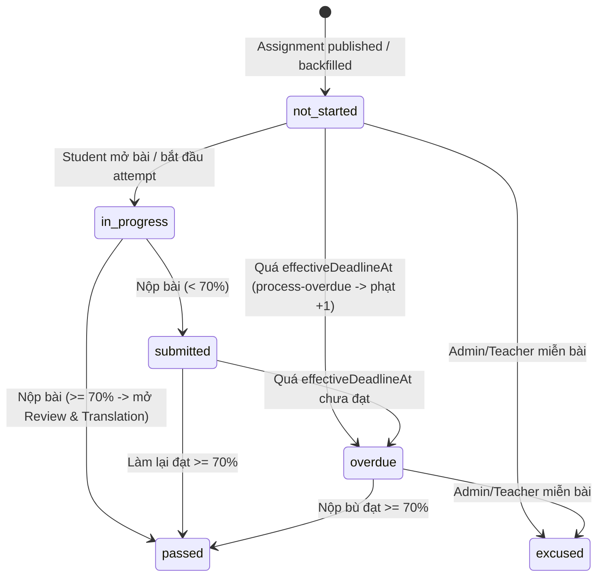

# 02 — Courses, Lessons, Assignments, Student Assignments & Deadlines Contract

**Lifecycle Status:** `Canonical`  
**Backend Controllers:** `courses.controller.ts`, `lessons.controller.ts`, `assignments.controller.ts`, `student-assignments.controller.ts`, `deadlines.controller.ts`  
**Frontend Consumers:** `frontend/src/lib/api/endpoints/{courses.ts,lessons.ts,assignments.ts,student-assignments.ts}`

---

## 1. Domain Scope & Business Invariants

1. **Courses & Enrollments (`/courses`):**
   - Chỉ `ADMIN` được tạo (`POST /courses`) hoặc xóa/archive (`DELETE /courses/:id`).
   - `TEACHER` chỉ được xem, sửa các trường được phép và quản lý học viên trong **khóa học mà mình là `teacherId`**.
   - **Khóa 1:1 (`type: 'one_to_one'`):** DB bảo vệ atomic bằng partial unique index `unique_active_one_to_one_course` (`isOneToOneActive: true`) — tối đa **1 học viên `active`** tại một thời điểm.
   - `DELETE /courses/:id`: từ chối nếu còn học viên `active`; nếu đã có lịch sử enrollment/assignment/lesson thì chuyển `status = 'archived'` thay vì hard-delete.
2. **Lessons (`/lessons` & `/courses/:courseId/lessons`):**
   - Thời gian chuẩn lưu UTC (`startAt`, `endAt`); DTO chấp nhận alias FE (`startTime`, `endTime`, `description` ↔ `content`).
   - `meetUrl` bắt buộc giao thức `https://`.
   - `PATCH /lessons/:id/cancel` và `DELETE /lessons/:id` đều là **soft-cancel** (`status = 'cancelled'`), giữ nguyên lịch sử.
3. **Assignments (`/assignments`):**
   - Khi tạo assignment, Backend chụp `exerciseSnapshot` bất biến (`select: false`) để đảm bảo chấm điểm deterministic ngay cả khi đề gốc đổi version.
   - Hỗ trợ giao theo ngày VN (`assignedDate` / `targetDate`: `YYYY-MM-DD` → tự tính `openAt = 06:00:00` ngày đó và `deadlineAt = 06:00:00` ngày hôm sau theo giờ `Asia/Ho_Chi_Minh`) hoặc truyền trực tiếp `openAt`/`deadlineAt`/`dueAt` (UTC ISO).
   - Hỗ trợ cả **Exam V2** (`examTestId`, `requiredScope: 'PART' | 'FULL'`, `requiredPartId`, `allowedModes`, `durationSecondsOverride`, `selectedQuestionGroupIds`, `customQuestionGroups`) lẫn đề legacy (`exerciseId`).
4. **Student Assignments (`/student-assignments`):**
   - Trước giờ `openAt` (`now < openAt`): Student gọi `GET /student-assignments/:id` nhận `isLocked: true` và `questions: []`, `passageHtml: ""`, `audioAssetId: undefined`.
   - Sau giờ mở: Student nhận câu hỏi đã sanitize (tuyệt đối không có `answerSpecification`, `grading`, `correctAnswer`, `explanation`).
   - **Answer Review & Translation Unlock:** chỉ mở khóa khi Student đạt **PASS (`>= 70%` hoặc `isTargetAchieved`)**; nếu chưa đạt, `GET /student-assignments/:id/review` trả `403 Forbidden`.
5. **Deadlines (`/deadlines`):**
   - `POST /deadlines/process-overdue` quét các `StudentAssignment` quá `effectiveDeadlineAt` chưa PASS và ghi điểm phạt `+1` vào `penalty_transactions` theo cơ chế **idempotent** (không bao giờ phạt trùng).

---

## 2. State Machine — `StudentAssignment` & Deadline Flow



---

## 3. Endpoint Summary Table

| Method | Full Path (`/api/v1/...`) | Auth / Roles | FE Consumer | Status |
| :--- | :--- | :--- | :--- | :--- |
| `POST` | `/courses` | `ADMIN` | `coursesApi.create` | Canonical |
| `GET` | `/courses` | `ADMIN`, `TEACHER`, `STUDENT` | `coursesApi.list` | Canonical |
| `GET` | `/courses/mine` | Authenticated | `coursesApi.listMine` | Canonical |
| `GET` | `/courses/:id` | Authenticated (scoped) | `coursesApi.getById` | Canonical |
| `PATCH` | `/courses/:id` | `ADMIN`, `TEACHER` | `coursesApi.update` | Canonical |
| `DELETE` | `/courses/:id` | `ADMIN` | *(BE-only)* | Canonical |
| `GET` | `/courses/:id/students` | `ADMIN`, `TEACHER` | `coursesApi.listStudents` | Canonical |
| `POST` | `/courses/:id/students` | `ADMIN`, `TEACHER` | `coursesApi.addStudent` | Canonical |
| `DELETE` | `/courses/:id/students/:studentId` | `ADMIN`, `TEACHER` | `coursesApi.removeStudent` | Canonical |
| `POST` | `/lessons` | `ADMIN`, `TEACHER` | `lessonsApi.create` *(xem Drift P0)* | Canonical |
| `GET` | `/lessons` | Authenticated | *(BE alias)* | Canonical |
| `POST` | `/courses/:courseId/lessons` | `ADMIN`, `TEACHER` | *(Canonical nested)* | Canonical |
| `GET` | `/courses/:courseId/lessons` | Authenticated (scoped) | *(Canonical nested)* | Canonical |
| `GET` | `/lessons/mine` | Authenticated | `lessonsApi.list` | Canonical |
| `GET` | `/lessons/:id` | Authenticated (scoped) | *(BE-only)* | Canonical |
| `PATCH` | `/lessons/:id` | `ADMIN`, `TEACHER` | `lessonsApi.update` | Canonical |
| `PATCH` | `/lessons/:id/cancel` | `ADMIN`, `TEACHER` | *(BE-only)* | Canonical |
| `DELETE` | `/lessons/:id` | `ADMIN`, `TEACHER` | *(BE-only, soft-cancel)* | Canonical |
| `POST` | `/assignments` | `ADMIN`, `TEACHER` | `assignmentsApi.create` | Canonical |
| `POST` | `/assignments/validate` | `ADMIN`, `TEACHER` | *(BE-only)* | Canonical |
| `POST` | `/assignments/preview` | `ADMIN`, `TEACHER` | *(BE-only)* | Canonical |
| `GET` | `/assignments/:id/preview` | `ADMIN`, `TEACHER` | *(BE-only)* | Canonical |
| `GET` | `/assignments` | `ADMIN`, `TEACHER` | `assignmentsApi.listByCourse` | Canonical |
| `GET` | `/assignments/course/:courseId` | `ADMIN`, `TEACHER`, `STUDENT` | `assignmentsApi.listByCourse` *(mock)* | Canonical |
| `GET` | `/assignments/mine` | `STUDENT` | `assignmentsApi.listMine` | Canonical |
| `GET` | `/assignments/:id` | `ADMIN`, `TEACHER`, `STUDENT` | `assignmentsApi.getById` | Canonical |
| `PATCH` | `/assignments/:id` | `ADMIN`, `TEACHER` | `assignmentsApi.update` *(xem Drift P0)* | Canonical |
| `GET` | `/assignments/:id/students` | `ADMIN`, `TEACHER` | `assignmentsApi.listStudents` | Canonical |
| `POST` | `/assignments/:id/backfill-students` | `ADMIN`, `TEACHER` | *(BE-only)* | Canonical |
| `GET` | `/student-assignments/:id` | `STUDENT`, `TEACHER`, `ADMIN` | `studentAssignmentsApi.getDetail` | Canonical |
| `POST` | `/student-assignments/:id/submissions` | `STUDENT` | `studentAssignmentsApi.submitAnswers` | Canonical (Hybrid) |
| `GET` | `/student-assignments/:id/submissions` | `STUDENT`, `TEACHER`, `ADMIN` | `studentAssignmentsApi.listSubmissions` | Canonical (Hybrid) |
| `GET` | `/student-assignments/:id/review` | `STUDENT`, `TEACHER`, `ADMIN` | `studentAssignmentsApi.getReview` | Canonical |
| `GET` | `/student-assignments/:id/translation` | `STUDENT`, `TEACHER`, `ADMIN` | `studentAssignmentsApi.getTranslation` | Canonical (Hybrid) |
| `PUT` | `/student-assignments/:id/translation/draft` | `STUDENT` | `studentAssignmentsApi.saveTranslationDraft` | Canonical (Hybrid) |
| `POST` | `/student-assignments/:id/translation/submit` | `STUDENT` | `studentAssignmentsApi.submitTranslation` | Canonical (Hybrid) |
| `POST` | `/student-assignments/:id/extensions` | `STUDENT` | `extensionsApi.createForAssignment` | Canonical |
| `POST` | `/deadlines/process-overdue` | `ADMIN`, `TEACHER` | *(Ops/Admin)* | Internal/Ops |
| `GET` | `/deadlines/overdue` | `ADMIN`, `TEACHER` | *(Ops/Admin)* | Internal/Ops |

---

## 4. Detailed Endpoint Specifications

### 4.1 Courses (`/courses`)

#### `POST /api/v1/courses` (`ADMIN`, HTTP 201)
- **Body (`CreateCourseDto`):**
  ```ts
  {
    code: string;        // 2..50 chars, unique (uppercase)
    title: string;       // 3..200 chars
    description?: string;
    startBand: number;   // 0..9, step 0.5 (@IsIeltsBand)
    targetBand: number;  // 0..9, step 0.5 (@IsIeltsBand)
    type?: "one_to_one" | "group";
    courseType?: string; // alias FE ("1:1" | "group")
    teacherId: string;   // @IsMongoId()
    startAt?: string;    // ISO DateString
    startDate?: string;  // FE alias
    endAt?: string;      // ISO DateString
    endDate?: string;    // FE alias
    timezone?: string;
    status?: CourseStatus; // auto-lowercased
  }
  ```
- **Errors:** `409 Conflict` (trùng `code`), `400 Bad Request`.

#### `GET /api/v1/courses` & `GET /api/v1/courses/mine` (HTTP 200)
- **Query (`CourseQueryDto`):** `page` (default `1`), `limit` (default `20`, max `100`), `status?: CourseStatus`, `type?: CourseType`, `search?: string`.
- **Scoping:** `STUDENT` chỉ thấy lớp đã enroll (`findMine`); `TEACHER` chỉ thấy lớp được phân công; `ADMIN` thấy toàn bộ.

#### `PATCH /api/v1/courses/:id` (`ADMIN`, `TEACHER`, HTTP 200)
- **Body (`UpdateCourseDto`):** Toàn bộ các field optional trừ `code`. Teacher chỉ sửa được các field được phép trên khóa của mình.

#### `POST /api/v1/courses/:id/students` (`ADMIN`, `TEACHER`, HTTP 201)
- **Body (`AddStudentDto`):** `{ studentId: string (@IsMongoId) }`.
- **Errors:** `409 Conflict` nếu học viên đã enroll (`ALREADY_ENROLLED`) hoặc lớp `one_to_one` đã có 1 học viên active (`COURSE_ONE_ON_ONE_LIMIT`).

#### `DELETE /api/v1/courses/:id/students/:studentId` (`ADMIN`, `TEACHER`, HTTP 200)
- Chuyển enrollment sang `dropped`, ghi `leftAt` và push vào `history[]`, giải phóng `isOneToOneActive`.

---

### 4.2 Lessons (`/lessons`, `/courses/:courseId/lessons`)

#### `POST /api/v1/courses/:courseId/lessons` & `POST /api/v1/lessons` (`ADMIN`, `TEACHER`, HTTP 201)
- **Body (`CreateLessonDto`):**
  ```ts
  {
    title: string;        // 2..200 chars
    startAt?: string;     // UTC ISO (canonical)
    startTime?: string;   // UTC ISO (FE alias)
    endAt?: string;       // UTC ISO (canonical)
    endTime?: string;     // UTC ISO (FE alias)
    meetUrl?: string;     // @IsUrl({ protocols: ['https'], require_protocol: true })
    content?: string;     // max 5000
    description?: string; // max 5000 (FE alias)
    status?: LessonStatus; // default "scheduled"
    type?: LessonType;     // default "live_meet"
    timezone?: string;
  }
  ```
- **Cảnh báo Drift:** `POST /lessons` cần `courseId` trong body nhưng `CreateLessonDto` không khai báo decorator cho `courseId` (xem `07-drift-audit-be-fe.md`). Khuyến nghị chuẩn: dùng `POST /courses/:courseId/lessons` hoặc bổ sung `@IsOptional() @IsMongoId() courseId?: string` vào `CreateLessonDto`.

#### `GET /api/v1/lessons/mine`, `GET /api/v1/lessons`, `GET /api/v1/courses/:courseId/lessons` (HTTP 200)
- **Query (`LessonQueryDto`):** `page` (default `1`), `limit` (default `20`, max `100`), `courseId?: ObjectId`, `from?: ISO`, `to?: ISO`, `status?: LessonStatus`.
- **Response (`data`):** Paginated `{ items, total, page, limit }` kèm `startAtVn`, `endAtVn` (giờ VN).

---

### 4.3 Assignments (`/assignments`)

#### `POST /api/v1/assignments` (`ADMIN`, `TEACHER`, HTTP 201)
- **Body (`CreateAssignmentDto`):**
  ```ts
  {
    courseId: string;                    // @IsMongoId()
    exerciseId?: string;                 // @IsMongoId() (Exercise hoặc ExamTest ID)
    examTestId?: string;                 // @IsMongoId() (alias cho ExamTest V2)
    title?: string;                      // max 200
    targetDate?: string;                 // YYYY-MM-DD (VN)
    assignedDate?: string;               // YYYY-MM-DD (VN)
    openAt?: string;                     // UTC ISO
    deadlineAt?: string;                 // UTC ISO
    dueAt?: string;                      // UTC ISO alias
    timezone?: string;
    allowRetake?: boolean;               // default false
    maxAttempts?: number;                // min 1
    status?: AssignmentStatus;           // default "published"
    action?: "draft" | "schedule" | "publish";
    requiredScope?: "PART" | "FULL";     // default "FULL"
    requiredPartId?: string;
    allowedModes?: string[];
    durationSecondsOverride?: number;    // min 0
    selectedQuestionGroupIds?: string[];
    targetScorePercent?: number;         // default 70
    customQuestionGroups?: CreateQuestionGroupDto[];
    idempotencyKey?: string;
  }
  ```
- **Side Effects:** Tự động tạo `StudentAssignment` cho toàn bộ học viên đang `active` trong khóa học, gửi Notification (`new_assignment`) & xếp hàng email BullMQ.

#### `POST /api/v1/assignments/validate` & `POST /api/v1/assignments/preview` (`ADMIN`, `TEACHER`, HTTP 200)
- Nhận cùng `CreateAssignmentDto` để kiểm tra hợp lệ hoặc xem trước danh sách câu hỏi & sĩ số học viên trước khi tạo thật.

#### `PATCH /api/v1/assignments/:id` (`ADMIN`, `TEACHER`, HTTP 200)
- **Body (`UpdateAssignmentDto`):** `title?`, `assignedDate?` (`YYYY-MM-DD`), `openAt?`, `deadlineAt?` *(lưu ý: không có `dueAt`!)*, `allowRetake?`, `maxAttempts?`, `status?: AssignmentStatus`, `action?`, `requiredScope?`, `requiredPartId?`, `durationSecondsOverride?`, `selectedQuestionGroupIds?`, `targetScorePercent?`.

#### `GET /api/v1/assignments`, `GET /api/v1/assignments/course/:courseId`, `GET /api/v1/assignments/mine` (HTTP 200)
- **Query (`AssignmentQueryDto`):** `page` (default `1`), `limit` (default `20`, max `100`), `courseId?: ObjectId`, `status?: AssignmentStatus`, `from?: ISO`, `to?: ISO`.

#### `POST /api/v1/assignments/:id/backfill-students` (`ADMIN`, `TEACHER`, HTTP 200)
- Tạo bổ sung `StudentAssignment` cho các học viên mới được enroll sau khi assignment đã publish.

---

### 4.4 Student Assignments (`/student-assignments`)

- `GET /student-assignments/:id`: Trả về `StudentAssignmentDetail` (kèm `exercise` đã sanitize, `isLocked` nếu chưa tới `openAt`, `passed`, `answerReviewUnlocked`, `translationAvailable`).
- `POST /student-assignments/:id/submissions`: `STUDENT` nộp bài; chấp nhận `body.answers` dạng mảng `[{ questionId, value }]` hoặc map `{ [questionId]: value }`. Trả `{ submissionId, id, attemptNo, score, scorePercent, passed, isPassed, bestScore, answerReviewUnlocked, translationAvailable, submittedAt, feedback }`.
- `GET /student-assignments/:id/submissions`: Trả danh sách lịch sử nộp bài sort theo `attemptNo ASC`.
- `GET /student-assignments/:id/review`: Trả `{ studentAssignmentId, passed, score, items: [{ questionId, orderIndex, prompt, studentAnswer, correctAnswer, isCorrect, explanation }] }`. Student chưa PASS → `403 Forbidden`.
- `GET /student-assignments/:id/translation`: Trả workspace dịch Reading (`{ translationId, studentAssignmentId, passageTitle, passageHtml, draftText, status, teacherFeedback?, submittedAt?, reviewedAt? }`).
- `PUT /student-assignments/:id/translation/draft` & `POST /student-assignments/:id/translation/submit`: `STUDENT` lưu nháp / nộp bài dịch (chấp nhận `translatedText` hoặc `textVi`).
- `POST /student-assignments/:id/extensions`: `STUDENT` gửi đơn xin gia hạn (chấp nhận `requestedDeadlineAt` hoặc `requestedDueAt`, kèm `reason`).

---

### 4.5 Deadlines (`/deadlines`)

- `POST /api/v1/deadlines/process-overdue` (`ADMIN`, `TEACHER`, HTTP 200): Body `ProcessOverdueDto` (`{ courseId?: ObjectId, limit?: 1..500 (default 100) }`). Chạy idempotent quét bài quá hạn và ghi nhận điểm phạt `+1`.
- `GET /api/v1/deadlines/overdue` (`ADMIN`, `TEACHER`, HTTP 200): Query `courseId?`, `page?`, `limit?`. Trả danh sách bài quá hạn.
