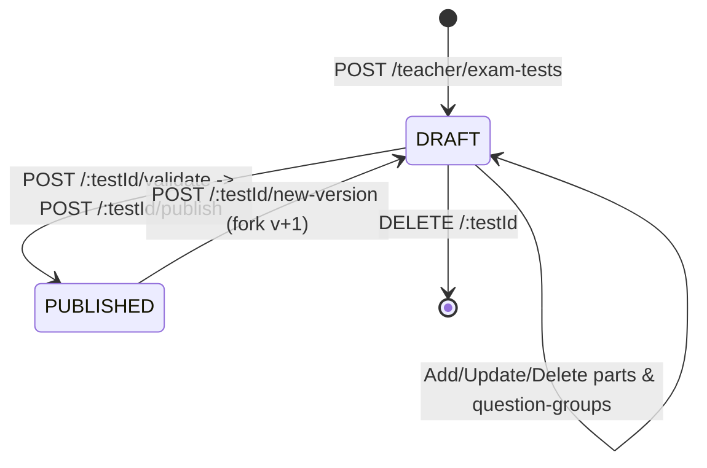
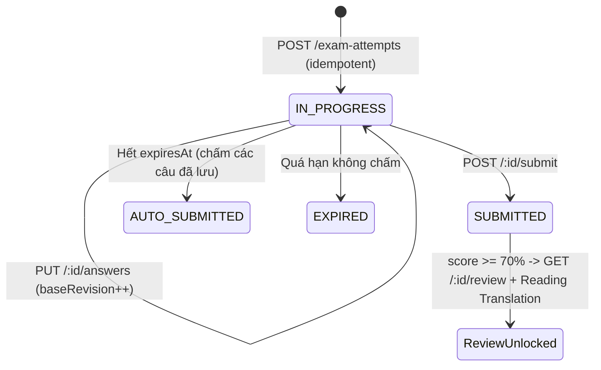

# 03 — Exam Modes V2, Attempts, Reading Translations & Media Contract

**Lifecycle Status:** `Canonical` (Luồng làm bài & ngân hàng đề chuẩn của hệ thống — dùng cho toàn bộ phát triển mới về Reading/Listening).  
**Backend Controllers:** `exam-tests.controller.ts` (`ExamTestsController` + `TeacherExamTestsController`), `exam-attempts.controller.ts`, `reading-translations.controller.ts` (`ReadingTranslationsController` + `TeacherReadingTranslationsController`), `media.controller.ts`  
**Frontend Consumers:** `frontend/src/lib/api/endpoints/{exam-tests.ts,teacher-exam-tests.ts,exam-attempts.ts,reading-translations.ts,media.ts}`

---

## 1. Domain Scope & Business Invariants

1. **Chế độ thi `PART` vs `FULL`:**
   - `PART`: bắt buộc truyền `partId` (ObjectId của `ExamPart`), chỉ chấm các câu thuộc part đó.
   - `FULL`: `partId = null`, làm toàn bộ passages/sections trong cùng 1 attempt, chuyển part không tạo attempt mới.
   - `PART` và `FULL` là **phạm vi chấm độc lập**.
2. **Bảo vệ đáp án tuyệt đối (Answer-Key Sanitization):**
   - `GET /exam-tests`, `GET /exam-tests/:testId`, `GET /exam-tests/:testId/parts/:partId`, `GET /exam-attempts/:id` **BẮT BUỘC** strip `grading`, `acceptedKeys`, `correctAnswer`, `explanation` ở tầng Backend response-mapper (Frontend cũng phòng thủ lớp 2 bằng `.strip()` trong `ExamQuestionPublicSchema`).
   - `GET /exam-attempts/:id/review` **chỉ mở khóa** khi attempt đã **PASS (`scorePercent >= passScore`, mặc định 70%)**.
3. **Đồng hồ & Optimistic Concurrency:**
   - Server quản lý `startedAt`, `expiresAt`, `serverTime`, `remainingSeconds`.
   - `PUT /exam-attempts/:id/answers` yêu cầu `baseRevision` để phát hiện xung đột multi-tab/multi-device (`ANSWERS_REVISION_CONFLICT`).
   - Hết giờ → tự động khóa autosave và chấm theo câu đã lưu (`AUTO_SUBMITTED` / `EXPIRED`).
4. **Mở khóa dịch Reading theo Passage (`reading-translations`):**
   - **Reading PART PASS** → mở khóa dịch đúng `passageId` đó.
   - **Reading FULL PASS** → mở khóa dịch toàn bộ passages trong bài test đó.
   - Passage đã mở khóa không bị khóa lại bởi attempt fail sau đó.
   - **Listening không có dịch bài** dù PASS.
5. **Versioning Đề thi (`teacher/exam-tests`):**
   - Chỉ đề ở trạng thái `DRAFT` mới được sửa metadata/parts/question-groups.
   - Đề đã `PUBLISHED` là bất biến; muốn sửa phải gọi `POST /teacher/exam-tests/:testId/new-version` để fork bản `DRAFT` mới (tăng `version`).

---

## 2. Lifecycle Diagrams





---

## 3. Endpoint Summary Table

| Method | Full Path (`/api/v1/...`) | Auth / Roles | Idempotency | FE Consumer | Status |
| :--- | :--- | :--- | :---: | :--- | :--- |
| `GET` | `/exam-tests` | Authenticated | — | `examTestsApi.list` | Canonical |
| `GET` | `/exam-tests/:testId` | Authenticated | — | `examTestsApi.getById` | Canonical |
| `GET` | `/exam-tests/:testId/parts/:partId` | Authenticated | — | `examTestsApi.getPart` | Canonical |
| `GET` | `/teacher/exam-tests` | `TEACHER`, `ADMIN` | — | `teacherExamTestsApi.list` | Canonical |
| `POST` | `/teacher/exam-tests` | `TEACHER`, `ADMIN` | — | `teacherExamTestsApi.create` | Canonical |
| `GET` | `/teacher/exam-tests/:testId` | `TEACHER`, `ADMIN` | — | `teacherExamTestsApi.getById` | Canonical |
| `PATCH` | `/teacher/exam-tests/:testId` | `TEACHER`, `ADMIN` | — | `teacherExamTestsApi.update` | Canonical |
| `POST` | `/teacher/exam-tests/:testId/parts` | `TEACHER`, `ADMIN` | — | `teacherExamTestsApi.addPart` | Canonical |
| `PATCH` | `/teacher/exam-tests/:testId/parts/:partId` | `TEACHER`, `ADMIN` | — | `teacherExamTestsApi.updatePart` | Canonical |
| `DELETE` | `/teacher/exam-tests/:testId/parts/:partId` | `TEACHER`, `ADMIN` | — | `teacherExamTestsApi.deletePart` | Canonical |
| `POST` | `/teacher/exam-tests/:testId/parts/:partId/question-groups` | `TEACHER`, `ADMIN` | — | `teacherExamTestsApi.addQuestionGroup` | Canonical |
| `PATCH` | `/teacher/exam-tests/:testId/question-groups/:groupId` | `TEACHER`, `ADMIN` | — | `teacherExamTestsApi.updateQuestionGroup` | Canonical |
| `POST` | `/teacher/exam-tests/:testId/validate` | `TEACHER`, `ADMIN` | — | `teacherExamTestsApi.validate` | Canonical |
| `GET` | `/teacher/exam-tests/:testId/preview` | `TEACHER`, `ADMIN` | — | `teacherExamTestsApi.preview` | Canonical |
| `POST` | `/teacher/exam-tests/:testId/publish` | `TEACHER`, `ADMIN` | — | `teacherExamTestsApi.publish` | Canonical |
| `POST` | `/teacher/exam-tests/:testId/new-version` | `TEACHER`, `ADMIN` | — | `teacherExamTestsApi.newVersion` | Canonical |
| `DELETE` | `/teacher/exam-tests/:testId` | `TEACHER`, `ADMIN` | — | `teacherExamTestsApi.delete` | Canonical |
| `GET` | `/exam-attempts` | Authenticated | — | `examAttemptsApi.list` | Canonical |
| `POST` | `/exam-attempts` | Authenticated | `idempotencyKey` | `examAttemptsApi.start` | Canonical |
| `GET` | `/exam-attempts/:id` | Authenticated (owner) | — | `examAttemptsApi.getById` | Canonical |
| `PUT` | `/exam-attempts/:id/answers` | Authenticated (owner) | `baseRevision` | `examAttemptsApi.saveAnswers` | Canonical |
| `POST` | `/exam-attempts/:id/submit` | Authenticated (owner) | `idempotencyKey` | `examAttemptsApi.submit` | Canonical |
| `GET` | `/exam-attempts/:id/result` | Authenticated (owner/staff) | — | `examAttemptsApi.getResult` | Canonical |
| `GET` | `/exam-attempts/:id/review` | Authenticated (PASS ≥70%) | — | `examAttemptsApi.getReview` | Canonical |
| `GET` | `/reading-translations/eligibility` | Authenticated | — | `readingTranslationsApi.getEligibility` | Canonical |
| `GET` | `/reading-translations/:passageId` | Authenticated | — | `readingTranslationsApi.getPassage` | Canonical |
| `PUT` | `/reading-translations/:passageId/draft` | Authenticated | `revision` | `readingTranslationsApi.saveDraft` | Canonical |
| `POST` | `/reading-translations/:passageId/submit` | Authenticated | — | `readingTranslationsApi.submit` | Canonical |
| `GET` | `/teacher/reading-translations` | `TEACHER`, `ADMIN` | — | `readingTranslationsApi.listTeacherQueue` *(xem Drift)* | Canonical |
| `POST` | `/teacher/reading-translations/:translationId/review` | `TEACHER`, `ADMIN` | — | `readingTranslationsApi.reviewTranslation` | Canonical |
| `PATCH` | `/teacher/reading-translations/:translationId/review` | `TEACHER`, `ADMIN` | — | *(BE PATCH alias)* | Canonical |
| `GET` | `/media/audio/:assetId/playback` | Authenticated | — | `mediaApi.getAudioPlayback` | Canonical |
| `POST` | `/media/audio/upload-intent` | `TEACHER`, `ADMIN` | — | `mediaApi.initAudioUpload` *(live)* | Canonical |
| `POST` | `/media/audio/upload-init` | `TEACHER`, `ADMIN` | — | `mediaApi.initAudioUpload` *(mock alias)* | Canonical |
| `POST` | `/media/audio/upload-complete` | `TEACHER`, `ADMIN` | — | `mediaApi.completeAudioUpload` *(mock)* | Canonical |

---

## 4. Detailed Endpoint Specifications

### 4.1 Student Exam Catalog (`/exam-tests`)
- `GET /exam-tests`: Query `ExamTestQueryDto` (`skill?: READING|LISTENING`, `mode?: PART|FULL`, `difficulty?`, `search?`, `status?`, `page=1`, `limit=20`). Chỉ trả đề `PUBLISHED`.
- `GET /exam-tests/:testId`: Trả metadata + `parts[]` đã sanitize + `activeAttempt?` của học viên hiện tại.
- `GET /exam-tests/:testId/parts/:partId`: Trả chi tiết 1 passage/section (stripped đáp án).

### 4.2 Teacher Exam Bank (`/teacher/exam-tests`)
- `POST /teacher/exam-tests` (`CreateExamTestDto`):
  ```ts
  {
    title: string;
    subtitle?: string;
    skill: "READING" | "LISTENING";
    description?: string;
    difficulty?: string;             // default "TARGET_65"
    tags?: string[];
    examPreset?: "IELTS_ACADEMIC" | "CUSTOM";
    allowedModes?: ("PART" | "FULL")[];
    passScore?: number;              // 0..100, default 70
    fullDurationSeconds?: number;    // >= 0
    translationEnabled?: boolean;    // default false
  }
  ```
- `PATCH /teacher/exam-tests/:testId` (`UpdateExamTestDto`): Toàn bộ trường optional (chỉ cho phép khi `DRAFT`, ngược lại `409 EXAM_VERSION_CONFLICT`).
- `POST /teacher/exam-tests/:testId/parts` (`CreateExamPartDto`): `{ type: "PASSAGE" | "SECTION", ordinal: number (>=1), title: string, contentHtml?: string, audioAssetId?: string, durationSeconds?: number }`.
- `PATCH /teacher/exam-tests/:testId/parts/:partId` (`UpdateExamPartDto`): `{ title?, ordinal?, contentHtml?, audioAssetId?, durationSeconds? }`.
- `POST /teacher/exam-tests/:testId/parts/:partId/question-groups` (`CreateQuestionGroupDto`):
  ```ts
  {
    title?: string;
    instruction?: string;
    type: ExamQuestionType;          // 15 loại chuẩn IELTS
    order: number;                   // >= 1
    sharedOptions?: { key: string; text: string }[];
    maxWords?: number;               // >= 1
    questions: {
      number: number;                // >= 1 (1-based global)
      prompt: string;
      type: ExamQuestionType;
      points: number;                // >= 0
      options?: { key: string; text: string }[];
      grading?: { acceptedKeys: string[]; caseSensitive?: boolean; maxWords?: number };
    }[];
  }
  ```
- `POST /teacher/exam-tests/:testId/validate` (HTTP 200): Trả `{ valid: boolean, errors: Issue[], warnings: Issue[] }`.
- `GET /teacher/exam-tests/:testId/preview`: Query `mode?: PART|FULL`, `partId?: string` — xem trước đúng góc nhìn học viên.
- `POST /teacher/exam-tests/:testId/publish` (HTTP 200) & `POST /teacher/exam-tests/:testId/new-version` (HTTP 201).

### 4.3 Exam Attempts (`/exam-attempts`)
- `GET /exam-attempts`: Query `testId?`, `status?`, `page?`, `limit?`. Trả danh sách attempt của chính học viên.
- `POST /exam-attempts` (`CreateExamAttemptDto`):
  ```ts
  {
    testId?: string;              // @IsMongoId()
    assignmentId?: string;        // @IsMongoId()
    mode: "PART" | "FULL";
    partId?: string | null;       // bắt buộc khi mode=PART, null khi mode=FULL
    studentAssignmentId?: string | null;
    idempotencyKey?: string;      // UUID v4 chống tạo trùng khi retry mạng
  }
  ```
- `PUT /exam-attempts/:id/answers` (`SaveAnswersDto`):
  ```ts
  {
    baseRevision: number; // >= 0 (optimistic concurrency)
    answers: { questionId: string; value: any }[] | Record<string, any>;
    flaggedQuestionIds?: string[];
  }
  ```
  - Trả `{ attemptId, revision, answeredCount, savedAt, serverTime, remainingSeconds }`.
  - Lỗi: `409 ANSWERS_REVISION_CONFLICT`, `400/410 ATTEMPT_EXPIRED`.
- `POST /exam-attempts/:id/submit` (HTTP 200, `SubmitAttemptDto`):
  `{ idempotencyKey?, expectedRevision?, answers?, flaggedQuestionIds? }`. Chấm điểm server-side, cập nhật `StudentAssignment` (nếu có gắn assignment và đúng `requiredScope`), trả `ExamResultResponse`.
- `GET /exam-attempts/:id/result`: Trả điểm, `passed`, `ieltsBandEstimate`, `partBreakdown`, `questionTypeBreakdown`, `answerReviewAvailable`, `translationEligible`.
- `GET /exam-attempts/:id/review`: Trả chi tiết từng câu + đáp án đúng + giải thích. Nếu chưa PASS → `403 ANSWER_REVIEW_LOCKED`.

### 4.4 Reading Translations (`/reading-translations` & `/teacher/reading-translations`)
- `GET /reading-translations/eligibility?testId=<id>&studentAssignmentId=<id>`: Trả trạng thái mở khóa từng passage (`LOCKED | UNLOCKED | DRAFT | SUBMITTED | REVIEWED`).
- `GET /reading-translations/:passageId?testId=<id>&studentAssignmentId=<id>`: Trả nội dung passage + bản dịch nháp/đã nộp + feedback giáo viên.
- `PUT /reading-translations/:passageId/draft` (`SaveTranslationDraftDto`): `{ testId?, studentAssignmentId?, exerciseVersion?, textVi: string, revision?: number }`. Nếu passage chưa mở khóa → `403 TRANSLATION_LOCKED`.
- `POST /reading-translations/:passageId/submit` (HTTP 200, `SubmitReadingTranslationDto`): `{ testId?, studentAssignmentId?, exerciseVersion?, textVi?: string, revision?: number }`.
- `GET /teacher/reading-translations` (`TeacherTranslationQueryDto`): Query `courseId?`, `status?: draft|submitted|reviewed`, `page=1`, `limit=20`. *(Lưu ý Drift: chưa hỗ trợ query `testId` mà FE đang truyền).*
- `POST` / `PATCH /teacher/reading-translations/:translationId/review` (`ReviewReadingTranslationDto`): `{ teacherComment?, feedback?, decision?: 'REVIEWED' | 'NEEDS_REVISION' | 'approved' | 'needs_revision' }`.

### 4.5 Media & Audio Storage (`/media/audio`)
- `GET /media/audio/:assetId/playback`: Trả signed stream URL `{ assetId, streamUrl, mimeType, durationSeconds?, expiresAt }`.
- `POST /media/audio/upload-intent` (và alias `POST /media/audio/upload-init`, `TEACHER`/`ADMIN`):
  - **Body (`AudioUploadIntentDto`):** `{ filename: string, mimeType: 'audio/mpeg' | 'audio/mp3' | 'audio/wav' | 'audio/ogg' | 'audio/m4a', fileSize: number (>= 1, max 50MB) }`.
  - **Response:** `{ assetId, uploadUrl, expiresAt }`. FE upload trực tiếp bằng `PUT uploadUrl`.
- `POST /media/audio/upload-complete` (`TEACHER`/`ADMIN`): Trả `{ ok: true }`.
