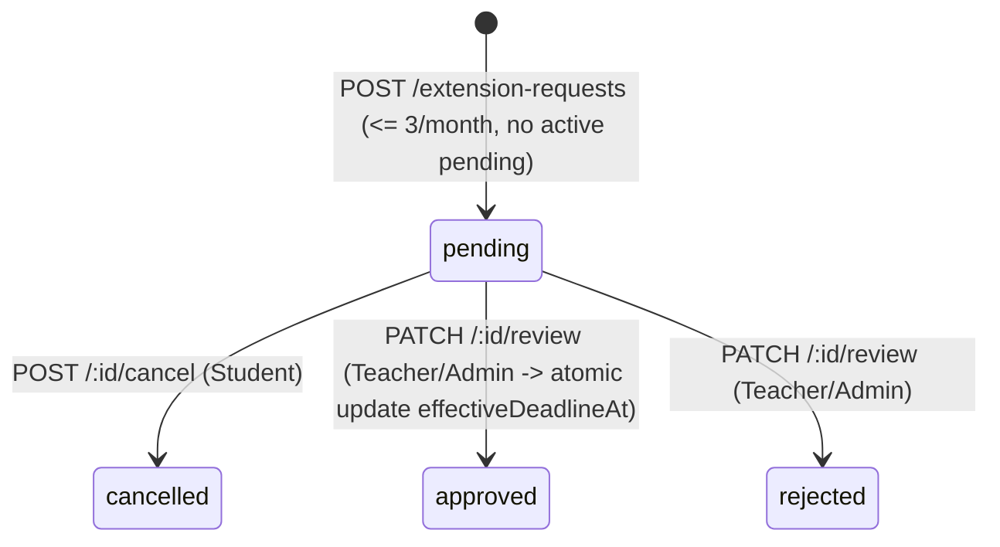

# 05 — Extensions, Penalties, Notifications, Dashboard, Audit & Jobs Contract

**Lifecycle Status:** `Canonical` & `Internal/Ops`  
**Backend Controllers:** `extensions.controller.ts`, `penalties.controller.ts`, `notifications.controller.ts`, `dashboard.controller.ts`, `audit.controller.ts`, `jobs.controller.ts`  
**Frontend Consumers:** `frontend/src/lib/api/endpoints/{extensions.ts,penalties.ts,notifications.ts,dashboard.ts}`

---

## 1. Domain Scope & Business Invariants

1. **Extension Requests (`/extension-requests`, alias `/extensions`):**
   - Học viên tối đa **3 yêu cầu gia hạn / tháng dương lịch** (theo múi giờ `Asia/Ho_Chi_Minh`). Vượt ngưỡng → `400/409 EXTENSION_MONTHLY_LIMIT_REACHED`.
   - Mỗi `StudentAssignment` chỉ được có **tối đa 1 đơn `PENDING`** tại một thời điểm (bảo vệ bằng partial unique index `unique_pending_per_student_assignment`).
   - Khi Teacher/Admin **duyệt (`approved`)**: cập nhật atomic `StudentAssignment.effectiveDeadlineAt = approvedDeadlineAt ?? requestedDeadlineAt`, ghi `AuditLog`, gửi `Notification` (`extension_reviewed`) + email.
2. **Penalties Ledger (`/penalties`):**
   - Dùng mô hình **append-only ledger** (`penalty_transactions`): phạt `+1` (`deltaPoints: +1`), hoàn tác `-1` (`deltaPoints: -1` với `reversedTransactionId` unique sparse để không bao giờ hoàn tác 2 lần).
   - `StudentProfile.penaltyPointsCache` chỉ là cache; **tổng `penalty_transactions` mới là nguồn sự thật (SSOT)**.
   - Mọi thao tác hoàn tác (`POST /penalties/:id/reverse`) bắt buộc nhập `reason` tối thiểu 10 ký tự và ghi `AuditLog`.
3. **Notifications (`/notifications`):**
   - Scoping tuyệt đối theo `@CurrentUser()` — người dùng chỉ đọc/đánh dấu đã đọc thông báo của chính mình.
4. **Dashboard & Enriched Profiles (`/dashboard/*`, `/students/*`, `/teachers/*`):**
   - Cung cấp endpoint tổng hợp 1-shot cho Student/Teacher Dashboard và Profile; đồng thời có `GET /students/:studentId/penalties` cho Teacher/Admin.
5. **Audit Logs (`/audit-logs`) & Background Jobs (`/jobs`):**
   - Chỉ `ADMIN` được xem `/audit-logs` và `/jobs/health`; `ADMIN`/`TEACHER` được kích hoạt `POST /jobs/deadlines/trigger` đẩy job vào BullMQ queue `deadlines`.

---

## 2. State Machine — Extension Request & Penalty Reversal



---

## 3. Endpoint Summary Table

| Method | Full Path (`/api/v1/...`) | Auth / Roles | FE Consumer | Status |
| :--- | :--- | :--- | :--- | :--- |
| `POST` | `/extension-requests` *(alias `/extensions`)* | `STUDENT` | `extensionsApi.requestForAssignment` | Canonical |
| `GET` | `/extension-requests/quota` | `STUDENT` | `extensionsApi.getQuota` | Canonical |
| `GET` | `/extension-requests/mine` | `STUDENT` | `extensionsApi.listMine` | Canonical |
| `POST` | `/extension-requests/:id/cancel` | `STUDENT` | *(BE-only)* | Canonical |
| `GET` | `/extension-requests/pending` | `ADMIN`, `TEACHER` | `extensionsApi.listPending` *(mock)* | Canonical |
| `GET` | `/extension-requests` | `ADMIN`, `TEACHER` | `extensionsApi.listPending` *(live)* | Canonical |
| `GET` | `/extension-requests/:id` | `STUDENT`, `TEACHER`, `ADMIN` | *(BE-only)* | Canonical |
| `PATCH` | `/extension-requests/:id/review` | `ADMIN`, `TEACHER` | `extensionsApi.decide` *(live)* | Canonical |
| `POST` | `/extension-requests/:id/decision` | `ADMIN`, `TEACHER` | `extensionsApi.decide` *(mock alias)* | Canonical |
| `GET` | `/penalties/mine` | `STUDENT` | `penaltiesApi.getMine` | Canonical |
| `GET` | `/penalties` | `ADMIN`, `TEACHER` | `penaltiesApi.list` | Canonical |
| `POST` | `/penalties/:id/reverse` | `ADMIN`, `TEACHER` | `penaltiesApi.reverse` | Canonical |
| `GET` | `/notifications` | Authenticated | `notificationsApi.list` | Canonical |
| `GET` | `/notifications/mine` | Authenticated | *(BE alias)* | Canonical |
| `GET` | `/notifications/unread-count` | Authenticated | `dashboardApi.getStudentDashboard` | Canonical |
| `PATCH` | `/notifications/:id/read` | Authenticated | `notificationsApi.markAsRead` | Canonical |
| `PATCH` | `/notifications/read-all` | Authenticated | *(BE-only)* | Canonical |
| `GET` | `/dashboard/student` | `STUDENT`, `ADMIN` | `dashboardApi.getStudentDashboard` *(mock only — xem Drift)* | Canonical |
| `GET` | `/dashboard/teacher` | `TEACHER`, `ADMIN` | `dashboardApi.getTeacherDashboard` *(mock only — xem Drift)* | Canonical |
| `GET` | `/students/me/profile` | `STUDENT`, `ADMIN` | `authApi.getStudentProfile` *(mock only — xem Drift)* | Canonical |
| `GET` | `/teachers/me/profile` | `TEACHER`, `ADMIN` | `authApi.getTeacherProfile` *(mock only — xem Drift)* | Canonical |
| `GET` | `/students/:studentId/penalties` | `TEACHER`, `ADMIN` | `penaltiesApi.getByStudent` | Canonical |
| `GET` | `/audit-logs` | `ADMIN` | *(Admin/Ops)* | Internal/Ops |
| `POST` | `/jobs/deadlines/trigger` | `ADMIN`, `TEACHER` | *(Admin/Ops)* | Internal/Ops |
| `GET` | `/jobs/health` | `ADMIN` | *(Admin/Ops)* | Internal/Ops |

---

## 4. Detailed Endpoint Specifications

### 4.1 Extension Requests (`/extension-requests`, `/extensions`)
- `POST /extension-requests` (`STUDENT`, HTTP 201, `CreateExtensionRequestDto`):
  ```ts
  {
    studentAssignmentId: string; // @IsMongoId()
    requestedDeadlineAt: string; // ISO DateString (phải sau effectiveDeadlineAt hiện tại)
    reason: string;              // 10..500 chars
  }
  ```
- `GET /extension-requests/quota` (`STUDENT`): Trả `{ month, used, limit: 3, remaining }`.
- `GET /extension-requests` & `GET /extension-requests/mine` & `GET /extension-requests/pending`: Query `ExtensionQueryDto` (`page=1`, `limit=20`, `status?: pending|approved|rejected|cancelled`, `courseId?`, `studentId?`).
- `PATCH /extension-requests/:id/review` (`ADMIN`, `TEACHER`, `ReviewExtensionRequestDto`):
  ```ts
  {
    status?: "approved" | "rejected";
    decision?: "approved" | "rejected"; // alias FE
    reviewNote?: string;                // max 500
    decisionNote?: string;              // alias FE, max 500
    approvedDeadlineAt?: string;        // ISO DateString optional override
  }
  ```
- `POST /extension-requests/:id/decision` (`ADMIN`, `TEACHER`, HTTP 200): Alias cho `:id/review`.
- `POST /extension-requests/:id/cancel` (`STUDENT`, HTTP 200): Hủy đơn đang `pending`.

### 4.2 Penalties (`/penalties`)
- `GET /penalties/mine` (`STUDENT`) & `GET /penalties` (`ADMIN`, `TEACHER`):
  - Query `PenaltyQueryDto` (`page=1`, `limit=20`, `studentId?`, `courseId?`, `status?: 'all' | 'active' | 'reversed'`, `search?`).
- `POST /penalties/:id/reverse` (`ADMIN`, `TEACHER`, HTTP 200, `ReversePenaltyDto`):
  - Body: `{ reason: string (10..500 chars) }`.
  - Lỗi: `409 PENALTY_ALREADY_REVERSED` nếu giao dịch đã từng được hoàn tác.

### 4.3 Notifications (`/notifications`)
- `GET /notifications` (và alias `/notifications/mine`): Query `NotificationQueryDto` (`page=1`, `limit=20`, `isRead?: boolean`, `read?: boolean`, `type?: NotificationType`).
- `GET /notifications/unread-count`: Trả `{ unreadCount }` / `{ count }`.
- `PATCH /notifications/:id/read`: Đánh dấu 1 thông báo đã đọc (`isRead = true`, `readAt = now`).
- `PATCH /notifications/read-all`: Đánh dấu tất cả thông báo chưa đọc của user hiện tại là đã đọc.

### 4.4 Dashboard & Profiles (`DashboardController`)
- `GET /dashboard/student` (`STUDENT`, `ADMIN`): Tổng hợp `todayExercises`, `upcomingDeadlines`, `upcomingLessons`, `recentScores`, `activePenaltiesCount`, `extensionsUsedThisMonth`, `maxExtensionsPerMonth`, `unreadNotificationsCount`.
- `GET /dashboard/teacher` (`TEACHER`, `ADMIN`): Tổng hợp `activeCoursesCount`, `pendingExtensionsCount`, `pendingTranslationsCount`, `overdueStudentsCount`, `recentAssignments`, `upcomingLessons`.
- `GET /students/me/profile` (`STUDENT`, `ADMIN`) & `GET /teachers/me/profile` (`TEACHER`, `ADMIN`): Hồ sơ chi tiết kèm các chỉ số tổng hợp.
- `GET /students/:studentId/penalties` (`TEACHER`, `ADMIN`): Sổ điểm phạt của 1 học viên cụ thể.

### 4.5 Audit Logs (`/audit-logs`) & Jobs (`/jobs`)
- `GET /audit-logs` (`ADMIN`): Query `AuditQueryDto` (`page=1`, `limit=20`, `action?`, `entityType?`, `actorId?`, `entityId?`).
- `POST /jobs/deadlines/trigger` (`ADMIN`, `TEACHER`): Enqueue job kiểm tra quá hạn ngay lập tức vào BullMQ queue `deadlines`; trả `{ message, jobId, queue }`.
- `GET /jobs/health` (`ADMIN`): Trả số lượng job các trạng thái của `emailQueue` và `deadlineQueue`.
