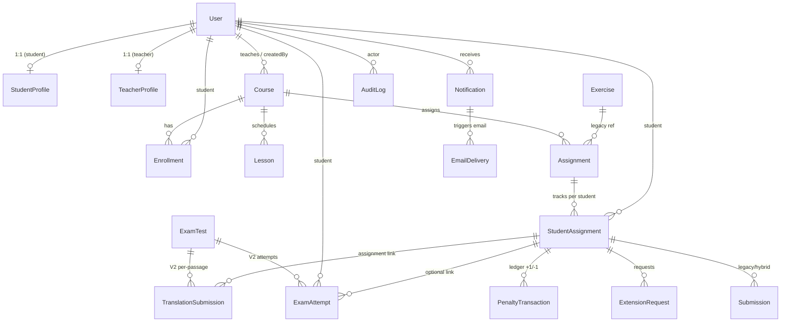

# 06 — Canonical Data Models & Shared Enums

**Nguồn đối chiếu 100% từ code:**
- Backend: 18 Mongoose schemas + `enums.ts` tại `Backend/src/database/schemas/*.ts`
- Frontend: `frontend/src/lib/api/schemas.ts` và `frontend/src/lib/api/types.ts`

---

## 1. Sơ đồ quan hệ dữ liệu (Entity-Relationship Overview)

---

## 2. Bảng đối chiếu Shared Enums (Backend ↔ Frontend)

> **Quy tắc:** Khi tạo mới hoặc sửa enum, phải đồng bộ cả `Backend/src/database/schemas/enums.ts` và `frontend/src/lib/api/{schemas.ts,types.ts}`. Các dòng gắn **[DRIFT]** đã được tổng hợp vào [07-drift-audit-be-fe.md](./07-drift-audit-be-fe.md).

| Enum (Backend) | Giá trị thực tế Backend (`enums.ts`) | Giá trị thực tế Frontend (`schemas.ts` / `types.ts`) | Trạng thái |
| :--- | :--- | :--- | :--- |
| `UserRole` | `student`, `teacher`, `admin` | `student`, `teacher`, `admin` | Khớp 100% |
| `UserStatus` | `active`, `inactive`, `suspended` | `active`, `inactive`, `suspended` | Khớp 100% |
| `CourseType` | `one_to_one`, `group` | `CourseFormat`: `1:1`, `group` *(FE preprocess `one_to_one → 1:1`)* | **[DRIFT - Mapped]** |
| `CourseStatus` | `draft`, `active`, `completed`, `archived`, `upcoming` | `active`, `upcoming`, `archived`, `draft`, `completed` | Khớp 100% |
| `LessonType` | `live_meet`, `workshop`, `review` | `live_meet`, `workshop`, `review` | Khớp 100% |
| `LessonStatus` | `scheduled`, `cancelled`, `completed` | `scheduled`, `live`, `completed`, `cancelled` *(FE thừa `live`)* | **[DRIFT]** |
| `EnrollmentStatus` | `active`, `dropped`, `completed` | `active`, `withdrawn`, `completed` *(`dropped` ≠ `withdrawn`)* | **[DRIFT]** |
| `ExerciseType` | `reading`, `listening` | `reading`, `listening` | Khớp 100% |
| `ExerciseStatus` | `draft`, `published`, `archived` | `draft`, `published`, `archived` | Khớp 100% |
| `QuestionType` *(Legacy)* | `multiple_choice`, `true_false_not_given`, `yes_no_not_given`, `matching`, `matching_headings`, `matching_information`, `sentence_completion`, `summary_completion`, `fill_blank`, `short_answer` | `mcq`, `tfng`, `ynng`, `fill_blank`, `matching`, `short_answer` *(FE preprocess normalize)* | **[DRIFT - Mapped]** |
| `AssignmentStatus` | `draft`, `scheduled`, `published`, `available`, `expired`, `closed`, `archived`, `completed` | `scheduled`, `active`, `closed` | **[DRIFT]** |
| `StudentAssignmentStatus` | `not_started`, `in_progress`, `submitted`, `passed`, `completed`, `overdue`, `excused` | `not_started`, `in_progress`, `submitted`, `passed`, `overdue`, `extended` | **[DRIFT]** |
| `TranslationSubmissionStatus` | `draft`, `submitted`, `reviewed` | `TranslationStatus`: `not_started`, `draft`, `submitted`, `needs_revision`, `approved` | **[DRIFT]** |
| `ExtensionRequestStatus` | `pending`, `approved`, `rejected`, `cancelled` | `pending`, `approved`, `rejected` *(FE thiếu `cancelled`)* | **[DRIFT]** |
| `NotificationType` | `new_assignment`, `overdue`, `course_enrolled`, `extension_reviewed`, `other` | `assignment_new`, `overdue`, `course_added`, `extension_decided` | **[DRIFT]** |
| `EmailDeliveryStatus` | `queued`, `sending`, `sent`, `failed` | *(Backend only)* | BE Only |
| `ExamSkill` *(V2)* | `READING`, `LISTENING` | `READING`, `LISTENING` | Khớp 100% |
| `ExamMode` *(V2)* | `PART`, `FULL` | `PART`, `FULL` | Khớp 100% |
| `ExamDifficulty` *(V2)* | `FOUNDATION`, `INTERMEDIATE`, `TARGET_65`, `TARGET_75_PLUS` | `FOUNDATION`, `INTERMEDIATE`, `TARGET_65`, `TARGET_75_PLUS` | Khớp 100% |
| `PartType` *(V2)* | `PASSAGE`, `SECTION` | `PASSAGE`, `SECTION` | Khớp 100% |
| `ExamTestStatus` *(V2)* | `DRAFT`, `PUBLISHED`, `ARCHIVED` | `DRAFT`, `PUBLISHED`, `ARCHIVED` | Khớp 100% |
| `ExamPreset` *(V2)* | `IELTS_ACADEMIC`, `CUSTOM` | *(Không khai báo riêng ở FE)* | BE Only |
| `AttemptStatus` *(V2)* | `IN_PROGRESS`, `SUBMITTED`, `AUTO_SUBMITTED`, `EXPIRED` | `IN_PROGRESS`, `SUBMITTED`, `EXPIRED`, `ABANDONED` *(FE thiếu `AUTO_SUBMITTED` ở `ExamAttemptStatusSchema`, nhưng có transform ở `ExamResultResponseSchema`)* | **[DRIFT]** |
| `ExamQuestionType` *(V2)* | 15 loại: `MULTIPLE_CHOICE_SINGLE`, `MULTIPLE_CHOICE_MULTIPLE`, `TRUE_FALSE_NOT_GIVEN`, `YES_NO_NOT_GIVEN`, `MATCHING_HEADINGS`, `MATCHING_INFORMATION`, `MATCHING_FEATURES`, `MATCHING_SENTENCE_ENDINGS`, `SENTENCE_COMPLETION`, `SUMMARY_COMPLETION`, `NOTE_COMPLETION`, `TABLE_COMPLETION`, `FLOW_CHART_COMPLETION`, `DIAGRAM_LABEL_COMPLETION`, `SHORT_ANSWER` | Khớp đủ 15/15 giá trị | Khớp 100% |

---

## 3. Chi tiết toàn bộ 18 Mongoose Schemas

Mọi collection đều bật `{ timestamps: true }` (`createdAt`, `updatedAt`). `TransformInterceptor` tự bổ sung `id = _id.toString()`.

### 3.1 Core Users & Profiles (Canonical)

#### 1. `users` (`user.schema.ts`)
- **Fields:**
  - `fullName: string` (required, trim)
  - `email: string` (required, lowercase, trim)
  - `passwordHash: string` (required, `select: false` — không bao giờ trả ra API)
  - `role: UserRole` (required) — `TransformInterceptor` tự mirror thêm `roles: [role]`
  - `status: UserStatus` (default `active`)
  - `phone?: string` (trim)
  - `tokenVersion?: number` (default `0` — tăng khi đổi mật khẩu/thu hồi toàn bộ phiên)
- **Indexes:** `{ email: 1 }` (**unique**), `{ role: 1, status: 1 }`.

#### 2. `student_profiles` (`student-profile.schema.ts`)
- **Fields:** `userId: ObjectId(User)` (required), `currentBand?: number` (0..9), `targetBand?: number` (0..9), `penaltyPointsCache: number` (default `0` — **chỉ là cache, không phải SSOT**; tổng `penalty_transactions` mới là SSOT), `metadata?: Record<string, unknown>`.
- **Indexes:** `{ userId: 1 }` (**unique**).

#### 3. `teacher_profiles` (`teacher-profile.schema.ts`)
- **Fields:** `userId: ObjectId(User)` (required), `specialization?: string`, `bio?: string`, `phone?: string` (trim).
- **Indexes:** `{ userId: 1 }` (**unique**).

---

### 3.2 Courses, Enrollments, Lessons & Assignments (Canonical)

#### 4. `courses` (`course.schema.ts`)
- **Fields:** `code: string` (required, uppercase, trim), `title: string` (required, trim), `description?: string`, `startBand: number` (0..9, required), `targetBand: number` (0..9, required), `type: CourseType` (required), `teacherId: ObjectId(User)` (required), `startAt?: Date`, `endAt?: Date`, `status: CourseStatus` (default `active`), `createdBy: ObjectId(User)` (required).
- **Indexes:** `{ code: 1 }` (**unique**), `{ teacherId: 1, status: 1 }`, `{ status: 1 }`.

#### 5. `enrollments` (`enrollment.schema.ts`)
- **Fields:** `courseId: ObjectId(Course)` (required), `studentId: ObjectId(User)` (required), `status: EnrollmentStatus` (default `active`), `joinedAt: Date` (default now), `leftAt?: Date`, `history: EnrollmentHistoryEntry[]` (`{ status, changedAt, actorId?, note? }`), `isOneToOneActive?: boolean` (chỉ set `true` khi lớp `one_to_one` có học viên `active` để khóa atomic capacity).
- **Indexes:**
  - `{ courseId: 1, studentId: 1 }` (**unique**)
  - `{ studentId: 1, status: 1 }`, `{ courseId: 1, status: 1 }`
  - `{ courseId: 1 }` (**partial unique** `partialFilterExpression: { isOneToOneActive: true }`, name `unique_active_one_to_one_course` — đảm bảo lớp 1:1 tối đa 1 học viên active).

#### 6. `lessons` (`lesson.schema.ts`)
- **Fields:** `courseId: ObjectId(Course)` (required), `title: string` (required, trim), `startAt: Date` (required), `endAt: Date` (required), `meetUrl?: string` (trim), `content?: string`, `type: LessonType` (default `live_meet`), `status: LessonStatus` (default `scheduled`).
- **Indexes:** `{ courseId: 1, startAt: 1 }`, `{ startAt: 1 }`, `{ status: 1 }`.

#### 7. `assignments` (`assignment.schema.ts`)
- **Fields:** `courseId: ObjectId(Course)` (required), `exerciseId: ObjectId(Exercise)` (required), `exerciseVersion: number` (min 1, required), `exerciseSnapshot?: ExerciseSnapshot` (`select: false` — bản chụp bất biến để chấm điểm), `assignedBy: ObjectId(User)` (required), `title?: string` (trim), `openAt: Date` (required), `deadlineAt: Date` (required), `allowRetake: boolean` (default `false`), `maxAttempts?: number` (min 1), `requiredScope?: 'PART' | 'FULL'` (default `'FULL'`), `requiredPartId?: string`, `allowedModes?: string[]` (default `['PART', 'FULL']`), `durationSecondsOverride?: number`, `assignedDate?: string`, `selectedQuestionGroupIds?: string[]` (default `[]`), `targetScorePercent?: number` (0..100, default `70`), `idempotencyKey?: string`, `status: AssignmentStatus` (default `draft`).
- **Indexes:** `{ courseId: 1, status: 1 }`, `{ deadlineAt: 1, status: 1 }`, `{ status: 1 }`, `{ idempotencyKey: 1 }` (**unique, sparse**), `{ courseId: 1, exerciseId: 1, openAt: 1 }`.

#### 8. `student_assignments` (`student-assignment.schema.ts`)
- **Fields:** `assignmentId: ObjectId(Assignment)` (required), `studentId: ObjectId(User)` (required), `originalDeadlineAt?: Date`, `effectiveDeadlineAt: Date` (required — cập nhật khi gia hạn được duyệt), `status: StudentAssignmentStatus` (default `not_started`), `bestScore?: number` (0..100), `passedAt?: Date`, `lastSubmittedAt?: Date`, `penaltyAppliedAt?: Date`, `isTargetAchieved?: boolean` (default `false`), `attemptsCount?: number` (default `0`).
- **Indexes:** `{ assignmentId: 1, studentId: 1 }` (**unique**), `{ status: 1, effectiveDeadlineAt: 1 }`, `{ studentId: 1, status: 1 }`.

---

### 3.3 Exam Modes V2 & Reading Translations (Canonical)

#### 9. `exam_tests` (`exam-test.schema.ts`)
- **Root Fields:** `title: string` (required, trim), `subtitle?: string`, `difficulty: ExamDifficulty` (default `TARGET_65`), `tags: string[]` (default `[]`), `skill: ExamSkill` (required), `description?: string`, `examPreset: ExamPreset` (default `IELTS_ACADEMIC`), `allowedModes: ExamMode[]` (default `['PART', 'FULL']`), `passScore: number` (0..100, default `70`), `fullDurationSeconds?: number`, `translationEnabled: boolean` (default `false`), `parts: ExamPart[]`, `status: ExamTestStatus` (default `DRAFT`), `version: number` (min 1, default `1`), `createdBy: ObjectId(User)` (required), `publishedAt?: Date`.
- **Embedded `ExamPart` (`_id: true`):** `ordinal: number`, `type: PartType`, `title: string`, `contentHtml?: string`, `audioAssetId?: ObjectId`, `durationSeconds?: number`, `questionGroups: QuestionGroup[]`.
- **Embedded `QuestionGroup` (`_id: true`):** `title?: string`, `instruction?: string`, `type: ExamQuestionType`, `order: number`, `sharedOptions?: ExamOption[]`, `maxWords?: number`, `questions: ExamQuestion[]`.
- **Embedded `ExamQuestion` (`_id: false`):** `number: number` (1-based global), `prompt: string`, `type: ExamQuestionType`, `points: number` (min 0), `options?: ExamOption[]`, `grading?: { acceptedKeys: string[], caseSensitive: boolean, maxWords?: number }` (**BẮT BUỘC strip qua response-mapper trước khi trả Student**).
- **Indexes:** `{ createdBy: 1, status: 1 }`, `{ skill: 1, status: 1 }`, `{ allowedModes: 1, status: 1 }`, `{ difficulty: 1, status: 1 }`.

#### 10. `exam_attempts` (`exam-attempt.schema.ts`)
- **Fields:** `studentId: ObjectId(User)` (required), `testId: ObjectId(ExamTest)` (required), `exerciseVersion: number` (required — snapshot `ExamTest.version`), `assignmentId?: ObjectId(Assignment)`, `studentAssignmentId?: ObjectId(StudentAssignment)`, `skill: ExamSkill` (required), `mode: ExamMode` (required), `partId: string | null` (default `null` cho `FULL`), `status: AttemptStatus` (default `IN_PROGRESS`), `startedAt: Date` (required), `expiresAt?: Date`, `submittedAt?: Date`, `lastSavedAt?: Date`, `answersRevision: number` (default `0` — optimistic concurrency), `scopeQuestionIds: string[]`, `flaggedQuestionIds?: string[]`, `savedAnswers: Map<string, unknown>`, `idempotencyKey?: string`.
- **Indexes:** `{ studentId: 1, status: 1 }`, `{ testId: 1, studentId: 1 }`, `{ idempotencyKey: 1 }` (**unique, sparse**).

#### 11. `translation_submissions` (`translation-submission.schema.ts`) — *Dùng chung V2 & Legacy*
- **Fields:** `studentAssignmentId?: ObjectId(StudentAssignment)`, `assignmentId?: ObjectId(Assignment)`, `testId?: ObjectId(ExamTest)`, `passageId?: string`, `exerciseVersion?: number`, `examAttemptId?: ObjectId(ExamAttempt)`, `sourceAttemptId?: ObjectId(ExamAttempt)`, `studentId: ObjectId(User)` (required), `translatedText: string` (required), `status: TranslationSubmissionStatus` (default `draft`), `submittedAt?: Date`, `reviewedBy?: ObjectId(User)`, `teacherComment?: string`, `reviewedAt?: Date`.
- **Indexes:** `{ studentAssignmentId: 1, passageId: 1 }` (**unique, sparse**), `{ studentId: 1, testId: 1, passageId: 1 }` (**unique, sparse**), `{ studentId: 1, status: 1 }`.

---

### 3.4 Legacy Flow (Coexisting — Không mở rộng tính năng mới)

#### 12. `exercises` (`exercise.schema.ts`)
- **Fields:** `title: string` (required), `description?: string`, `type: ExerciseType` (required), `passage?: string`, `audioAssets?: { objectKey, url?, durationSeconds? }[]`, `questions: Question[]` (`questionId`, `type: QuestionType`, `prompt`, `options?`, `answerSpecification` [`select: false`, phải strip bằng mapper], `points`, `explanation?`), `passScore: number` (default `70`), `version: number` (default `1`), `status: ExerciseStatus` (default `draft`), `createdBy: ObjectId(User)` (required).
- **Indexes:** `{ type: 1, status: 1 }`, `{ createdBy: 1 }`.

#### 13. `submissions` (`submission.schema.ts`)
- **Fields:** `studentAssignmentId: ObjectId(StudentAssignment)` (required), `assignmentId: ObjectId(Assignment)` (required), `studentId: ObjectId(User)` (required), `attemptNo: number` (min 1, required), `answers: { questionId, value, awardedPoints? }[]`, `scorePercent: number` (0..100), `correctCount: number`, `totalQuestions: number`, `isPassed: boolean`, `submittedAt: Date`, `exerciseVersion: number`, `examAttemptId?: ObjectId(ExamAttempt)`, `mode?: 'PART' | 'FULL'`, `partId?: string`, `scopeQuestionIds?: string[]`, `earnedPoints?: number`, `totalPoints?: number`.
- **Indexes:** `{ studentAssignmentId: 1, attemptNo: 1 }` (**unique**), `{ studentId: 1, assignmentId: 1 }`.

---

### 3.5 Extensions, Penalties, Notifications & Ops (Canonical)

#### 14. `extension_requests` (`extension-request.schema.ts`)
- **Fields:** `studentAssignmentId: ObjectId(StudentAssignment)` (required), `studentId: ObjectId(User)` (required), `courseId: ObjectId(Course)` (required), `reason: string` (required), `requestedDeadlineAt: Date` (required), `grantedDeadlineAt?: Date`, `status: ExtensionRequestStatus` (default `pending`), `reviewedBy?: ObjectId(User)`, `reviewedAt?: Date`, `reviewNote?: string`.
- **Indexes:** `{ studentId: 1, createdAt: 1 }` (đếm quota 3 lần/tháng), `{ courseId: 1, status: 1 }`, `{ studentAssignmentId: 1, status: 1 }` (**partial unique** khi `status === 'pending'`, name `unique_pending_per_student_assignment`).

#### 15. `penalty_transactions` (`penalty-transaction.schema.ts`)
- **Fields:** `studentId: ObjectId(User)` (required), `studentAssignmentId: ObjectId(StudentAssignment)` (required), `deltaPoints: number` (`+1` phạt, `-1` hoàn tác), `reason: string` (required), `idempotencyKey: string` (required), `actorId?: ObjectId(User)`, `reversedTransactionId?: ObjectId(PenaltyTransaction)`, `isReversed: boolean` (default `false`), `reversedBy?: ObjectId(User)`, `reversedAt?: Date`, `reversalReason?: string`.
- **Indexes:** `{ idempotencyKey: 1 }` (**unique**), `{ reversedTransactionId: 1 }` (**unique, sparse**), `{ studentId: 1, createdAt: -1 }`.

#### 16. `notifications` (`notification.schema.ts`)
- **Fields:** `userId: ObjectId(User)` (required), `type: NotificationType` (required), `title: string` (required), `body: string` (required), `payload?: Record<string, unknown>`, `isRead: boolean` (default `false`), `readAt?: Date`, `idempotencyKey?: string`.
- **Indexes:** `{ userId: 1, createdAt: -1 }`, `{ userId: 1, isRead: 1 }`, `{ idempotencyKey: 1 }` (**unique, sparse**).

#### 17. `email_deliveries` (`email-delivery.schema.ts`)
- **Fields:** `notificationId?: ObjectId(Notification)`, `recipientEmail: string` (required, lowercase), `templateKey: string` (required), `payload?: Record<string, unknown>`, `status: EmailDeliveryStatus` (default `queued`), `providerMessageId?: string`, `attemptCount: number` (default `0`), `sentAt?: Date`, `errorMessage?: string`, `idempotencyKey: string` (required).
- **Indexes:** `{ idempotencyKey: 1 }` (**unique**), `{ status: 1, createdAt: -1 }`.

#### 18. `audit_logs` (`audit-log.schema.ts`)
- **Fields:** `actorId?: ObjectId(User)`, `action: string` (required, indexed), `entityType: string` (required, indexed), `entityId?: ObjectId`, `metadata?: Record<string, unknown>` (**tuyệt đối không log password/token/answer keys**).
- **Indexes:** `{ actorId: 1, createdAt: -1 }`, `{ entityType: 1, entityId: 1, createdAt: -1 }`, `{ action: 1, createdAt: -1 }`.
