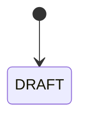

# 08 — Extension Standard, Versioning & Contract Verification Guide

Tài liệu này quy định **chuẩn bắt buộc** khi Frontend và Backend phát triển thêm tính năng/module mới (ví dụ: **Writing**, **Speaking**, **Billing/Payments**, **AI Feedback**, **Analytics**) dựa trên nền tảng IELTS LMS hiện tại mà **không phát sinh drift**.

---

## 1. Quy ước đặt tên & Thiết kế REST API cho tính năng mới

1. **URL & Prefix:**
   - Mọi endpoint mới nằm dưới `/api/v1/<resource-kebab-case>` (số nhiều, chữ thường, gạch nối: ví dụ `/writing-tasks`, `/speaking-sessions`).
   - Endpoint quản trị/tạo nội dung riêng cho giáo viên dùng prefix `/api/v1/teacher/<resource>` (nhất quán với `/teacher/exam-tests` và `/teacher/reading-translations`).
   - **Không tạo alias trùng lặp** cho cùng 1 hành vi (tránh lặp lại kiểu `/extensions` + `/extension-requests` hay `startAt` + `startTime`). Chọn 1 tên canonical duy nhất ngay từ đầu.
2. **Naming & Types:**
   - JSON keys: `camelCase`.
   - IDs: MongoDB `ObjectId` dạng chuỗi 24 ký tự hex (`@IsMongoId()`). `TransformInterceptor` luôn chuẩn hóa `_id → id`.
   - Timestamps: ISO-8601 UTC string (`*At`, ví dụ `createdAt`, `submittedAt`, `expiresAt`). Tránh trộn `*Time` hoặc `*Date` trừ khi là ngày dương lịch `YYYY-MM-DD` (ví dụ `assignedDate`).
   - Enums:
     - Với module domain mới theo chuẩn Exam V2, ưu tiên `UPPER_SNAKE_CASE` (nhất quán với `ExamSkill`, `ExamMode`, `AttemptStatus`) và khai báo **đồng thời** ở `Backend/src/database/schemas/enums.ts` và `frontend/src/lib/api/{schemas.ts,types.ts}`.
3. **Pagination & Query:**
   - Luôn dùng chuẩn `{ items, total, page, limit, totalPages }` với mặc định `page = 1`, `limit = 20`, `max(limit) = 100`.
   - Mọi query param mà FE gửi **BẮT BUỘC** phải được khai báo bằng decorator `class-validator` trong Query DTO (vì `forbidNonWhitelisted: true` đang bật toàn cục).
4. **Error Codes:**
   - Mọi lỗi nghiệp vụ nên ném `HttpException` kèm `{ code: 'SCREAMING_SNAKE_CASE', message: '...' }` để `GlobalExceptionFilter` giữ nguyên `code` và Frontend map được thông báo thân thiện trong `CODE_MESSAGES_VI` (`frontend/src/lib/api/error.ts`).

---

## 2. Mandatory Checklist trước khi code một Module mới

Mỗi khi thêm 1 domain/endpoint mới, BE và FE phải chốt đủ 7 mục sau **trước khi viết code**:

- [ ] **1. Schema & Indexes (`Backend/src/database/schemas/`):** Đã định nghĩa collection name (`snake_case` số nhiều), `{ timestamps: true }`, các compound/unique/partial index chống race condition?
- [ ] **2. Auth & RBAC Scoping:** Đã gắn `@UseGuards(AuthGuard('jwt'), RolesGuard)` và `@Roles(...)`? Với `TEACHER`, service đã kiểm tra quyền sở hữu khóa học (`course.teacherId === actor._id`) chưa? Với `STUDENT`, đã kiểm tra `ownerId === actor._id` chưa?
- [ ] **3. Sensitive Data & Answer-Key Sanitization:** Nếu có đáp án, rubric chấm điểm, transcript hoặc PII — đã có **response-mapper riêng ở Backend** (không dựa vào `select: false` trên subdocument) + `.strip()` ở Frontend Zod schema chưa?
- [ ] **4. Idempotency & Concurrency:** Với các action tạo/nộp/chuyển tiền/chấm điểm, đã hỗ trợ `Idempotency-Key` (header) hoặc optimistic concurrency (`baseRevision`) và sparse unique index trong MongoDB chưa?
- [ ] **5. Audit Log & Async Jobs:** Các thao tác thay đổi dữ liệu nhạy cảm (duyệt, hoàn tác, xuất bản đề, đổi quyền) đã ghi `AuditLog` (không log password/token/answer key) và đẩy gửi mail/tác vụ nặng qua BullMQ chưa?
- [ ] **6. HTML Sanitization:** Nếu có Rich Text (đề bài, bài viết Writing, nhận xét GV), FE đã render qua `safeSetHtml()` / `sanitizeHtml()` trong `frontend/src/lib/sanitize/html.ts` chưa?
- [ ] **7. Query Keys & Cache Invalidation:** FE đã thêm namespace mới vào `frontend/src/lib/api/query-keys.ts` và xác định rõ các mutation sẽ invalidate key nào chưa?

---

## 3. Versioning & Backward-Compatibility Policy

- **Additive-only trên `/api/v1`:** Được phép thêm field optional mới vào response hoặc optional param mới vào request mà không tăng version API.
- **Breaking Changes (đổi tên field, đổi kiểu dữ liệu, thu hẹp enum, đổi semantics status code):**
  1. Không sửa phá vỡ endpoint đang chạy trên `/api/v1`.
  2. Hoặc tạo endpoint/module V2 mới (như cách `exam-tests` thay thế `exercises`), hoặc nâng prefix lên `/api/v2/...`.
- **Deprecation Lifecycle:**
  1. Gắn nhãn `Legacy (Deprecated)` trong `docs/contract/` và `@ApiOperation({ deprecated: true })` trên NestJS controller.
  2. Đóng băng tính năng mới trên route deprecated.
  3. Chỉ xóa khi xác nhận 0 consumer trên Frontend và đã hoàn tất migration dữ liệu (có backup).

---

## 4. Quy trình kiểm chứng Contract tự động (Contract Verification Loop)

Mỗi PR thay đổi API ở Backend hoặc Frontend endpoint/schema phải chạy qua chuỗi kiểm chứng sẵn có của repo:

```bash
# 1. Backend: Build, test & cập nhật OpenAPI snapshot
cd Backend
npm run build
npm run test
npm run export:openapi   # Xuất ra Backend/docs/openapi.json

# 2. Frontend: Typecheck & chạy bộ Zod/Contract tests
cd ../frontend
npm run typecheck
npm run test -- src/lib/api/client.test.ts src/lib/api/contracts.test.ts src/lib/api/exam-v2-contracts.test.ts src/lib/api/lesson-contract.test.ts
```

**Yêu cầu cho mọi module mới:**
- Thêm 1 file contract test mới tại `frontend/src/lib/api/<domain>-contract.test.ts` kiểm chứng:
  1. Zod schema parse được payload chuẩn từ BE.
  2. Student-facing schema strip được toàn bộ field nhạy cảm nếu BE vô tình trả kèm.
  3. Error code nghiệp vụ được map đúng trong `getFriendlyErrorMessage()`.

---

## 5. Template cho Domain Contract mới (`docs/contract/XX-<domain>.md`)

Khi mở rộng tính năng mới (ví dụ `09-writing-module.md`), copy nguyên khung sau và thêm dòng tương ứng vào bảng mục lục của [README.md](./README.md):

```markdown
# XX — <Tên Domain> Contract

**Lifecycle Status:** `Canonical`  
**Backend Controllers:** `<domain>.controller.ts`  
**Frontend Consumers:** `frontend/src/lib/api/endpoints/<domain>.ts`

---

## 1. Domain Scope & Business Invariants
- (Nêu rõ nghiệp vụ cốt lõi, ownership/scoping, rule bảo mật, idempotency)

## 2. State Machine / Flow (nếu có)


## 3. Endpoint Summary Table
| Method | Full Path (`/api/v1/...`) | Auth / Roles | Idempotency | FE Consumer | Status |
| :--- | :--- | :--- | :---: | :--- | :--- |

## 4. Detailed Endpoint Specifications
### `POST /api/v1/<resource>` (HTTP 201)
- **Request Body (`Create<Resource>Dto`):** ...
- **Success Response (`data`):** ...
- **Errors:** `400`, `403`, `409 <DOMAIN_CODE>`
- **Side Effects:** DB writes, AuditLog, Notification/BullMQ

## 5. Data Model & Enum Additions
- Cập nhật đồng bộ vào `06-data-models-and-enums.md`.
```
