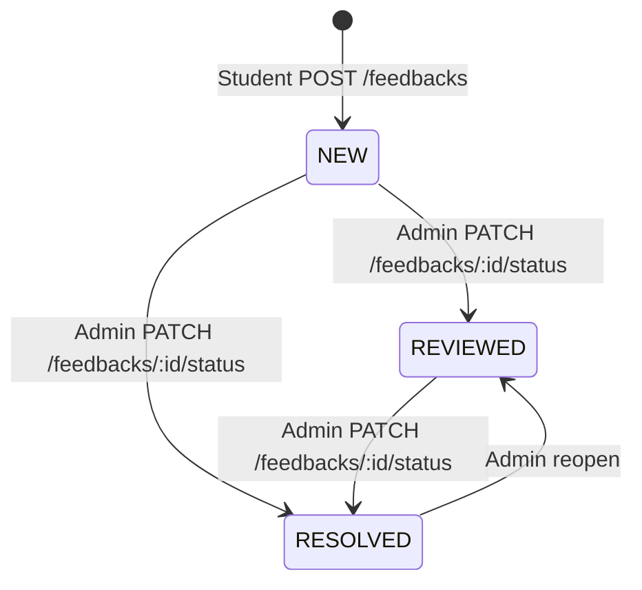

# 09 — Platform UX, Anonymous Feedback, Study Time, Admin Password Reset & Teacher Reminders Contract

**Lifecycle Status:** `Canonical (Planned — Phase 12)`  
**Verified Baseline:** 2026-11-27 (follows [08-extension-and-versioning-guide.md](./08-extension-and-versioning-guide.md))  
**Backend Controllers & Jobs:**
- `FeedbacksController` (`Backend/src/modules/feedbacks/feedbacks.controller.ts`)
- `StudySessionsController` (`Backend/src/modules/study-sessions/study-sessions.controller.ts`)
- `UsersController` (`Backend/src/modules/users/users.controller.ts` — extends with `POST /users/:id/reset-password`)
- `JobsController` + `AssignmentReminderScheduler` / `AssignmentReminderProcessor` (`Backend/src/modules/jobs/`)
- `EnrollmentsService` / `UsersService` (exposes `totalStudySeconds` & `weeklyStudySeconds` to teacher student directory)

**Frontend Consumers:**
- `frontend/src/components/layout/header.tsx` (Live VN Clock + Theme Toggle)
- `frontend/src/components/theme/theme-provider.tsx` + `frontend/src/app/globals.css` (Full-system Light/Dark Theme)
- `frontend/src/lib/api/endpoints/feedbacks.ts` (`student/feedback`, `admin/feedbacks`)
- `frontend/src/lib/api/endpoints/study-sessions.ts` (global active heartbeat hook + `teacher/students`, `teacher/students/[id]`)
- `frontend/src/lib/api/endpoints/users.ts` (`admin/users` reset student password modal)
- `frontend/src/app/teacher/dashboard/page.tsx` & `/teacher/notifications` (1-week schedule reminder notifications)

---

## 1. Domain Scope & Business Invariants

### 1.1 Header Live Clock (Frontend-Only)
- Thay thế hoàn toàn badge tĩnh `GMT+7 (Asia/Ho_Chi_Minh)` ở [header.tsx](../../frontend/src/components/layout/header.tsx#L81-L84) bằng đồng hồ cập nhật theo thời gian thực (mỗi 15–30 giây hoặc đầu phút), luôn định dạng theo múi giờ chuẩn `Asia/Ho_Chi_Minh`.
- Định dạng bắt buộc đầy đủ 4 thành phần: **Giờ • Thứ • Tuần (ISO week) • Ngày** — ví dụ: `13:45 • Thứ 6 • Tuần 48 • 27/11/2026`.
- Tránh hydration mismatch trong Next.js: render placeholder ổn định trên SSR, kích hoạt giá trị live trong `useEffect` (client-only).

### 1.2 Full-System Light / Dark Theme (Frontend-Only)
- Hỗ trợ 3 chế độ lưu ở `localStorage` (`web_ielts_theme`): `light` | `dark` | `system` (mặc định `light` hoặc theo `prefers-color-scheme` nếu `system`).
- Áp dụng class `dark` trên `<html>` (kèm inline script chống flash FOUC trước hydration trong `layout.tsx`), khai báo `@custom-variant dark (&:where(.dark, .dark *));` trong `globals.css` (Tailwind v4).
- Đảm bảo độ tương phản WCAG AA (≥ 4.5:1) trên toàn bộ: `AppShell`, `Header`, `Sidebar`, `Footer`, `Card`, `DataTable`, `Dialog/Modal`, `Form inputs`, `StatusBadge`, `RichTextEditor`, và màn hình thi CBT (`ExamPlayer`).

### 1.3 Anonymous Student Feedback (`feedbacks`)
- **Ẩn danh tuyệt đối ở tầng lưu trữ:** Document `Feedback` trong MongoDB **KHÔNG lưu `studentId`, `email`, `fullName`, `ipAddress` hay `userAgent`**. Admin và mọi API đọc góp ý hoàn toàn không có khả năng truy ngược tác giả.
- **Chống spam mà vẫn giữ ẩn danh:** Rate-limit ở Redis theo key `feedback:rate:<sha256(userId + ':' + vnDate)>` (tối đa **5 góp ý / học viên / ngày** theo giờ VN; TTL 24h).
- Chỉ `STUDENT` được gửi góp ý (`POST /feedbacks`). Chỉ `ADMIN` được xem danh sách, đọc chi tiết và cập nhật trạng thái xử lý (`NEW` → `REVIEWED` → `RESOLVED`).
- Nội dung góp ý là plain text (`@IsString()`, `@MinLength(10)`, `@MaxLength(2000)`), không cho phép HTML thô; FE render dưới dạng text an toàn (không dùng `dangerouslySetInnerHTML`).

### 1.4 Student Online Study Time Tracking (`study-sessions`)
- **Định nghĩa thời gian học:** Tổng thời gian học viên thực sự mở web và hoạt động trên cổng học viên (`/student/*`, kể cả lúc làm bài thi, đọc passage, làm bài dịch).
- **Cơ chế Heartbeat (chống gian lận & chống phồng số):**
  - Frontend chạy hook `useStudyTimeHeartbeat()` chỉ khi `user.roles.includes('student')`.
  - Gửi `POST /api/v1/study-sessions/heartbeat` mỗi **60 giây** khi `document.visibilityState === 'visible'` và có tương tác gần nhất (chuột/phím/cuộn/chạm) trong vòng **180 giây** (idle timeout = 3 phút). Khi tab ẩn hoặc idle, dừng gửi.
  - Backend **không tin tưởng tuyệt đối `deltaSeconds` từ client**:
    - Giới hạn cứng `deltaSeconds` mỗi heartbeat trong khoảng `[1, 90]` giây.
    - Kiểm tra thời gian từ `lastHeartbeatAt` gần nhất trên `StudentProfile` (hoặc Redis key `study:hb:<studentId>`): chỉ cộng `min(deltaSeconds, elapsedSinceLastHeartbeat, 90)` và bỏ qua nếu khoảng cách `< 15 giây` (chống spam/nhiều tab mở song song nhân đôi thời gian!).
  - Cộng dồn nguyên tử (`$inc`) vào 2 nơi:
    1. `StudentStudyDaily` (`{ studentId, dateVn: 'YYYY-MM-DD' }`, upsert atomic) để phục vụ thống kê theo tuần/7 ngày gần nhất.
    2. `StudentProfile.totalStudySeconds` (cache tổng tích lũy để query danh sách học viên cực nhanh).
- **Phân quyền hiển thị:**
  - `TEACHER` chỉ xem được thời gian học của **học viên đang ghi danh trong khóa học mình phụ trách** (hiển thị cột **Tổng thời gian học** & **7 ngày gần nhất** ở `/teacher/students` và biểu đồ/tổng hợp chi tiết ở `/teacher/students/[id]`).
  - `ADMIN` xem được toàn bộ. `STUDENT` chỉ xem được của chính mình (`GET /study-sessions/me/summary`).

### 1.5 Admin Reset Student Password (`POST /users/:id/reset-password`)
- **Nguyên tắc bảo mật bắt buộc:** Không lưu mật khẩu dạng plaintext hay mã hóa giải ngược. Toàn bộ mật khẩu luôn hash 1 chiều bằng `argon2id`.
- Khi học viên quên mật khẩu, `ADMIN` gọi `POST /api/v1/users/:id/reset-password`:
  - **Phạm vi:** Chỉ cho phép reset tài khoản có role `STUDENT` (trả `403 FORBIDDEN` nếu target là `ADMIN` hoặc `TEACHER` — bảo vệ tài khoản đặc quyền; hoặc chỉ chặn `ADMIN` nếu sau này muốn mở cho `TEACHER`, mặc định Phase 12 giới hạn `STUDENT`).
  - **Mật khẩu mới:** Nếu Admin không truyền `newPassword`, Backend tự sinh mật khẩu tạm dễ đọc và đủ mạnh (ví dụ 10 ký tự từ tập chữ/số không gây nhầm `O/0/I/l`, dạng `IELTS-7K4M9P`). Nếu Admin truyền `newPassword`, validate tối thiểu 8 ký tự.
  - **Hiệu ứng bắt buộc:**
    1. Hash mật khẩu mới bằng `argon2id` và lưu vào `user.passwordHash`.
    2. Tăng `user.tokenVersion += 1` và gọi `authService.revokeAllUserSessions(userId)` để đá toàn bộ phiên cũ.
    3. Gắn `user.mustChangePassword = true` (tùy chọn `requirePasswordChange`, mặc định `true`) để nhắc học viên đổi lại sau khi đăng nhập.
    4. Ghi `AuditLog` (`action: 'ADMIN_RESET_STUDENT_PASSWORD'`, `actorId: admin._id`, `entityId: student._id` — **tuyệt đối KHÔNG ghi mật khẩu mới vào AuditLog hay server log**).
    5. Trả `temporaryPassword` **1 lần duy nhất** trong HTTP response (`Cache-Control: no-store`) để Admin copy gửi cho học viên.

### 1.6 Teacher 1-Week Advance Assignment Scheduling Reminder (`jobs` + `notifications`)
- **Nghiệp vụ:** Hàng ngày lúc **08:00 giờ VN** (`0 8 * * *`, timezone `Asia/Ho_Chi_Minh`) qua BullMQ repeatable job (`QUEUE_REMINDERS`, `JOB_CHECK_TEACHER_SCHEDULE`):
  - Tìm toàn bộ `Course` đang có `status: CourseStatus.ACTIVE` (và chưa hết hạn `endAt > now`).
  - Xác định khung tuần kế tiếp: `windowStart = now + 7 days` (hoặc khung `[now + 1 day, now + 7 days]` theo ngày VN — mặc định: **kiểm tra xem trong 7 ngày tới tính từ `now` có ít nhất 1 `Assignment` với `status ∈ {PUBLISHED, SCHEDULED, AVAILABLE}` hay không**, đồng thời kiểm tra cả khóa học sắp bắt đầu trong 7 ngày tới).
  - Nếu một khóa học `ACTIVE` có **0 bài tập** được lên lịch trong khung 7 ngày tới (`openAt` nằm trong `[todayVn + 1d, todayVn + 7d]`):
    - Gửi 1 `Notification` (`type: NotificationType.ASSIGNMENT_SCHEDULE_REMINDER`) cho `course.teacherId` (kèm email nhắc nhở qua `QUEUE_EMAIL` template `assignment-schedule-reminder`).
    - **Idempotency chống spam:** Key `notif:schedule-reminder:<teacherId>:<courseId>:<isoYear>-W<isoWeek>` đảm bảo mỗi khóa học chỉ nhắc giảng viên tối đa **1 lần / tuần ISO**.
- Admin có thể kích hoạt thủ công để test/vận hành qua `POST /api/v1/jobs/reminders/trigger`.

---

## 2. State Machines

### 2.1 Anonymous Feedback Lifecycle


---

## 3. Endpoint Summary Table

| Method | Full Path (`/api/v1/...`) | Auth / Roles | Idempotency | FE Consumer | Status |
| :--- | :--- | :--- | :---: | :--- | :--- |
| `POST` | `/feedbacks` | JWT (`STUDENT`) | Redis daily rate-limit (5/day) | `feedbacksApi.create` | Planned |
| `GET` | `/feedbacks` | JWT (`ADMIN`) | — | `feedbacksApi.list` | Planned |
| `PATCH` | `/feedbacks/:id/status` | JWT (`ADMIN`) | — | `feedbacksApi.updateStatus` | Planned |
| `POST` | `/study-sessions/heartbeat` | JWT (`STUDENT`) | Server-side min-gap 15s cap 90s | `studySessionsApi.heartbeat` | Planned |
| `GET` | `/study-sessions/me/summary` | JWT (`STUDENT`) | — | `studySessionsApi.getMySummary` | Planned |
| `GET` | `/study-sessions/teacher/summary` | JWT (`TEACHER`, `ADMIN`) | — | `studySessionsApi.getTeacherSummary` | Planned |
| `GET` | `/study-sessions/students/:studentId` | JWT (`TEACHER`, `ADMIN`) | — | `studySessionsApi.getStudentDetail` | Planned |
| `POST` | `/users/:id/reset-password` | JWT (`ADMIN`) | — | `usersApi.resetStudentPassword` | Planned |
| `POST` | `/jobs/reminders/trigger` | JWT (`ADMIN`) | Weekly idempotency key per course | `systemApi.triggerReminders` (optional) | Planned |

---

## 4. Detailed Endpoint Specifications

### 4.1 `POST /api/v1/feedbacks` (HTTP 201)
- **Roles:** `STUDENT`
- **Request Body (`CreateFeedbackDto`):**
  ```ts
  {
    category: FeedbackCategory; // 'CONTENT' | 'SYSTEM_BUG' | 'TEACHING' | 'FEATURE_REQUEST' | 'OTHER'
    rating?: number;            // optional integer 1..5
    content: string;            // required, trimmed, 10..2000 chars
  }
  ```
- **Success Response (`data`):**
  ```json
  {
    "id": "6746e1a2b3c4d5e6f7a8b901",
    "category": "SYSTEM_BUG",
    "rating": 4,
    "status": "NEW",
    "createdAt": "2026-11-27T07:00:00.000Z"
  }
  ```
- **Errors:** `400` (validation), `403` (non-student), `429 FEEDBACK_DAILY_LIMIT_EXCEEDED` (>5 góp ý/ngày).
- **Side Effects:** Insert `Feedback` (**zero author fields**), increment Redis rate-limit key with 24h TTL.

### 4.2 `GET /api/v1/feedbacks` (HTTP 200)
- **Roles:** `ADMIN`
- **Query Params (`FeedbackQueryDto`):**
  - `page?: number` (default `1`), `limit?: number` (default `20`, max `100`)
  - `status?: FeedbackStatus` (`NEW` | `REVIEWED` | `RESOLVED`)
  - `category?: FeedbackCategory`
  - `search?: string` (regex escaped on `content`)
- **Success Response (`data`):**
  ```json
  {
    "items": [
      {
        "id": "6746e1a2b3c4d5e6f7a8b901",
        "category": "TEACHING",
        "rating": 5,
        "content": "Bài giảng rất dễ hiểu, mong có thêm đề luyện Listening.",
        "status": "NEW",
        "adminNote": null,
        "reviewedAt": null,
        "createdAt": "2026-11-27T07:00:00.000Z"
      }
    ],
    "total": 12,
    "page": 1,
    "limit": 20,
    "totalPages": 1,
    "unreadCount": 4
  }
  ```

### 4.3 `PATCH /api/v1/feedbacks/:id/status` (HTTP 200)
- **Roles:** `ADMIN`
- **Request Body (`UpdateFeedbackStatusDto`):**
  ```ts
  {
    status: FeedbackStatus; // 'NEW' | 'REVIEWED' | 'RESOLVED'
    adminNote?: string;     // optional, max 1000 chars
  }
  ```
- **Success Response (`data`):** Updated `Feedback` item.
- **Side Effects:** Updates `status`, `adminNote`, `reviewedBy = admin._id`, `reviewedAt = now`, logs `AuditLog` (`FEEDBACK_STATUS_UPDATED`).

### 4.4 `POST /api/v1/study-sessions/heartbeat` (HTTP 200)
- **Roles:** `STUDENT`
- **Request Body (`StudyHeartbeatDto`):**
  ```ts
  {
    deltaSeconds: number; // integer 1..90
    route?: string;       // optional pathname e.g. '/student/assignments', max 200 chars
  }
  ```
- **Success Response (`data`):**
  ```json
  {
    "accepted": true,
    "creditedSeconds": 60,
    "todayStudySeconds": 1860,
    "totalStudySeconds": 42600
  }
  ```
- **Errors:** `400` (invalid `deltaSeconds`), `403` (non-student).
- **Behavior:** If gap since last heartbeat for this student is `< 15s`, returns `{ accepted: false, creditedSeconds: 0, todayStudySeconds, totalStudySeconds }` without incrementing.

### 4.5 `GET /api/v1/study-sessions/me/summary` (HTTP 200)
- **Roles:** `STUDENT`
- **Success Response (`data`):**
  ```json
  {
    "totalStudySeconds": 42600,
    "todayStudySeconds": 1860,
    "last7DaysStudySeconds": 14400,
    "lastActiveAt": "2026-11-27T07:05:00.000Z",
    "dailyBreakdown": [
      { "dateVn": "2026-11-27", "studySeconds": 1860 }
    ]
  }
  ```

### 4.6 `GET /api/v1/study-sessions/teacher/summary` (HTTP 200)
- **Roles:** `TEACHER`, `ADMIN`
- **Query Params (`TeacherStudySummaryQueryDto`):**
  - `courseId?: string` (`@IsOptional() @IsMongoId()`)
- **Success Response (`data`):**
  ```json
  {
    "items": [
      {
        "studentId": "6746...",
        "totalStudySeconds": 42600,
        "last7DaysStudySeconds": 14400,
        "lastActiveAt": "2026-11-27T07:05:00.000Z"
      }
    ]
  }
  ```
- **Scoping:** For `TEACHER`, strictly restricted to students with `Enrollment.status === ACTIVE` in courses owned by `actor._id` (if `courseId` is given, verifies `course.teacherId === actor._id`, else `403`). Returns `{ items: [] }` if teacher has 0 courses/students.

### 4.7 `GET /api/v1/study-sessions/students/:studentId` (HTTP 200)
- **Roles:** `TEACHER`, `ADMIN`
- **Query Params (`StudentStudyDetailQueryDto`):**
  - `days?: number` (integer `7..90`, default `14`)
- **Scoping:** For `TEACHER`, verifies `studentId` is enrolled in at least one course owned by `actor._id` (else `403`).
- **Success Response (`data`):** Same shape as `4.5` (`totalStudySeconds`, `todayStudySeconds`, `last7DaysStudySeconds`, `lastActiveAt`, `dailyBreakdown[]`).

### 4.8 `POST /api/v1/users/:id/reset-password` (HTTP 200)
- **Roles:** `ADMIN`
- **Response Headers:** `Cache-Control: no-store`
- **Request Body (`AdminResetPasswordDto`):**
  ```ts
  {
    newPassword?: string;          // optional, 8..128 chars; if omitted, auto-generated
    requirePasswordChange?: boolean; // optional, default true
    reason?: string;               // optional, max 300 chars (for AuditLog)
  }
  ```
- **Success Response (`data`):**
  ```json
  {
    "userId": "6746...",
    "email": "student@example.com",
    "temporaryPassword": "IELTS-7K4M9P",
    "mustChangePassword": true,
    "revokedAllSessions": true
  }
  ```
- **Errors:** `400` (invalid ObjectId or password policy), `403 ADMIN_RESET_STUDENT_ONLY` (target user is not `STUDENT`), `404` (user not found).
- **Side Effects:** Updates `passwordHash` (`argon2id`), sets `mustChangePassword`, increments `tokenVersion += 1`, calls `authService.revokeAllUserSessions(id)`, writes `AuditLog` (`ADMIN_RESET_STUDENT_PASSWORD`, **never logs password**).

### 4.9 `POST /api/v1/jobs/reminders/trigger` (HTTP 200)
- **Roles:** `ADMIN`
- **Success Response (`data`):**
  ```json
  {
    "checkedCourses": 8,
    "remindedCount": 3,
    "skippedAlreadyReminded": 2,
    "isoWeek": "2026-W48"
  }
  ```

---

## 5. Data Model & Enum Additions (to sync into `06-data-models-and-enums.md`)

### 5.1 New & Extended Enums (`Backend/src/database/schemas/enums.ts` & `frontend/src/lib/api/{schemas,types}.ts`)
- `FeedbackCategory`: `'CONTENT' | 'SYSTEM_BUG' | 'TEACHING' | 'FEATURE_REQUEST' | 'OTHER'`
- `FeedbackStatus`: `'NEW' | 'REVIEWED' | 'RESOLVED'`
- `NotificationType` (additive): add `ASSIGNMENT_SCHEDULE_REMINDER = 'assignment_schedule_reminder'`

### 5.2 New Mongoose Schemas
1. **`Feedback` (`collection: 'feedbacks'`, `{ timestamps: true }`):**
   - `category: FeedbackCategory` (required)
   - `rating?: number` (`min: 1, max: 5`)
   - `content: string` (required, trimmed)
   - `status: FeedbackStatus` (default `FeedbackStatus.NEW`)
   - `adminNote?: string`
   - `reviewedBy?: Types.ObjectId` (`ref: 'User'`)
   - `reviewedAt?: Date`
   - **NO `studentId` / author PII fields.**
   - **Indexes:** `{ status: 1, createdAt: -1 }`, `{ category: 1, createdAt: -1 }`.

2. **`StudentStudyDaily` (`collection: 'student_study_daily'`, `{ timestamps: true }`):**
   - `studentId: Types.ObjectId` (`ref: 'User'`, required)
   - `dateVn: string` (`YYYY-MM-DD`, required)
   - `studySeconds: number` (required, default `0`, min `0`)
   - `heartbeatCount: number` (default `0`)
   - `lastHeartbeatAt: Date` (required)
   - **Indexes:** `{ studentId: 1, dateVn: 1 }` (`unique: true`), `{ dateVn: 1 }`.

### 5.3 Additive Fields on Existing Schemas
1. **`StudentProfile` (`Backend/src/database/schemas/student-profile.schema.ts`):**
   - `totalStudySeconds: number` (`@Prop({ default: 0, min: 0 })`)
   - `lastStudyHeartbeatAt?: Date` (`@Prop()`)
2. **`User` (`Backend/src/database/schemas/user.schema.ts`):**
   - `mustChangePassword: boolean` (`@Prop({ default: false })`) — included in `usersService.sanitize(user)` and `AuthUserSchema` (optional boolean).

---

## 6. Frontend Query Keys & Error Codes

### 6.1 Query Keys (`frontend/src/lib/api/query-keys.ts`)
- `studentKeys.studySummary: ["student", "study-summary"] as const`
- `teacherKeys.studentsStudySummary: (courseId?: string) => ["teacher", "students-study-summary", courseId ?? "all"] as const`
- `teacherKeys.studentStudyDetail: (studentId: string, days = 14) => ["teacher", "student-study-detail", studentId, days] as const`
- `adminKeys.feedbacksRoot: ["admin", "feedbacks"] as const`
- `adminKeys.feedbacks: (status?: string, category?: string, search?: string, page = 1) => ["admin", "feedbacks", status ?? "all", category ?? "all", search ?? "", page] as const`

### 6.2 Domain Error Codes (`frontend/src/lib/api/error.ts` → `CODE_MESSAGES_VI`)
- `FEEDBACK_DAILY_LIMIT_EXCEEDED`: `"Bạn đã đạt giới hạn gửi góp ý trong ngày hôm nay (tối đa 5 lần)."`
- `ADMIN_RESET_STUDENT_ONLY`: `"Chỉ được cấp lại mật khẩu trực tiếp cho tài khoản học viên."`

---

## 7. Mandatory 7-Point Checklist Verification
- [x] **Schemas & Indexes:** `feedbacks` (`{ status: 1, createdAt: -1 }`, `{ category: 1, createdAt: -1 }`), `student_study_daily` (`{ studentId: 1, dateVn: 1 }` unique), additive fields on `StudentProfile` & `User`.
- [x] **Auth & RBAC Scoping:** Every route uses `@UseGuards(AuthGuard('jwt'), RolesGuard)` + `@Roles(...)`; `StudySessionsService` enforces teacher course/enrollment ownership; `POST /users/:id/reset-password` restricted to `ADMIN` targeting `STUDENT`.
- [x] **Sensitive Data Sanitization:** `Feedback` stores zero author PII; `reset-password` returns `temporaryPassword` once with `Cache-Control: no-store` and never logs passwords; `User.passwordHash` never leaked.
- [x] **Idempotency & Concurrency:** Atomic `$inc` upsert on `StudentStudyDaily` & `StudentProfile`; 15s heartbeat deduplication guard; weekly idempotency key on `ASSIGNMENT_SCHEDULE_REMINDER`.
- [x] **Audit Log & Async Jobs:** `ADMIN_RESET_STUDENT_PASSWORD` and `FEEDBACK_STATUS_UPDATED` write `AuditLog`; teacher reminder runs on BullMQ repeatable job + `QUEUE_EMAIL`.
- [x] **HTML Sanitization:** Feedback content is plain text (no raw HTML rendering).
- [x] **Query Keys & Mock Mode:** All new query keys defined in Section 6.1; Frontend mock router (`frontend/src/lib/api/mocks/router.ts`) implements matching mock handlers for `NEXT_PUBLIC_API_MODE=mock`.
