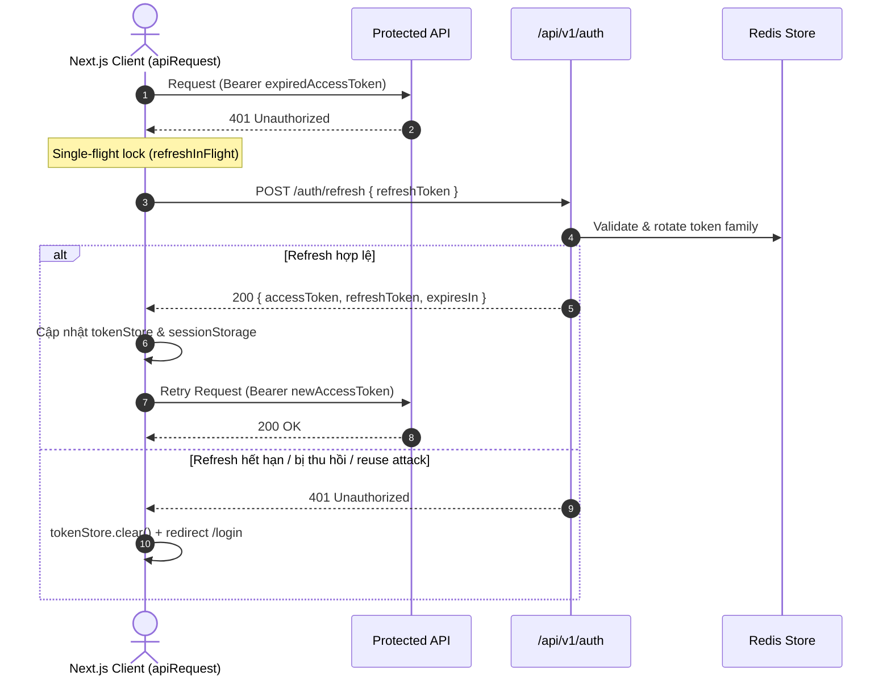

# IELTS LMS — Master API & Architecture Contract

**Version:** 2.0 (Codebase-Verified Baseline)  
**Verified Date:** 2026-11-25  
**Backend Stack:** NestJS 10 (`Backend/`) + MongoDB (Mongoose 8) + Redis / BullMQ  
**Frontend Stack:** Next.js 16.4 / React 19 (`frontend/`) + TanStack Query 5 + Zod 4  
**Authority:** Bộ tài liệu `docs/contract/` là **Single Source of Truth (SSOT)** hợp nhất 100% từ source code hiện hành, **thay thế** cho các tài liệu cũ bị phân mảnh như `Backend/docs/FRONTEND_API_CONTRACT.md` (v1.0) và `docs/IELTS_LMS_EXAM_MODES_API_CONTRACT_V2.md` (proposed delta).

---

## 1. Bản đồ tài liệu Contract (`docs/contract/`)

| # | Tài liệu | Phạm vi & Trạng thái |
| :--- | :--- | :--- |
| 0 | [README.md](./README.md) | **Master Index & Global Protocol**: Base URL, Headers, Envelope, Error, Auth/Refresh, RBAC, Sanitization, Timezone. |
| 1 | [01-auth-users-system.md](./01-auth-users-system.md) | **Canonical** — `/auth`, `/users`, `/system`, `/health` (đăng nhập, xoay vòng token, hồ sơ, bootstrap admin lần đầu, health). |
| 2 | [02-courses-lessons-assignments.md](./02-courses-lessons-assignments.md) | **Canonical** — `/courses`, `/lessons`, `/assignments`, `/student-assignments`, `/deadlines` (lớp học, lịch học, giao bài, hạn nộp). |
| 3 | [03-exam-v2-attempts-translations.md](./03-exam-v2-attempts-translations.md) | **Canonical (Exam V2)** — `/exam-tests`, `/exam-attempts`, `/reading-translations`, `/media` (đề thi PART/FULL, chấm điểm, mở khóa dịch ≥70%, upload audio/media). |
| 4 | [04-legacy-exercises-submissions.md](./04-legacy-exercises-submissions.md) | **Legacy (Coexisting)** — `/exercises`, `/submissions`, `/translations` (luồng cũ đang tồn tại song song; không xây tính năng mới trên đây). |
| 5 | [05-extensions-penalties-notifications-admin.md](./05-extensions-penalties-notifications-admin.md) | **Canonical & Ops** — `/extensions`, `/penalties`, `/notifications`, `/dashboard`, `/audit`, `/jobs`. |
| 6 | [06-data-models-and-enums.md](./06-data-models-and-enums.md) | **Data SSOT** — Toàn bộ 18 Mongoose schemas (fields, constraints, indexes, relations) & bảng đối chiếu Enum BE↔FE. |
| 7 | [07-drift-audit-be-fe.md](./07-drift-audit-be-fe.md) | **Drift Audit** — Danh sách các điểm lệch thực tế giữa 22 Backend controllers/DTOs và 19 Frontend endpoint modules/Zod schemas (xếp hạng `P0`–`P3`). |
| 8 | [08-extension-and-versioning-guide.md](./08-extension-and-versioning-guide.md) | **Governance & Extension** — Quy ước mở rộng tính năng mới, template domain contract, checklist bảo mật/audit, quy trình kiểm chứng tự động (OpenAPI + Vitest). |

---

## 2. Giao thức HTTP, Base URL & Security Baseline

Nguồn đối chiếu: `Backend/src/main.ts`, `Backend/src/app.module.ts`, `Backend/src/config/configuration.ts`, `frontend/src/lib/api/client.ts`.

### 2.1 Base URL & Global Prefix
- **Global Prefix:** `/api/v1` (cấu hình qua `API_PREFIX`, mặc định `api/v1`).
- **Local Dev Backend:** `http://localhost:3000/api/v1` (Swagger UI tại `http://localhost:3000/api/v1/docs`).
- **Frontend Env:** `NEXT_PUBLIC_API_BASE_URL` (chuẩn hóa bỏ trailing slash trước khi ghép path).
- **Body Size Limit:** Tối đa **10 MB** (`content-length > 10 * 1024 * 1024` trả `413 { statusCode: 413, message: 'Payload too large' }`).

### 2.2 HTTP Headers & CORS
- **CORS (`credentials: true`):**
  - Cho phép mọi origin `http://localhost:*`, `http://127.0.0.1:*`, danh sách `CORS_ALLOWED_ORIGINS`, và request không có origin (curl/mobile/server-to-server).
  - Methods: `GET, POST, PUT, PATCH, DELETE, OPTIONS`.
  - Allowed Headers:
    - `Content-Type` (`application/json` hoặc `multipart/form-data` khi upload media)
    - `Authorization: Bearer <accessToken>`
    - `Idempotency-Key` / `idempotency-key`
    - `X-Correlation-Id` / `x-correlation-id`
    - `X-Request-Id` / `x-request-id`
- **Correlation ID (`CorrelationIdMiddleware`):**
  - Tự động đọc `x-correlation-id` hoặc `x-request-id`; nếu không có sẽ sinh UUID v4 và gắn lại vào response header `X-Correlation-Id` cũng như error payload (`correlationId`).
- **Security Middleware:** `helmet()` và `cookieParser()` bật toàn cục.

### 2.3 Rate Limiting (`ThrottlerModule`)
- `default`: **100 requests / 60 giây** (áp dụng mặc định).
- `login`: **10 requests / 60 giây** (áp dụng cho endpoint đăng nhập nhạy cảm).
- Khi vượt ngưỡng trả `429 Too Many Requests`.

### 2.4 Validation Strictness (`ValidationPipe`)
Backend bật toàn cục trong `Backend/src/main.ts`:
```ts
new ValidationPipe({
  whitelist: true,
  forbidNonWhitelisted: true,
  transform: true,
  transformOptions: { enableImplicitConversion: true },
})
```
> **Cảnh báo quan trọng cho FE ↔ BE:** Vì `forbidNonWhitelisted: true` đang bật toàn cục, **bất kỳ field dư nào không được khai báo bằng decorator `class-validator` trong DTO sẽ bị Backend reject `400 Bad Request`**. Xem chi tiết drift liên quan đến `idempotencyKey` trong `07-drift-audit-be-fe.md`.

---

## 3. Standard Envelopes (Success, Error, Pagination)

### 3.1 Success Envelope (`TransformInterceptor`)
Mọi response 2xx đi qua `Backend/src/common/interceptors/transform.interceptor.ts` đều được bọc:
```json
{
  "statusCode": 200,
  "data": {},
  "timestamp": "2026-11-25T08:00:00.000Z"
}
```
**Hành vi chuẩn hóa ngầm của `TransformInterceptor.normalize()`:**
1. Chuyển toàn bộ MongoDB `ObjectId` → `string`.
2. Gọi `.toObject({ virtuals: true })` trên Mongoose document; chuyển `Map` → plain object.
3. Tự động bổ sung `id = _id.toString()` nếu object có `_id` mà chưa có `id`.
4. Tự động đồng bộ 2 chiều `role` ↔ `roles`: nếu có `role: string` chưa có `roles` thì thêm `roles: [role]`; ngược lại nếu có `roles: string[]` chưa có `role` thì lấy `role: roles[0]`.

**Phía Frontend (`frontend/src/lib/api/client.ts`):**
- `apiRequest()` tự động **unwrap** `payload.data` nếu response JSON có `typeof payload.statusCode === 'number' && 'data' in payload`.
- Nếu status `204 No Content`, trả về `undefined`.

### 3.2 Error Envelope (`GlobalExceptionFilter`)
Mọi lỗi 4xx/5xx đi qua `Backend/src/common/filters/global-exception.filter.ts`:
```json
{
  "statusCode": 400,
  "error": "BadRequestException",
  "message": ["title must be longer than or equal to 3 characters"],
  "path": "/api/v1/courses",
  "timestamp": "2026-11-25T08:00:00.000Z",
  "correlationId": "d3b07384-d113-441d-a34f-03ec7b6b1580",
  "code": "OPTIONAL_DOMAIN_ERROR_CODE",
  "details": {}
}
```
- `message`: có thể là `string` hoặc `string[]` (lỗi `ValidationPipe`).
- Các field tùy chọn chỉ xuất hiện khi exception payload có cung cấp: `code`, `errors`, `details`, `info`, `correlationId`.
- Khi `NODE_ENV === 'production'`, lỗi unhandled (500) luôn che stack/chi tiết DB và trả `message: 'Internal server error'`, `error: 'InternalServerError'`.
- **Phía Frontend (`error.ts`):** Chuẩn hóa về `ApiError({ statusCode, code, message, requestId, timestamp, details })` (map `requestId = json.requestId ?? json.correlationId`, `details = json.details ?? json.errors`, `code = json.code ?? 'HTTP_<status>'`). Các domain error code chuẩn đã được map sang thông báo tiếng Việt trong `CODE_MESSAGES_VI` (xem `frontend/src/lib/api/error.ts`).

### 3.3 Pagination Envelope
Các endpoint danh sách phân trang trả `data` theo cấu trúc chuẩn:
```json
{
  "items": [],
  "total": 42,
  "page": 1,
  "limit": 20
}
```
*(Một số endpoint bổ sung thêm `totalPages` hoặc các trường tổng hợp như `unreadCount` — được ghi rõ ở từng domain spec).*

### 3.4 Idempotency & Retry Policy
- **Frontend (`client.ts`):**
  - Chỉ tự động retry **1 lần** (`maxAttempts = 2`, backoff `250ms * attempt`) cho request `GET` gặp lỗi mạng (`statusCode === 0`) hoặc lỗi retryable (`408`, `429`, `>= 500`). Không retry `POST`/`PATCH`/`PUT`/`DELETE`.
  - Khi caller truyền `idempotencyKey`, FE gửi header `Idempotency-Key: <key>` **và** hiện cũng tự chèn `idempotencyKey` vào JSON body nếu body là object (xem cảnh báo drift tại `07-drift-audit-be-fe.md`).

---

## 4. Authentication, Token Rotation & Session Contract

Nguồn đối chiếu: `Backend/src/modules/auth/*`, `frontend/src/lib/api/client.ts`, `frontend/src/lib/api/token-store.ts`.

- **Access Token:** JWT ký bằng `JWT_ACCESS_SECRET`, mặc định sống `15m`. Gửi qua `Authorization: Bearer <accessToken>`.
- **Refresh Token:** JWT ký bằng `JWT_REFRESH_SECRET`, mặc định sống `7d`, lưu trạng thái xoay vòng (rotation + token family) trong **Redis** (prefix `ielts:customer:` / `ielts:prod:` / `ielts:test:`).
- **Frontend Session Storage:** `tokenStore` lưu `{ user, tokens }` trong bộ nhớ và `window.sessionStorage` với key `web_ielts_dev_session`.
- **Single-Flight Refresh:** Khi nhiều request đồng thời nhận `401 Unauthorized`, FE gom vào **1 promise duy nhất** (`refreshInFlight`) gọi `POST /api/v1/auth/refresh`, lưu cặp token mới rồi retry request ban đầu tối đa 1 lần. Nếu refresh thất bại → xóa session và gọi `onUnauthorizedHandler` (redirect `/login`).



---

## 5. Global RBAC & Ownership Invariants

Hệ thống sử dụng 3 vai trò (`UserRole`): `admin`, `teacher`, `student`.
Guards: `JwtAuthGuard` (xác thực JWT) và `RolesGuard` (kiểm tra `@Roles(...)` decorator, trả `403 Forbidden` nếu thiếu quyền).

| Quyền / Phạm vi | `admin` | `teacher` | `student` |
| :--- | :---: | :---: | :---: |
| Quản lý người dùng (`/users`, khóa/mở tài khoản) | Toàn quyền | Chỉ xem danh bạ/học viên liên quan | Chỉ `GET/PATCH /users/me` |
| Quản lý khóa học (`/courses`) | Toàn quyền (tạo/sửa/xóa/gán GV) | Chỉ xem/sửa/ghi danh **khóa mình phụ trách** | Chỉ xem khóa mình đã ghi danh (`/courses/mine`) |
| Ngân hàng đề V2 (`/exam-tests`) | Toàn quyền | Quản lý đề do mình tạo / phân quyền; preview + publish | Chỉ xem đề `PUBLISHED` đã sanitize (không có đáp án) |
| Làm bài & Nộp bài (`/exam-attempts`) | Xem/quản trị | Xem kết quả học viên trong lớp mình phụ trách | Chỉ tạo/làm/xem attempt của **chính mình** |
| Dịch Reading (`/reading-translations`) | Toàn quyền | Review & nhận xét bài dịch học viên lớp mình | Chỉ mở khi **PASS ≥ 70%** đúng passage/full scope |
| Xin gia hạn & Điểm phạt (`/extensions`, `/penalties`) | Toàn quyền + hoàn tác phạt + xem audit | Duyệt/từ chối gia hạn của lớp mình | Tạo đơn gia hạn (tối đa 3 lần/tháng), xem phạt của mình |
| Vận hành (`/audit`, `/jobs`, `/deadlines`) | Toàn quyền | Không có quyền | Không có quyền |

---

## 6. Timezone, Date Format & HTML Sanitization Rules

### 6.1 Date & Timezone
- Mọi timestamp trao đổi giữa BE và FE dùng chuẩn **ISO-8601 UTC** (`YYYY-MM-DDTHH:mm:ss.sssZ`).
- Đồng hồ đếm ngược làm bài (`startedAt`, `expiresAt`, `remainingSeconds`) lấy **server time làm nguồn sự thật**; Frontend chỉ render đếm ngược tương đối.
- Hạn nộp bài (`dueAt`, `effectiveDueAt`) do Backend tính toán (bao gồm phần cộng thêm khi đơn gia hạn được duyệt).

### 6.2 HTML Sanitization & URL Validation (XSS Protection)
Nguồn đối chiếu: `frontend/src/lib/sanitize/html.ts`.
- Mọi nội dung Rich Text từ TinyMCE / Reading Passage / Translation / Feedback khi render ở Frontend **bắt buộc** đi qua `safeSetHtml()` hoặc `sanitizeHtml()` với 2 preset:
  - `richText`: chỉ cho phép `p, br, b, strong, i, em, u, ul, ol, li, h2, h3, h4, blockquote, table, thead, tbody, tr, th, td, span, div` và thuộc tính `class, style` (loại bỏ toàn bộ `script`, event handler, `data-*`, `aria-*`).
  - `inline`: chỉ cho phép `b, strong, i, em, u, br, span` và thuộc tính `class`.
- **URL Validation:**
  - Link ngoài chung: chỉ chấp nhận `http:` hoặc `https:` (`isSafeExternalUrl`).
  - Google Meet URL: bắt buộc `https:` (`isHttpsUrl`).
  - Audio stream URL: chấp nhận đường dẫn tương đối `/...` hoặc `http:`/`https:` (`isSafeAudioStreamUrl`).
