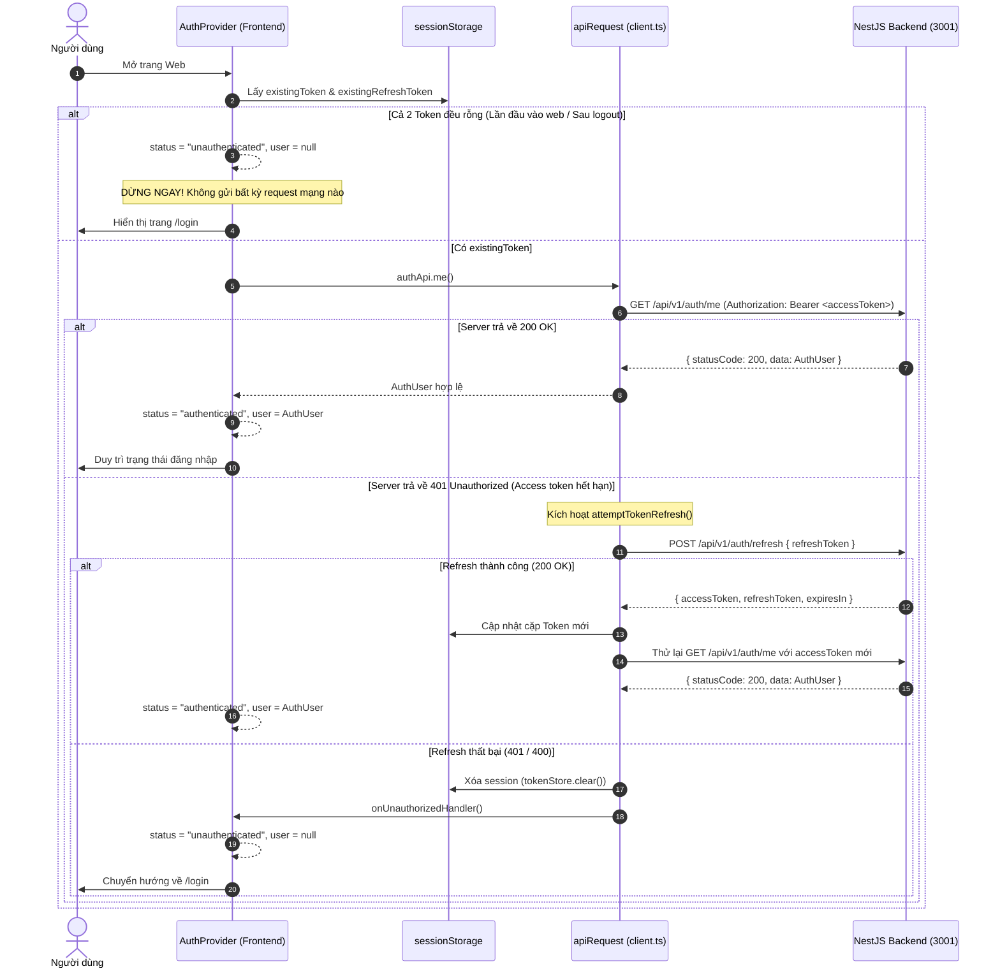
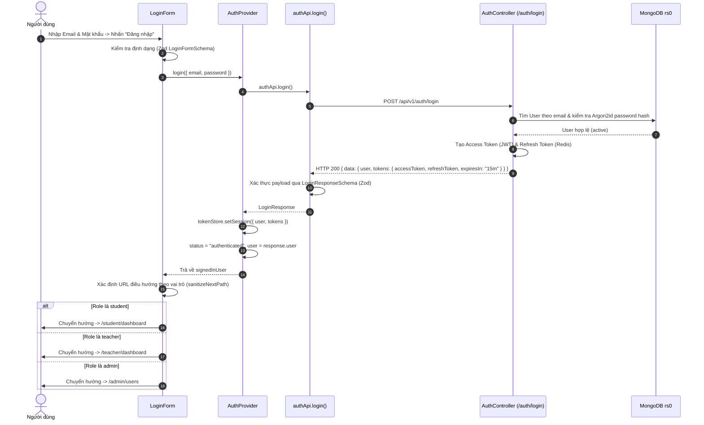
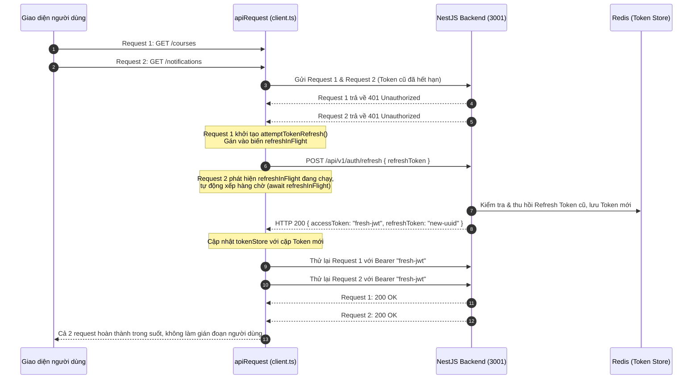

# AUTHENTICATION & TOKEN LIFECYCLE SPECIFICATION

> **Dự án**: IELTS Academic Learning Management System (IELTS LMS)  
> **Workspace**: `D:\WEB-IELTS`  
> **Thời gian cập nhật**: 14/11/2026

---

## 1. TỔNG QUAN KIẾN TRÚC PHIÊN ĐĂNG NHẬP (AUTHENTICATION ARCHITECTURE)

Hệ thống xác thực kết hợp giữa **JWT Không trạng thái (Stateless Access Token)** và **Redis-backed Refresh Token xoay vòng (Token Rotation)**:

- **Access Token**: JWT ký bằng HMAC SHA-256 (`JWT_ACCESS_SECRET`), có thời hạn ngắn (`15m`), mang các claim: `sub` (User ID), `email`, `role`, `roles`, `iat`, `exp`.
- **Refresh Token**: Chuỗi định danh duy nhất (UUID), có thời hạn dài (`7d`), được lưu trữ trên Redis key `refresh_token:<userId>:<tokenId>` có TTL tự động.
- **Frontend Token Storage**: Lưu trữ an toàn trong `window.sessionStorage` với khóa `web_ielts_dev_session`. Hết phiên khi đóng tab trình duyệt, tránh nguy cơ rò rỉ XSS vĩnh viễn của `localStorage` và tránh lỗi xung đột cross-tab.
- **State Machine ở AuthProvider**:
  - `loading`: Đang khởi động ứng dụng và kiểm tra tính hợp lệ của token có sẵn.
  - `authenticated`: Người dùng đã được xác thực, có đối tượng `user` và cặp token hợp lệ.
  - `unauthenticated`: Không có phiên hoặc phiên đã bị thu hồi/hết hạn.

---

## 2. QUY TRÌNH KHỞI ĐỘNG PHIÊN (SESSION BOOTSTRAP)

Khi người dùng mở ứng dụng hoặc tải lại trang:

---

## 3. QUY TRÌNH ĐĂNG NHẬP & PHÂN QUYỀN ĐIỀU HƯỚNG (LOGIN & RBAC REDIRECT)

---

## 4. CƠ CHẾ TỰ ĐỘNG LÀM MỚI TOKEN (TOKEN REFRESH WITH IN-FLIGHT DEDUPLICATION)

Khi có nhiều request API đồng thời nhận mã `401 Unauthorized`:

---

## 5. QUY TRÌNH ĐĂNG XUẤT AN TOÀN (LOGOUT & SESSION TERMINATION)

1. **Người dùng nhấn "Đăng xuất"**.
2. **Thu hồi trên Backend**:
   - Gửi `POST /api/v1/auth/logout` kèm Bearer Access Token.
   - Backend xóa Refresh Token tương ứng trên Redis để ngăn chặn hoàn toàn việc tái sử dụng.
3. **Xóa sạch phiên trên Client**:
   - `tokenStore.clear()` xóa dữ liệu trong `sessionStorage`.
   - `queryClient.clear()` xóa toàn bộ TanStack Query cache (ngăn rò rỉ dữ liệu của học viên/giáo viên trước đó vào màn hình).
   - `setUser(null)` và đặt `status = "unauthenticated"`.
4. **Điều hướng an toàn**:
   - Chuyển hướng trình duyệt về `/login`.
   - Ngăn chặn việc bấm "Back" trên trình duyệt quay lại trang nhạy cảm thông qua Role Guard.

