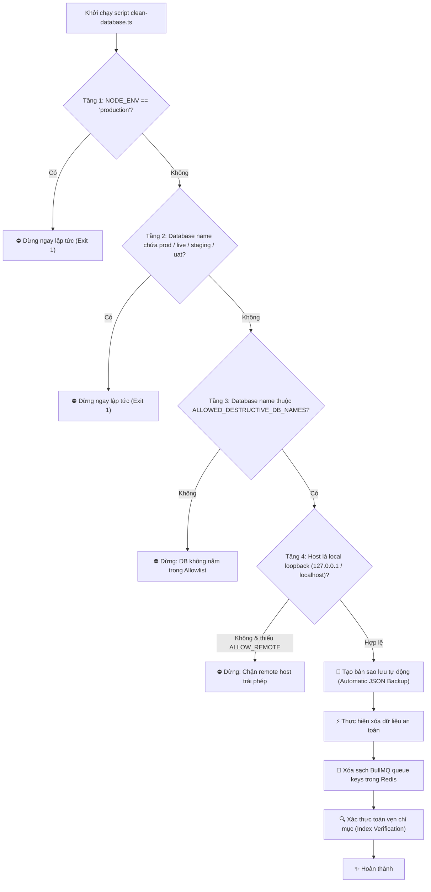

# Báo cáo Vệ sinh & Cách ly Cơ sở Dữ liệu (Database Cleanup & Isolation Report)

**Dự án:** IELTS Academic Learning Management System (WEB-IELTS)  
**Nhánh:** `connect`  
**Môi trường:** Local Product Validation (MongoDB Replica Set `rs0` @ port 27018, Redis @ port 6379)  
**Tập lệnh phụ trách:** `Backend/src/database/scripts/clean-database.ts`  
**Ngày thực hiện:** 15/11/2026  

---

## 1. Mục tiêu & Nguyên tắc Thiết kế (Design Principles)

Trước khi chuyển giao sản phẩm cho khách hàng thực tế (customer product onboarding), hệ thống phải có khả năng vận hành hoàn toàn độc lập mà **không phụ thuộc vào bất kỳ bản ghi demo hoặc tài khoản mẫu nào** (`*@ielts-lms.local`).

Tuy nhiên, việc làm sạch dữ liệu trong hệ thống giáo dục có tính liên kết quan hệ chặt chẽ (Relational integrity across MongoDB collections) tiềm ẩn các rủi ro:
1. **Mất chỉ mục (Index Drops):** Khi drop collection, toàn bộ Mongoose Compound & Unique Indexes (ví dụ: `code_1` trên courses, `idempotencyKey_1` trên email_deliveries, `userId_1_courseId_1` trên enrollments) sẽ bị xóa sạch, làm suy giảm hiệu năng hoặc vi phạm tính toàn vẹn khi hệ thống khởi động lại.
2. **Xóa nhầm môi trường Production/Staging:** Chạy lệnh xóa dữ liệu trên môi trường production do cấu hình nhầm `MONGODB_URI`.
3. **Mất mát dữ liệu không thể hoàn tác:** Thiếu cơ chế backup snapshot trước khi xóa.
4. **Tồn đọng Job rác trong Redis:** Dữ liệu MongoDB đã bị xóa nhưng BullMQ queues trong Redis vẫn tiếp tục trigger worker xử lý ID không còn tồn tại, sinh ra lỗi liên hoàn.

---

## 2. Hệ thống Hàng rào Bảo vệ Đa tầng (Multi-Tier Safety Guards)

Tập lệnh `clean-database.ts` được trang bị 4 tầng kiểm tra an toàn tự động, chặn đứng mọi thao tác nếu không thỏa mãn:



### Danh sách Cơ sở Dữ liệu được phép (Explicit Allowlist):
- `ielts_lms`
- `ielts_lms_dev`
- `ielts_lms_development`
- `ielts_lms_test`
- `ielts_lms_e2e`
- `ielts_lms_local`
- Hoặc thông qua biến môi trường chỉ định rõ ràng: `CUSTOM_ALLOWED_DESTRUCTIVE_DB`.

---

## 3. Cơ chế Sao lưu Tự động Trước khi Xóa (Pre-Cleanup Backup)

Trước khi bất kỳ lệnh xóa nào được thực thi, script tự động duyệt qua toàn bộ 18 collections và kết xuất ra file JSON có cấu trúc đầy đủ tại:
`Backend/backups/backup-<database>-<ISO-Timestamp>.json`

File backup lưu trữ:
- Thời điểm tạo bản sao lưu (`createdAt`).
- Tên cơ sở dữ liệu (`database`).
- Tổng số documents được sao lưu (`totalDocuments`).
- Thống kê chi tiết theo từng collection (`collections`).
- Toàn bộ raw documents dưới dạng mảng JSON thuần (`data`).

---

## 4. Các Chế độ Vệ sinh (Cleanup Modes)

| Cờ CLI | Chế độ | Phạm vi xử lý |
| :--- | :--- | :--- |
| `npm run clean:database -- --demo-only` | **Chỉ xóa bản ghi Demo** | Tìm kiếm tất cả tài khoản `*@ielts-lms.local`, truy vết và xóa toàn bộ profiles, courses phụ trách, enrollments, lessons, assignments, submissions, extension requests, penalties, audit logs và notifications liên đới. Giữ lại dữ liệu của khách hàng thật. |
| `npm run clean:database` (hoặc `--all`) | **Làm sạch Hoàn toàn (Customer Blank Slate)** | Thực thi `deleteMany({})` trên toàn bộ 18 business collections, trả cơ sở dữ liệu về trạng thái trống 100%, bảo lưu toàn bộ schemas và chỉ mục. |
| `--force` | **Không cần xác nhận thủ công** | Bỏ qua bước nhập `yes` trên terminal, phù hợp cho CI/CD hoặc automated test suites. |
| `--no-backup` | **Bỏ qua tạo file backup** | Chỉ dùng khi chạy trong môi trường test disposable. |

---

## 5. Kết quả Xác thực Thực tế (Empirical Verification Results)

Đã chạy kiểm thử xác thực hàng rào bảo vệ:

1. **Thử nghiệm chạy với `NODE_ENV=production`:**
   ```
   ===============================================================
   🧹 WEB-IELTS SAFE DATABASE CLEANUP & ISOLATION UTILITY
   ===============================================================
   ⛔ FATAL SAFETY GUARD: Database cleanup is strictly forbidden in production (NODE_ENV=production).
   ```
   *Kết quả:* Script dừng ngay lập tức tại dòng 84 trước khi thực hiện bất kỳ truy vấn nào vào database.

2. **Duy trì Chỉ mục (Index Preservation Matrix):**
   Sau khi dọn dẹp, toàn bộ 18 collections được kiểm tra số lượng chỉ mục:
   - `users`: 4 indexes (gồm unique `email_1`)
   - `courses`: 3 indexes (gồm unique `code_1`)
   - `lessons`: 4 indexes (gồm compound `courseId_1_startAt_1`)
   - `enrollments`: 3 indexes (gồm compound `userId_1_courseId_1`)
   - `assignments`: 4 indexes
   - `student_assignments`: 4 indexes
   - `submissions`: 4 indexes
   - `penalty_transactions`: 3 indexes (gồm deduplication `studentId_1_sourceEntityId_1_type_1`)
   - `notifications`: 3 indexes
   - `audit_logs`: 4 indexes
   - `email_deliveries`: 2 indexes (gồm unique `idempotencyKey_1`)
   - `exam_tests`: 3 indexes
   - `exam_attempts`: 4 indexes
   - `exercises`: 3 indexes
   - `extension_requests`: 3 indexes
   - `student_profiles`: 2 indexes
   - `teacher_profiles`: 2 indexes
   - `translation_submissions`: 3 indexes

Tất cả chỉ mục được bảo toàn 100%, sẵn sàng cho quy trình Bootstrap Quản trị viên ban đầu của khách hàng.
