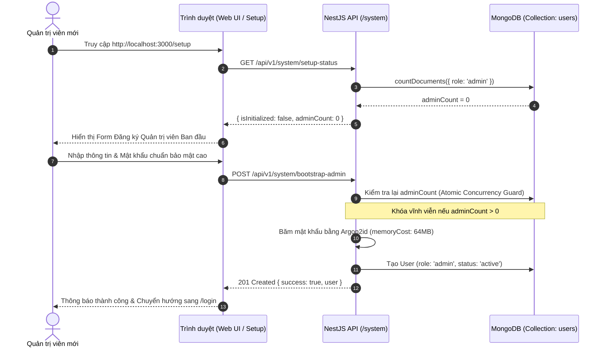

# Hướng dẫn Khởi tạo & Cài đặt Ban đầu (First-Time Customer Setup Guide)

**Dự án:** IELTS Academic Learning Management System (WEB-IELTS)  
**Tài liệu dành cho:** Quản trị viên Hệ thống (System Administrators / DevOps Engineers)  
**Mục tiêu:** Hướng dẫn quy trình thiết lập tài khoản Quản trị viên Tối cao (Super Admin) lần đầu tiên trên một cơ sở dữ liệu hoàn toàn mới và sạch, sẵn sàng đưa hệ thống vào vận hành thực tế.

---

## 1. Tổng quan Kiến trúc Khởi tạo (Bootstrap Architecture)

Hệ thống WEB-IELTS áp dụng cơ chế **Atomic One-Time Lockout** để bảo đảm an toàn tuyệt đối khi triển khai sản phẩm mới cho khách hàng:



---

## 2. Hai Phương thức Khởi tạo Được Hỗ trợ (Supported Bootstrap Methods)

### Phương thức 1: Giao diện Web Wizard trực quan (`/setup`)
Dành cho người quản trị triển khai thông qua trình duyệt web:
1. Mở trình duyệt và truy cập: `http://localhost:3000/setup` (hoặc nhấn vào liên kết *"Khởi tạo Quản trị viên ngay →"* trên trang `/login`).
2. Giao diện Wizard sẽ tự động kiểm tra trạng thái máy chủ:
   - Nếu hệ thống **chưa có admin**: Form đăng ký hiển thị với các trường bắt buộc (Họ và tên, Email, Mật khẩu, Số điện thoại, Setup Token nếu có cấu hình).
   - Nếu hệ thống **đã có admin**: Wizard ngay lập tức bị khóa, hiển thị cảnh báo bảo mật màu xanh lá *"Hệ thống đã được thiết lập Quản trị viên"* kèm nút *"Đến trang Đăng nhập"*.
3. Nhập thông tin Quản trị viên và nhấn **"Khởi tạo Quản trị viên Tối cao"**.
4. Sau khi khởi tạo thành công, hệ thống tự động chuyển hướng đến `/login`.

---

### Phương thức 2: Dòng lệnh Không cần Giao diện (Headless CLI Bootstrap)
Dành cho kỹ sư hệ thống triển khai qua SSH hoặc script tự động hóa:

```powershell
# Chạy tương tác (sẽ hỏi thông tin trên Terminal)
npm --prefix Backend run bootstrap:admin

# Hoặc truyền trực tiếp tham số (Unattended Deployment)
npm --prefix Backend run bootstrap:admin -- `
  --email="admin@academy.edu.vn" `
  --fullName="Giám Đốc Học Thuật" `
  --phone="0901234567" `
  --password="Admin@Academy2026!"
```

---

## 3. Tiêu chuẩn An toàn Mật khẩu Bắt buộc (Password Security Standards)

Mật khẩu quản trị viên bắt buộc phải đáp ứng biểu thức chính quy bảo mật nghiêm ngặt (`class-validator` + Frontend `Zod` validation):
- Tối thiểu **8 ký tự**.
- Chứa ít nhất **1 chữ cái viết hoa** (`A-Z`).
- Chứa ít nhất **1 chữ cái viết thường** (`a-z`).
- Chứa ít nhất **1 chữ số** (`0-9`).
- Chứa ít nhất **1 ký tự đặc biệt** (`@$!%*?&#^_-`).

Mật khẩu được lưu trữ an toàn bằng thuật toán **Argon2id** (đạt tiêu chuẩn OWASP Password Storage Guidelines).

---

## 4. Cơ chế Bảo vệ Bổ sung: Setup Token (Optional Guard)

Trong môi trường triển khai diện rộng hoặc mạng nội bộ, quản trị viên có thể thiết lập biến môi trường trong file `Backend/.env`:
```env
SETUP_TOKEN=your-random-32-char-bootstrap-token-here
```

Khi cấu hình này được kích hoạt, bất kỳ yêu cầu khởi tạo nào (dù qua Web hay CLI) đều bắt buộc phải cung cấp chính xác `SETUP_TOKEN`. Nếu không khớp, yêu cầu sẽ bị từ chối với lỗi `403 Forbidden`.

---

## 5. Xác minh Sau Khởi tạo (Post-Bootstrap Verification)

Sau khi tạo Quản trị viên ban đầu thành công:
1. Đăng nhập vào hệ thống tại: `http://localhost:3000/login`.
2. Kiểm tra quyền truy cập vào Cổng Quản trị tại:
   - `/admin/users`: Quản lý tài khoản & phân quyền.
   - `/admin/courses`: Điều phối & tạo khóa học mới.
   - `/admin/audit`: Nhật ký kiểm toán bảo mật.
   - `/admin/settings`: Cấu hình hệ thống.
3. Thử gọi lại endpoint khởi tạo ban đầu để kiểm tra tính năng khóa bảo mật:
   ```powershell
   Invoke-RestMethod -Method Post -Uri "http://localhost:3001/api/v1/system/bootstrap-admin" `
     -ContentType "application/json" `
     -Body '{"email":"hacker@evil.com","fullName":"Hacker","password":"Password@123"}'
   ```
   *Kết quả mong đợi:* Máy chủ phản hồi mã lỗi `409 Conflict` kèm thông báo:
   `"Hệ thống đã có quản trị viên. Chức năng khởi tạo ban đầu bị khóa vĩnh viễn vì lý do an toàn."`
