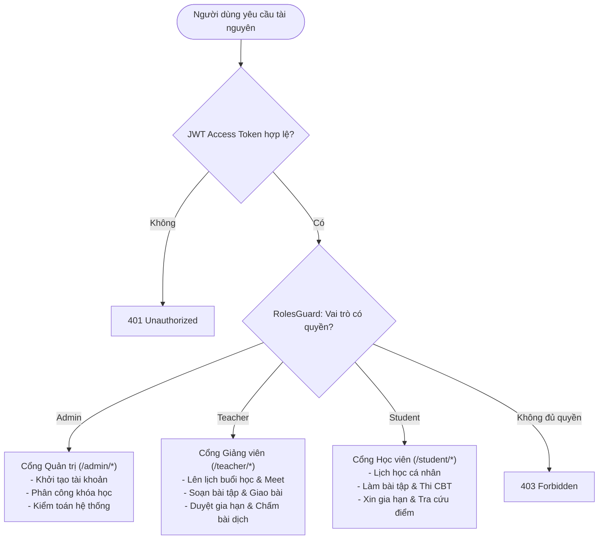

# Đánh giá & Rà soát An ninh Hệ thống (Application Security Review)

**Dự án:** IELTS Academic Learning Management System (WEB-IELTS)  
**Nhánh:** `connect`  
**Ngày đánh giá:** 15/11/2026  
**Tiêu chuẩn đối chiếu:** OWASP Top 10 (2021) & NIST Special Publication 800-63B  

---

## 1. Kiểm soát Truy cập Dựa trên Vai trò (Role-Based Access Control — RBAC)

Hệ thống triển khai mô hình RBAC chặt chẽ trên cả hai tầng Backend (Guards) và Frontend (RoleGuard / Middleware):

### Các biện pháp phòng thủ xác lập:
1. **Teacher Authorization Scoping:** Giảng viên chỉ có quyền thao tác (tạo bài, sửa lịch, xem bài nộp) trên các khóa học mà mình được phân công (`instructorId === actor._id`). Mọi hành vi can thiệp vào khóa học của giảng viên khác đều bị chặn với mã `403 Forbidden`.
2. **Student Privacy Scoping:** Học viên chỉ có quyền truy cập vào các bài tập và buổi học của các khóa học mà mình đã được ghi danh (`enrollments`). Không thể xem bài làm hoặc thông tin của học viên khác.

---

## 2. Bảo mật Quy trình Khởi tạo Ban đầu (One-Time Bootstrap Lockout)

Nhằm ngăn chặn lỗ hổng chiếm quyền quản trị tối cao (Privilege Escalation), endpoint `POST /api/v1/system/bootstrap-admin` được bảo vệ bởi:
- **Kiểm tra nguyên tử trước khi ghi:** Đếm số lượng tài khoản có vai trò `admin` trong MongoDB. Nếu `adminCount > 0`, hệ thống ném ra ngoại lệ `409 ConflictException` vĩnh viễn.
- **Giới hạn tần suất gọi (Rate Limiting):** Áp dụng `@Throttle({ default: { limit: 5, ttl: 60000 } })` để chống brute-force.
- **Mã xác thực tùy chọn (`SETUP_TOKEN`):** Quản trị viên có thể yêu cầu cung cấp token bảo mật đặc biệt thông qua biến môi trường để phê duyệt khởi tạo.

---

## 3. Quản lý Mật khẩu & Mã hóa (Password & Cryptography Management)

- **Thuật toán Băm Mật khẩu:** Sử dụng **Argon2id** (thuật toán đoạt giải Password Hashing Competition) với thông số:
  - `type: argon2.argon2id`
  - `memoryCost: 65536` (64 MB)
  - `timeCost: 3`
  - `parallelism: 4`
- **Tiêu chuẩn Độ phức tạp Mật khẩu:** Bắt buộc tối thiểu 8 ký tự, gồm chữ hoa, chữ thường, chữ số và ký tự đặc biệt (`@$!%*?&#^_-`).
- **Lưu trữ Phiên Đăng nhập (JWT):**
  - Access Token: Thời gian sống ngắn (`15m`).
  - Refresh Token: Thời gian sống `7d`, lưu trữ băm trong Redis, tự động thu hồi khi đăng xuất.
  - Bí mật mã hóa (`JWT_ACCESS_SECRET`, `JWT_REFRESH_SECRET`) bắt buộc phải có độ dài tối thiểu 32 ký tự, được nạp từ biến môi trường, không lưu hardcode trong mã nguồn.

---

## 4. Phòng chống Tấn công Injection & XSS (Input Sanitization & Data Protection)

1. **Chống NoSQL Injection:**
   - Sử dụng `class-validator` với tùy chọn `whitelist: true`, `forbidNonWhitelisted: true`. Mọi trường lạ nằm ngoài DTO đều bị loại bỏ tự động trước khi tới controller.
   - Các ID tham số được xác thực bằng validator chuyên dụng `@IsMongoId()`.
2. **Chống Cross-Site Scripting (XSS):**
   - Phía Frontend sử dụng `DOMPurify` thông qua module [html.ts](file:///d:/WEB-IELTS/frontend/src/lib/sanitize/html.ts) để làm sạch toàn bộ nội dung HTML bài đọc, đề thi và bài tập trước khi render.
   - Phía Backend kích hoạt bộ tiêu đề bảo mật HTTP **Helmet** (`Content-Security-Policy`, `X-Frame-Options`, `X-Content-Type-Options`, `Strict-Transport-Security`).

---

## 5. An toàn Nhật ký Kiểm toán (Audit Log Sanitization)

Module `AuditService` áp dụng cơ chế lọc bỏ thông tin nhạy cảm (Sanitization Filter):
- Tuyệt đối không bao giờ ghi lại các trường: `password`, `newPassword`, `token`, `accessToken`, `refreshToken`, `secret`, `answerKey`.
- Mọi thao tác quản trị (tạo người dùng, đổi quyền, phân công khóa học) đều được lưu trữ vết tại bảng `audit_logs` với đầy đủ `actorId`, `action`, `entityType`, `entityId`, và dấu thời gian ISO 8601.
